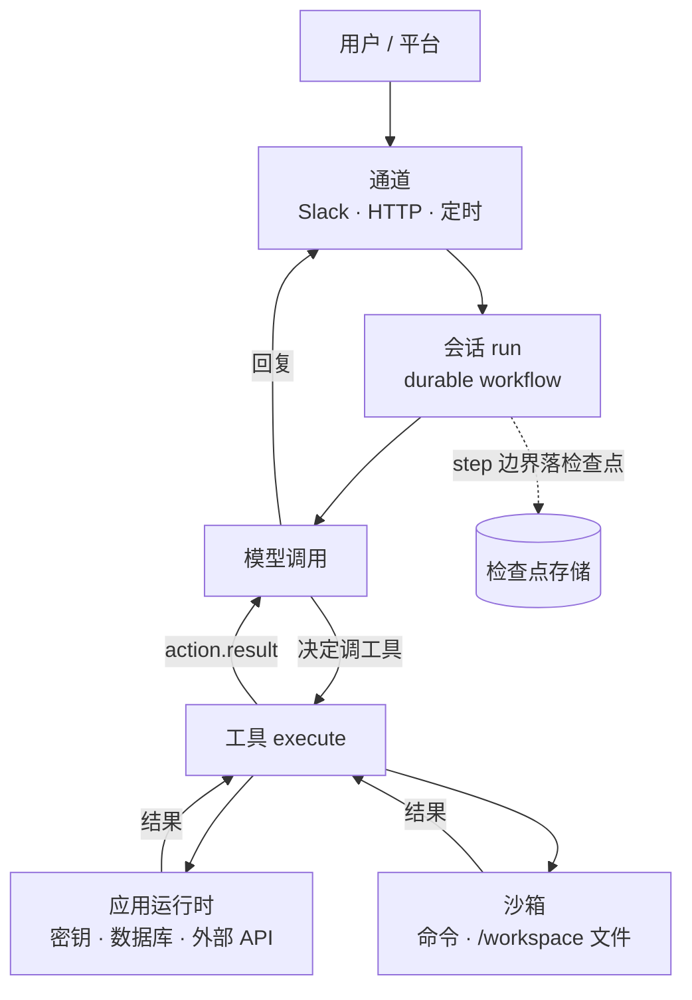

# 第 1 章 认识 eve

> eve 是一个「文件系统即配置」的 agent 框架。你写能力，它跑循环；你声明文件，它负责持久化、沙箱、审批和多渠道。

## 1.1 它解决的问题

写一个能演示的 agent 很快，写一个能上线的 agent 很慢。慢的地方不在模型调用，而在模型调用周围：

- 用户发了消息，进程崩了，这一轮做到一半的工具调用怎么算？
- 工具要改生产数据，谁来按确认键？按完键之后上下文还在吗？
- 模型要跑一段 Python 画图，跑在哪？会不会读到数据库密码？
- 同一个 agent 要同时出现在网页、Slack 和每天早上八点的日报里，代码要不要写三份？

这些问题每个项目都要解一遍。eve 的答案是：把它们做成框架默认行为，你只描述能力。

## 1.2 四个设计决定

理解这四条，后面所有设计都顺理成章。

**决定一：目录结构就是配置。**

没有 `registerTool()`，没有 YAML 清单。`agent/tools/read_logs.ts` 的文件名就是模型看到的工具名。`agent/skills/triage/SKILL.md` 的目录名就是技能名。加载规则是路径推导的，所以「有什么能力」这个问题用 `ls` 就能回答。

代价是命名即契约：改名等于改 API，模型看到的工具名会变，评测里的断言也会失效。

**决定二：会话是持久 workflow，不是内存对象。**

一个 session 是一条 durable workflow，一个 turn 是其中一次用户输入引发的全部工作，一个 step 是 turn 内的检查点。已完成的 step 永不重跑，框架直接回放记录的结果；被打断的 step 会重跑。

这条决定的直接后果：你的工具可能被执行两次。所以有副作用的操作要么幂等，要么挂审批（第 10、11 章）。

**决定三：两个执行环境，一条信任边界。**

| 环境 | 有什么 | 跑什么 |
| --- | --- | --- |
| 应用运行时 | 完整 Node.js、`process.env`、数据库连接、API key | agent 循环、工具、钩子、连接、通道 |
| 沙箱 | 独立文件系统、进程，**没有**应用密钥 | 模型让它跑的 shell 命令、脚本、文件操作 |

模型能指挥沙箱，但摸不到密钥。密钥留在应用侧，工具需要时自己取。这条边界是 eve 安全模型的核心，第 5 章展开，附录 C 讲 `process.env` 在四个进程里分别是什么样。

**决定四：能力是分层加载的，不是一股脑塞进提示词。**

系统提示每轮都发；技能只在模型判断相关时才加载；工作区文件靠 `read_file` 按需读；子代理在独立上下文里干活只回传结论。这套分层决定了你的 token 账单和行为稳定性，第 6 章专门讲。

## 1.3 三层执行模型

这是全书最重要的表，请记住它。

| 概念 | 是什么 | 生命周期 | 什么时候消失 |
| --- | --- | --- | --- |
| **session** | 一整段对话或任务 | 天到周（默认 30 天超时） | 超时、reset、或显式结束 |
| **turn** | 一条用户消息 + 它触发的所有工作 | 一次交互 | 模型给出回复，或被取消/失败 |
| **step** | turn 内的一个检查点 | 一次模型调用 + 紧随其后的工具调用 | 完成即固化，不再重跑 |

三个概念对应三种不同的东西：

- session 对应**上下文和状态**（消息历史、`defineState`、沙箱文件系统）
- turn 对应**一次交互的边界**（可以被打断、被 steer、被取消）
- step 对应**重放单位**（决定了崩溃后哪些代码会再跑一遍）

画成图更直观：

```text
session: wrun_A ────────────────────────────────────────────────►
  │
  ├── turn_0 ─────────────────────┐
  │     step 0: 模型调用 → 工具调用  │  已完成，固化
  │     step 1: 模型调用 → 工具调用  │  已完成，固化
  │     step 2: 模型调用 → 回复      │  完成 → turn.completed
  │
  ├── turn_1 ─────────────────────┐
  │     step 0: 模型调用 → 审批请求  │  停泊（不占算力）
  │     ……等人按确认，可能是三天后……
  │     step 0 续跑 → 工具执行       │  从停泊点继续，turnId 不变
  │
  └── turn_2 ...
```

同一次请求经过的组件，以及每个边界上谁负责什么：



两条边界值得记住：**模型只能碰到工具的输入输出**（碰不到 `process.env`），**工具跑在应用运行时**（不是沙箱）。这两条决定了密钥放在哪、崩溃后什么会重跑。

## 1.4 一个 agent 由什么组成

最小可用 agent 只有一个文件：

```text
agent/
└── instructions.md
```

`instructions.md` 里写清楚它是谁、做什么，`npm run dev` 就能对话。其余全是可选的积木：

| 路径 | 作用 | 什么时候加 |
| --- | --- | --- |
| `agent.ts` | 模型、推理强度、压缩阈值、运行时限制 | 要换模型或调参数时 |
| `tools/` | 模型能调用的类型化动作 | 需要访问外部系统或执行代码 |
| `sandbox/` | 沙箱配置和工作区种子文件 | 需要跑命令、读参考文件 |
| `skills/` | 按需加载的流程文档 | 有长流程、不该每轮都占上下文 |
| `memory/` | 跨会话记忆槽 | 需要记住用户偏好、历史事实 |
| `subagents/` | 独立上下文的专家 | 任务能拆分、要隔离工具面 |
| `connections/` | 外部 MCP / OpenAPI 服务 | 接 Linear、GitHub、内部 API |
| `channels/` | 对外的入口（HTTP、Slack…） | 要给用户或其它系统用 |
| `schedules/` | cron 定时任务 | 日报、巡检、清理 |
| `hooks/` | 事件订阅 | 审计、指标、落库 |
| `evals/`（在 `agent/` 外） | 回归测试 | 任何要长期维护的项目 |

## 1.5 它不适合什么

说清楚边界比吹优点有用。

**不适合：需要完全自定义 agent 循环的场景。** eve 管着模型-工具循环，你不能插进去改「什么时候该继续调模型」。要在循环层面做非常规实验（比如自定义的 beam search、多模型投票的中间调度），自己写循环更省事。

**不适合：纯无状态的单次函数调用。** 如果需求是「输入一段文本，输出一个分类」，用 AI SDK 直接调模型就行，eve 的持久化、沙箱、通道全是负担。

**不适合：硬实时。** 沙箱首次准备可能要拉镜像、装依赖，几秒到几十秒。延迟敏感的高频接口不要走沙箱。

**适合：长任务、有副作用、要多渠道、要人把关的 agent。** 值班助手、客服分流、代码维护、数据分析和报表、内部流程自动化——这些正是它设计的目标。

## 1.6 生态与依赖

eve 建在三层开源件上，都能替换：

| 层 | 默认 | 可换 |
| --- | --- | --- |
| 模型调用 | Vercel AI Gateway，或直连 provider | 任意 AI SDK `LanguageModel`，含 Ollama 等本地模型 |
| 持久化 | Vercel Workflow（部署在 Vercel）/ 本地 world（`eve dev`、`eve start`） | `@workflow/world-postgres` 等 Workflow World 实现 |
| 沙箱 | 按环境自动选（Vercel Sandbox / Docker / microsandbox / just-bash） | 自定义 provider |

这意味着自托管是可行的：Postgres 做持久化、Docker 做沙箱、自己的进程管理器跑 `eve start`，不依赖任何托管服务。第 17 章给出路线。

## 1.7 常见误解

**「文件系统即配置」等于没有类型安全。**
不等于。工具的 `inputSchema` 是 Zod，`execute` 的入参类型由 schema 推导，`outputSchema` 同理。目录结构是约定，能力定义是 TypeScript。

**「durable」等于「不会重复执行」。**
不等于。已完成的 step 不重跑，但**正在执行**的 step 被打断后会重跑。这是两件不同的事，第 10 章用一整章讲清楚。

**「沙箱」等于「虚拟机」。**
取决于 provider。默认的 `just-bash` 只是纯 JS 的虚拟文件系统，没有真正的进程隔离；Docker 和 microsandbox 才有。选错 provider 会得到「安全错觉」。

**「技能」等于「工具」。**
技能只往上下文里加文本，不增加任何执行能力。工具才执行代码。混淆这两个概念会导致「我写了个技能，为什么模型不能读数据库」这类问题。

## 1.8 练习

1. 用自己的话写下 session / turn / step 的区别，以及「哪个会重跑」。
2. 列出你手上想做的一个 agent，判断它属于「适合」还是「不适合」，理由写具体。
3. 想一个你的场景里「绝对不能执行两次」的操作，记下来——第 11 章会用到。

## 延伸阅读

- [Getting Started](https://eve.dev/docs/getting-started)
- [Execution Model and Durability](https://eve.dev/docs/concepts/execution-model-and-durability)
- [Security Model](https://eve.dev/docs/concepts/security-model)

---

下一章：[第 2 章 第一个 agent](02-hello-agent.md)
