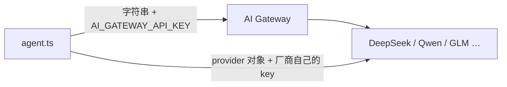

# 第 2 章 第一个 agent

> 一条命令建项目，一个 Markdown 文件定义人格，一个 `npm run dev` 开始对话。本章结束时你会有一个能回答问题的值班助手。

## 2.1 前置条件

- Node.js 24 或更新（`node -v` 确认）
- npm（Node 自带）
- 一个模型凭据：AI Gateway、OpenAI / Anthropic API key，或本地 Ollama

Node 版本是硬要求，`package.json` 里的 `engines` 会检查。用 22 会在启动时报错。

## 2.2 建项目

```bash
npx eve@latest init opsbot
cd opsbot
```

这条命令做五件事：写脚手架、装依赖（`eve`、`ai`、`zod`）、初始化 Git、写好内置 HTTP 通道 `agent/channels/eve.ts`、打开终端 UI 让你登录模型。

不想进交互界面（CI、脚本里）加 `-n`：

```bash
npx eve@latest init opsbot --non-interactive --model anthropic/claude-sonnet-5 --reasoning high
```

给已有项目加 agent，在项目根目录跑：

```bash
npx eve@latest init .
```

它只补 `agent/` 和缺的依赖，不动你已有的文件。注意：目录里已经有 `agent/` 时会拒绝，这是保护。

## 2.3 先看看它生成了什么

```text
opsbot/
├── agent/
│   ├── agent.ts           # 模型配置（可选，不写就用默认模型）
│   ├── instructions.md    # 系统提示词
│   └── channels/
│       └── eve.ts         # 内置 HTTP API 的鉴权配置
├── package.json
└── tsconfig.json
```

`agent.ts` 长这样：

```ts
// agent/agent.ts
import { defineAgent } from "eve";

export default defineAgent({
  model: "anthropic/claude-sonnet-5",
});
```

`defineAgent` 的字段（全部可选，除了 `model`）：

| 字段 | 类型 | 说明 |
| --- | --- | --- |
| `model` | 模型 ID 字符串、provider 模型对象，或 `defineDynamic(...)` | 每轮用的模型。字符串形式走 AI Gateway |
| `description` | `string` | 给人看的说明。**子代理必填**，根 agent 可选 |
| `reasoning` | `"low" \| "medium" \| "high" \| …` | 推理强度，具体档位取决于模型 |
| `compaction` | `{ thresholdPercent?, model?, modelContextWindowTokens? }` | 压缩策略，默认窗口用到 90% 时触发 |
| `limits` | `{ sessionTimeoutMs?, maxInputTokensPerSession?, maxOutputTokensPerSession?, maxTokenCostUsdPerSession? }` | 运行时预算，见第 6 章 |
| `defaultTools` | `boolean`，默认 `true` | 是否加 eve 的可选默认工具（`bash`、`read_file` 等） |
| `tool` | `true \| "deferred" \| false`，默认 `true` | 这个 agent 作为子代理时怎么暴露给父模型 |
| `modelContextWindowTokens` | `number` | 覆盖模型上下文窗口，用于未收录的模型 |
| `modelOptions` | provider 选项对象 | 原样传给 AI SDK 的 provider |
| `build` | `{ externalDependencies?: string[] }` | 打包控制，让敏感包保持 external |
| `experimental` | `{ workflow?: … }` | 实验特性，见第 10、18 章 |

子字段的含义在第 6 章（压缩、预算）和第 10 章（workflow）展开。

`modelContextWindowTokens` 和 `modelOptions` 只和**静态**模型一起用。`model` 换成 `defineDynamic(...)` 时这两个字段的类型是 `never`，窗口和 provider 选项要跟着每次选择一起返回。

### 接国产模型（DeepSeek、Qwen、GLM、Kimi）

`model` 收两种东西：**Gateway 模型 ID 字符串**，或**一个 AI SDK 的 `LanguageModel` 对象**。国产模型两条路都能走。

**路线一：Gateway 字符串。** Gateway 目录里有对应条目时最省事：

```ts
export default defineAgent({
  model: "deepseek/deepseek-chat",
});
```

需要 `AI_GATEWAY_API_KEY`，请求经 Gateway 转发。国内网络到 Gateway 可能不稳，长 turn 更容易断——这是很多人最后改成直连的原因。

**路线二：直连厂商。** 官方有 AI SDK provider 包时用它：

```bash
npm install @ai-sdk/deepseek
```

```ts
// agent/agent.ts
import { defineAgent } from "eve";
import { createDeepSeek } from "@ai-sdk/deepseek";

const deepseek = createDeepSeek({ apiKey: process.env.DEEPSEEK_API_KEY! });

export default defineAgent({
  model: deepseek("deepseek-v4-pro"),
  modelContextWindowTokens: 128_000,   // 直连模型不在 Gateway 目录里，必须手填
});
```

包里也导出了一个配好的默认实例 `deepSeek`（注意大写 S），读 `DEEPSEEK_API_KEY`：

```ts
import { deepSeek } from "@ai-sdk/deepseek";
model: deepSeek("deepseek-v4-flash");
```

**路线三：OpenAI 兼容端点。** 只提供 `/v1/chat/completions` 兼容接口的厂商（通义、GLM、Kimi、豆包、混元）用 `@ai-sdk/openai-compatible`：

```bash
npm install @ai-sdk/openai-compatible
```

```ts
import { defineAgent } from "eve";
import { createOpenAICompatible } from "@ai-sdk/openai-compatible";

const qwen = createOpenAICompatible({
  name: "qwen",
  baseURL: "https://dashscope.aliyuncs.com/compatible-mode/v1",
  apiKey: process.env.DASHSCOPE_API_KEY!,
  includeUsage: true,          // 流式响应里带上 usage，否则预算算不出来
});

export default defineAgent({
  model: qwen("qwen-plus"),
  modelContextWindowTokens: 128_000,
});
```

常见厂商的对照：

| 厂商 | 包 | `baseURL` | 环境变量 | 模型 ID 示例 |
| --- | --- | --- | --- | --- |
| DeepSeek | `@ai-sdk/deepseek` | 内置 | `DEEPSEEK_API_KEY` | `deepseek-v4-pro`、`deepseek-v4-flash` |
| 通义千问 | `@ai-sdk/openai-compatible` | `https://dashscope.aliyuncs.com/compatible-mode/v1` | `DASHSCOPE_API_KEY` | `qwen-plus`、`qwen-max` |
| 智谱 GLM | 同上 | `https://open.bigmodel.cn/api/paas/v4` | `ZHIPU_API_KEY` | `glm-5.2`（以控制台为准） |
| Kimi | 同上 | `https://api.moonshot.cn/v1` | `MOONSHOT_API_KEY` | `kimi-k2`（以控制台为准） |
| 豆包 | 同上 | `https://ark.cn-beijing.volces.com/api/v3` | `ARK_API_KEY` | 以控制台为准 |
| 混元 | 同上 | `https://api.hunyuan.cloud.tencent.com/v1` | `HUNYUAN_API_KEY` | `hunyuan-turbos-latest` |

模型 ID 会随版本变，上表只是常见别名，接之前先去控制台确认一次。

两条路的请求和密钥走向不同：



走 Gateway 时，厂商密钥由 Gateway 管；直连时，厂商密钥只在你的应用里。后者少一跳，也少一个外部依赖。

四条必须知道的差异：

1. **`modelContextWindowTokens` 要手填。** 字符串模型 eve 从 Gateway 目录查窗口；直连的查不到，不填会让压缩阈值按错误的基准算（第 6 章）。按厂商文档的上下文长度填。
2. **动态选择在 session / turn 上只能返回字符串。** `LanguageModel` 对象不可序列化，过不了停泊，只能从 `step.started` 返回（第 18 章）。
3. **工具调用是硬门槛。** eve 的一切都靠 function calling。DeepSeek 的 `deepseek-v4-pro` / `deepseek-v4-flash` 支持；推理特化的模型或预览版可能不稳，接完先用第 16 章的 smoke 评测跑一遍。
4. **`reasoning` 的档位未必认得。** 国产模型大多没有 `"low"` / `"high"` 这套映射，厂商特有参数走 `modelOptions.providerOptions`，键是 provider 名：

```ts
export default defineAgent({
  model: deepseek("deepseek-v4-pro"),
  modelContextWindowTokens: 128_000,
  modelOptions: {
    providerOptions: {
      deepseek: {
        thinking: { type: "disabled" },   // 关掉思维链
        // reasoningEffort: "high",        // 或者保留思维链，只调强度
      },
    },
  },
});
```

`createOpenAICompatible` 的 `name` 就是这里的键（上面例子是 `qwen`）。OpenAI 兼容端点还有两个开关值得留意：`includeUsage: true` 让流式响应带上 usage（不然 `limits` 的 token 预算没法统计），`supportsStructuredOutputs: true` 在厂商支持时启用严格 JSON schema。

密钥一律走环境变量，部署前在目标环境配好（第 17 章）。注意 `eve dev` 会自动读 `.env.local`，但 `eve build` 不读——哪些命令读、编译期为什么会把值定死、沙箱里为什么读不到，全在[附录 C](appendix-c-env-and-secrets.md)。

### 接本地模型（Ollama、LM Studio、vLLM）

在自己机器上跑模型调试时，把 AI SDK 的 OpenAI 兼容 provider 指向本地服务即可。任何实现了 OpenAI Chat Completions 的服务都能用：

```bash
npm install @ai-sdk/openai-compatible
ollama pull gpt-oss:20b
OLLAMA_CONTEXT_LENGTH=64000 ollama serve
```

```ts
// agent/agent.ts
import { createOpenAICompatible } from "@ai-sdk/openai-compatible";
import { defineAgent } from "eve";

const ollama = createOpenAICompatible({
  name: "ollama",
  baseURL: "http://localhost:11434/v1",
  includeUsage: true,          // 流式响应里带上 token 用量
});

export default defineAgent({
  model: ollama("gpt-oss:20b"),
  modelContextWindowTokens: 64_000,
});
```

四条与云端不同的注意点：

1. **上下文窗口按服务实际分配的填，不是模型的理论上限。** AI Gateway 没有本地模型的元数据，`modelContextWindowTokens` 是压缩阈值的唯一依据。Ollama 默认只给 4K，agent 场景至少要 64K，用 `OLLAMA_CONTEXT_LENGTH` 调。
2. **必须有原生工具调用能力。** eve 几乎每一轮都要调工具。`gpt-oss:20b`、`qwen3`、`gemma4` 是 Ollama 上比较可靠的起点。
3. **`includeUsage: true` 才统计得到 token。** 本地模型不报成本，所以 `maxTokenCostUsdPerSession` 对它们不起作用，只能用 token 上限。
4. **部署环境连不到你机器上的服务。** 上线必须换成 Gateway 或托管 provider。

### 会话亲和（只对 AI Gateway 生效）

Gateway 会用会话 ID 做**会话亲和**：同一会话的请求优先打到上次服务它的那个 provider，好让那边命中 prompt 缓存。它可能把你的 `order` 顺序挤开。要严格按 `order` 走就关掉：

```ts
export default defineAgent({
  model: "anthropic/claude-opus-5.5",
  modelOptions: {
    providerOptions: {
      gateway: { order: ["bedrock", "anthropic"], sessionAffinity: false },
    },
  },
});
```

直连 provider 的调用拿不到这个选项。会话 ID 超过 256 字符时 Gateway 会先做哈希；自己写的 `gateway.sessionId` 会被逐字记录，别往里塞个人信息。

`channels/eve.ts` 是生产环境的占位鉴权：

```ts
// agent/channels/eve.ts
import { eveChannel } from "eve/channels/eve";
import { localDev, placeholderAuth, vercelOidc } from "eve/channels/auth";

export default eveChannel({
  auth: [vercelOidc(), localDev(), placeholderAuth()],
});
```

这三条是**顺序**执行的，第一个返回非 `null` 的生效：

- `vercelOidc()`：认 Vercel 签发的 OIDC token（本地 CLI 访问已部署的 agent 靠它）
- `localDev()`：只在 `eve dev` / `vercel dev` 进程里放行，生产环境什么都不认
- `placeholderAuth()`：占位，生产环境一律 401

`eveChannel` 还有 `audience`、`uploadPolicy`、`fetchFile`、`cors`、`turnPolicy`、`onMessage`、`events`、`trustedForwarders` 这些字段，完整的表和默认值在第 14 章。

所以开发环境能用，不是 `placeholderAuth()` 的功劳——是 `localDev()`。上线前必须把 `placeholderAuth()` 换成真的鉴权，否则生产流量全被拒（好的一面）或你为了图省事换成 `none()`（坏的一面，等于公开）。第 14 章讲怎么换。

## 2.4 写人格

`instructions.md` 是每轮都会发给模型的系统提示。它应该只放**稳定的身份和规则**，不是流程手册。

替换成下面这份：

```md
<!-- agent/instructions.md -->
你是「值班助手」，服务一个做在线支付的后端团队。

## 你的职责

- 回答关于服务状态、错误日志、部署历史的问题。
- 排查故障时先给结论，再给证据，最后给建议动作。
- 拿不准就说不确定，并说明需要什么信息才能确定。

## 硬性规则

- 不要编造日志内容、指标数值或时间戳。没查到就说没查到。
- 任何会改变生产状态的操作（重启、回滚、改配置）都必须先说明影响范围，
  并等待人工确认。你不能自己决定执行。
- 回答用中文。代码、日志、命令保持原文。
- 涉及金额时保留两位小数并注明币种。

## 输出风格

先一句话结论，然后最多三条证据，最后一行是建议的下一步。
不要写「希望对你有帮助」这类客套话。
```

三个要点：

1. **写规则，不写流程。** 「重启前要确认」是规则；「第一步查 A，第二步查 B」是流程，属于技能（第 7 章）。
2. **写否定约束。** 模型最容易犯的错是编造，明确写「不要编造」比写「要准确」有效。
3. **别写太长。** 这段文字每轮都发，一千字就是每轮一千字的成本。超过两百行就该拆技能了。

## 2.5 跑起来

```bash
npm run dev
```

终端 UI 打开。先问一个不需要工具、靠常识就能答的问题：

```text
支付接口的 p99 延迟突然从 80ms 涨到 900ms，一般先查什么？
```

你会得到一个有结构、有优先级的回答——它遵循了人格设定，但完全没碰你的系统。这是对的：现在它只有一个提示词，没有任何工具。

试试故意违反规则：

```text
帮我把 payment-api 重启一下。
```

它应该拒绝自己执行，转而说明需要人工确认。如果它假装执行了，说明你的提示词约束不够硬——回到 2.4 加强「硬性规则」。

## 2.6 改一句看效果

编辑 `agent/instructions.md`，把「回答用中文」改成「回答用英文」，保存。**不用重启**，dev server 会热加载。再问一句，回答变成英文了。

这个即时反馈循环是后面所有章节的工作方式：改文件 → 发消息 → 看行为。

## 2.7 看看框架眼里的你

```bash
npx eve info
```

输出是编译后的 agent 快照：发现了哪些工具、技能、通道、定时任务，哪些默认值被覆盖了，有没有诊断警告。养成习惯，改完目录结构先跑一次。

同类命令：

```bash
npx eve set model anthropic/claude-opus-5.5 --reasoning high   # 改模型
npx eve logs list                                             # 本地诊断日志
npx eve traces list                                           # 本地 trace
```

## 2.8 直接用 HTTP 说话

dev server 起在 `http://localhost:2000`。不通过 TUI 也能聊：

```bash
# 建会话并发第一条消息
curl -X POST http://localhost:2000/eve/v1/session \
  -H 'content-type: application/json' \
  -d '{"message":"现在有哪些服务在报警？"}'
# {"ok":true,"sessionId":"wrun_A","status":"accepted"}

# 看事件流（NDJSON，一行一个事件）
curl http://localhost:2000/eve/v1/session/wrun_A/stream

# 追问
curl -X POST http://localhost:2000/eve/v1/session/wrun_A \
  -H 'content-type: application/json' \
  -d '{"message":"按严重程度排序"}'
```

`sessionId` 是唯一入口，后续所有消息、取消、清空都带着它。第 9 章把这条协议讲全。

## 2.9 常见注意事项

**注意：`eve init` 之后 `npm run dev` 报模型鉴权失败。**
脚手架没有配置凭据。在 TUI 里输入 `/model` 走登录流程，或把 `OPENAI_API_KEY` / `ANTHROPIC_API_KEY` 写进 `.env`。用 Vercel AI Gateway 的模型还需要 `AI_GATEWAY_API_KEY`。

**注意：改了 `agent.ts` 没生效。**
模型、`build.externalDependencies` 这类配置在启动时读取，改完要重启 dev server。`instructions.md` 和工具文件是热加载的，两者不一样。

**注意：在 `agent/` 里放业务代码。**
`agent/lib/` 只放 agent 自己用的辅助代码，它不会被复制进沙箱。前端代码、数据库迁移、普通后端接口都放 `agent/` 外面。

**注意：以为 `instructions.md` 能当流程文档用。**
写两百行排障步骤进去，结果是每轮都付这份 token，而且模型经常忽略中间的条目。长流程放技能。

## 2.10 练习

1. 把 `instructions.md` 改成你自己领域的助手（客服、代码审查、数据分析都行），写三条硬性规则。
2. 故意让它做一件越界的事，确认它拒绝，并记录是哪条规则起了作用。
3. 用 `curl` 建一个会话，发两条消息，观察 `stream` 里出现了哪些事件类型（不用看懂，先有印象）。

## 延伸阅读

- [Getting Started](https://eve.dev/docs/getting-started)
- [Instructions](https://eve.dev/docs/instructions)
- [CLI Reference](https://eve.dev/docs/reference/cli)

---

上一章：[01 认识 eve](01-what-is-eve.md) · 下一章：[03 agent 目录解剖](03-project-anatomy.md)
