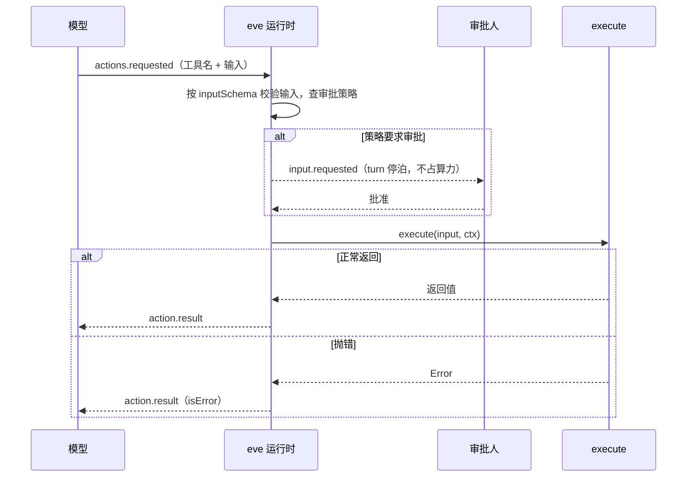

# 第 4 章 工具

> 工具是 eve 里唯一能执行你自己代码的原语。文件名是工具名，`inputSchema` 是接口契约，`execute` 是你自己的代码。这一章把 `defineTool` 的每个字段讲透。

## 4.1 最小工具

```ts
// agent/tools/get_service_status.ts
import { defineTool } from "eve/tools";
import { z } from "zod";

export default defineTool({
  description: "查询某个服务当前的健康状态和实例数。",
  inputSchema: z.object({
    service: z.string().min(1).describe("服务名，例如 payment-api"),
  }),
  async execute({ service }) {
    const res = await fetch(`${process.env.OPS_API}/services/${service}`);
    if (!res.ok) throw new Error(`OPS API 返回 ${res.status}`);
    const data = await res.json();
    return {
      service,
      status: data.status,          // "healthy" | "degraded" | "down"
      instances: data.instances,
      updatedAt: data.updated_at,
    };
  },
});
```

四个必需项：

1. 文件放在 `agent/tools/` 下，文件名就是模型看到的工具名（`get_service_status`）。
2. `description`：写给模型看的，不是写给同事看的。
3. `inputSchema`：Zod、任意 Standard Schema，或纯 JSON Schema 对象。无参数也要写 `z.object({})`。
4. `execute(input, ctx)`：同步、异步、或异步生成器。

**工具跑在应用运行时**，不是沙箱。所以它能读 `process.env`、能连数据库、能 import `lib/`。这是设计意图：密钥不进入模型可控的算力环境。

`process.env` 在编译期、运行时、沙箱、浏览器里是四件不同的事，写错了会出现「本地能跑、构建失败」或「部署后读不到」。完整规则见[附录 C](appendix-c-env-and-secrets.md)。

一次工具调用在运行时里经过这些步骤：



审批发生在 `execute` **之前**，所以被拒绝的调用根本不会进入你的代码。这也是为什么审批不能代替幂等：批准之后如果 step 重跑，`execute` 还是会再执行一次（第 11 章）。

### `defineTool` 的全部字段

| 字段 | 类型 | 必填 | 说明 |
| --- | --- | --- | --- |
| `description` | `string` | 是 | 模型靠它决定调不调。写「做什么 + 什么时候不该用」 |
| `inputSchema` | Zod / Standard Schema / JSON Schema | 是 | 入参契约。无参数写 `z.object({})` |
| `execute` | `(input, ctx) => T \| Promise<T> \| AsyncIterable<T>` | 是 | 实现体。异步生成器可流式返回中间快照 |
| `outputSchema` | Standard JSON Schema / JSON Schema | 否 | 返回值类型，供 SDK 类型推导与校验 |
| `approval` | `ApprovalPolicy \| { request, response?, prompt? }` | 否 | 审批策略，**省略等于 `never()`**，见第 11 章 |
| `approvalKey` | `(input) => string` | 否 | 审批记忆的键。`once()` 默认按工具名记，设了它按输入记 |
| `toModelOutput` | `(output) => ToolModelOutput` | 否 | 模型看到的投影。原始输出仍给钩子和客户端 |
| `endsTurn` | `boolean \| (output) => boolean` | 否 | 成功后直接结束 turn，不再调模型 |
| `deferred` | `boolean`，默认 `false` | 否 | 不进工具列表，靠 `eve__search` / `eve__tool` 访问 |
| `availableInSubagents` | `boolean`，默认 `true` | 否 | `false` 时委派会话拿不到它 |
| `label` | `{ start, delta?, complete? }` | 否 | UI 上显示的活动文案 |

字段之间没有隐藏的互斥关系，除了两条：`endsTurn` 在委派会话和请求结构化输出的 turn 里会被忽略；`deferred` 不能用在 provider 原生工具上（编译器拒绝）。

## 4.2 description 怎么写

模型靠 description 决定调不调、怎么调。三条实用规则：

| 写法 | 效果 |
| --- | --- |
| `"查询服务状态"` | 太短，模型不知道边界，容易在无关场景调用 |
| `"查询某个服务当前的健康状态和实例数。只在用户问到服务是否正常、有几个实例、最近一次健康检查结果时使用。不返回历史数据。"` | 说明做什么 + 何时用 + 不做什么 |
| `"获取数据"` | 无用。模型只能靠猜 |

好的 description 通常包含：动作、输入语义、返回什么、什么时候**不**该用。

## 4.3 inputSchema 的细节

### Zod 是默认选择

```ts
inputSchema: z.object({
  service: z.string().min(1).max(64),
  window: z.enum(["5m", "1h", "24h"]).default("1h"),
  limit: z.number().int().min(1).max(200).default(50),
})
```

- Zod 用你自己装的版本校验，eve 不锁定版本。
- `.describe()` 会进入模型看到的 schema，是给模型的字段说明。
- 可选字段保持可选。eve 对函数工具显式关闭了 provider 的 strict mode，所以 OpenAI 之类不会强制所有字段必填。
- `default()` 生效：模型没传的字段会填默认值。

### 纯 JSON Schema

需要动态生成 schema（比如从数据库表结构推导）时用：

```ts
inputSchema: {
  type: "object",
  properties: {
    sql: { type: "string", description: "单条只读 SELECT" },
  },
  required: ["sql"],
}
```

注意三点：

- `$schema` 关键字会被去掉再发给模型。
- eve 用 JSON Schema 2020-12 规则校验，兼容 draft-07 关键字。
- `format` 只当注解，不会因为它拒绝输入。
- 无法本地求值的 schema（未知 `type`、解析不了的 `$ref`）会**原样发给模型、跳过校验**直接进 `execute`。这是安全缺口，动态 schema 要自己校验。

## 4.4 `execute` 的第二个参数：ctx

```ts
async execute(input, ctx) {
  ctx.session.id            // 会话 ID
  ctx.session.turn.id       // 当前 turn
  ctx.session.auth.current  // 当前调用者（可能为 null）
  ctx.session.auth.initiator// 创建会话的人
  ctx.session.parent        // 父会话（子代理里才有）
  ctx.callId                // 本次工具调用的 ID
  ctx.toolName              // 运行时最终工具名（可能带命名空间）
  ctx.messages              // 触发本次调用的模型输入
  ctx.abortSignal           // turn 被取消时触发
  await ctx.getSandbox()    // 沙箱句柄
  ctx.getToken(provider)    // 取连接凭据（第 13 章）
  ctx.approval?.responder   // 审批人身份，仅审批过的调用才有（0.79.1 起，见第 11 章）
}
```

最常用的是 `ctx.session.auth.current`——所有「按用户/租户隔离」的逻辑都从这里取，**绝不能从模型输入里取**。

```ts
// agent/tools/list_my_incidents.ts
export default defineTool({
  description: "列出当前用户负责的未关闭事故。",
  inputSchema: z.object({}),
  async execute(_input, ctx) {
    const user = ctx.session.auth.current;
    if (user?.principalType !== "user") {
      throw new Error("需要登录用户身份");
    }
    return db.incidents.findMany({
      where: { assignee: user.principalId, status: "open" },
    });
  },
});
```

## 4.5 输出：outputSchema 与 toModelOutput

默认情况下 `execute` 返回什么，模型就看到什么。两个字段改变这件事。

**`outputSchema`** 声明返回结构，同时给 `execute` 的返回值定型：

```ts
outputSchema: z.object({
  service: z.string(),
  status: z.enum(["healthy", "degraded", "down"]),
  instances: z.number(),
}),
```

**`toModelOutput`** 决定模型看到什么。适合「渠道需要完整数据渲染，模型只需要结论」的场景：

```ts
async execute({ service }) {
  const detail = await fetchServiceDetail(service); // 很大：几十个字段
  return detail;
},
toModelOutput(output) {
  return {
    type: "text",
    value: `${output.service} 当前 ${output.status}，${output.instances} 个实例，` +
           `${output.errorRate}% 错误率。`,
  };
},
```

要点：

- `toModelOutput` 只影响模型。钩子和通道在 `action.result` 里仍然拿到完整输出，可以渲染富 UI。
- 返回 `{ type: "text", value }` 或 `{ type: "json", value }`。
- 工具输出必须 JSON 可序列化。`Date`、`Map`、`Set`、`NaN`、循环引用都要先转换。

### 把图片交给模型

图表、截图这类二进制结果，用 `toolOutputPart` 构造成内容块：

```ts
import { defineTool, toolOutput, toolOutputPart } from "eve/tools";

export default defineTool({
  description: "截取页面截图。",
  inputSchema: z.object({ url: z.string() }),
  async execute({ url }) {
    const png = await capture(url);
    return { path: png.path, base64: png.base64 };
  },
  toModelOutput(output) {
    return toolOutput.content([
      toolOutputPart.text(`截图已保存到 ${output.path}：`),
      toolOutputPart.file(output.base64, { mediaType: "image/png" }),
    ]);
  },
});
```

限制：文件必须是 base64 字符串（原始 `Buffer` 会被拒绝，因为过不了持久化 JSON 边界）；超过 3 MiB 会警告；发给不支持视觉的模型会由 provider 报错。

eve 会把每个返回的文件写进沙箱 `/workspace/.eve/attachments/`，历史里只留引用。后续模型调用每次都重发同一份字节，prompt cache 不会失效。

## 4.6 三个控制行为开关

### `endsTurn`：这次调用就是全部答案

```ts
// agent/tools/react.ts
export default defineTool({
  description: "给当前消息点一个表情回应。当回应本身就是完整答复时使用。",
  endsTurn: true,
  inputSchema: z.object({ emoji: z.string() }),
  async execute({ emoji }) {
    await addReaction(emoji);
    return { emoji };
  },
});
```

eve 会在模型看到的 description 末尾自动追加一句「调用此工具会结束你的回合」，所以你自己**不要**在 description 里写这件事。

也可以用函数动态判断：

```ts
endsTurn: (output) => output.posted,
```

细节：

- 只有「本 step 里所有工具调用都能结束回合且都成功」时，回合才真的结束。
- 委派会话（子代理）里忽略 `endsTurn`，因为子代理必须回话。
- 请求结构化输出的回合也忽略。

### `deferred`：不放进工具列表

工具多到每轮都塞满上下文时用：

```ts
export default defineTool({
  deferred: true,
  description: "把完成的报告导出为 PDF。",
  inputSchema: z.object({ reportId: z.string() }),
  execute: ({ reportId }) => exportReport(reportId),
});
```

模型不在工具列表里看到它，而是用 `eve__search({ query: "export" })` 找到，再用 `eve__tool({ name: "export_report", input })` 调用。找到之后，审批、`toModelOutput`、流事件全都按 `export_report` 走，不显示成 `eve__tool`。

provider 原生工具（如 `webSearch()`）不能 deferred，因为 provider 必须看到定义。

### `availableInSubagents: false`：只在顶层可用

```ts
export default defineTool({
  availableInSubagents: false,
  description: "启动只有顶层协调者才该发起的跨服务操作。",
  inputSchema: z.object({ task: z.string() }),
  execute: ({ task }) => coordinate(task),
});
```

默认是 `true`。设成 `false` 后，根副本子代理拿不到这个工具。

## 4.7 活动标签：label

给用户看的进度文案，和模型看到的东西无关：

```ts
export default defineTool({
  description: "把项目部署到指定环境。",
  inputSchema: z.object({
    project: z.string(),
    environment: z.enum(["preview", "production"]),
  }),
  label: {
    start: ({ project, environment }) => `部署 ${project} 到 ${environment}`,
  },
  async execute(input) {
    return deploy(input);
  },
});
```

Slack 之类的通道会把「Deploy」换成「部署 storefront 到 production」。回调抛错或返回空串时，回退到工具名的可读形式（`sync_accounts` → `Sync accounts`）。

## 4.8 流式中间结果

`execute` 写成异步生成器，每次 `yield` 是一个完整快照：

```ts
export default defineTool({
  description: "生成项目报告。",
  inputSchema: z.object({ project: z.string() }),
  label: {
    start: ({ project }) => `为 ${project} 生成报告`,
    delta: (_input, partial) => partial.phase,
    complete: (_input, output) => `报告完成，共 ${output.sections.length} 节`,
  },
  async *execute({ project }) {
    yield { phase: "收集资料", sections: [] };
    const sections = await collect(project);
    yield { phase: "撰写", sections };
    const final = await write(sections);
    yield { phase: "完成", sections: final };
  },
});
```

关键语义，容易搞错：

- 中间的 `yield` 以 `action.partial` 事件发出，**不进模型历史**，只有最后一次 `yield` 是工具结果。
- 快照是「后写覆盖前写」，不是追加。同一个 `callId` 的新 partial 替换旧的。
- 生成器的 `return` 值**被忽略**，最后必须 `yield` 出最终结果。
- 中间快照可以被重放覆盖（step 重试时），所以不要把它当进度条做累加。

## 4.9 工具抛错之后

`execute` 抛异常时：

1. eve 记一条失败的 `action.result`。
2. 模型拿到错误信息，可以换个做法、换工具、或重试。
3. **eve 不会自动重试**，不看异常类型、不看 HTTP 状态码、不看 `retryable` 字段。

所以重试策略要自己写在工具里：

```ts
async execute({ service }) {
  for (let attempt = 0; attempt < 3; attempt++) {
    const res = await fetch(url, { signal: ctx.abortSignal });
    if (res.ok) return res.json();
    if (res.status < 500) break;             // 4xx 重试没意义
    await new Promise((r) => setTimeout(r, 200 * 2 ** attempt));
  }
  throw new Error(`查询 ${service} 失败，已重试`);
}
```

错误信息要可操作。`throw new Error("failed")` 让模型无从下手；`throw new Error("OPS API 返回 404：服务名 payment-api 不存在，可用服务列表见 /services")` 让模型能自己纠正。

## 4.10 幂等：这一节比其它都重要

eve 的持久化保证是：**已完成的 step 不重跑，正在执行的 step 被打断会重跑**。

所以同一个工具可能被执行两次。任何有副作用的操作（扣款、发邮件、重启服务、写库）都必须处理这件事，按强度排序：

1. **给上游传稳定的幂等键**（最好）。键从 `ctx.callId` 或业务主键派生。
2. **自己记录操作唯一性**，每次尝试前检查。
3. **挂人工审批**。注意：审批**不能**替代去重——网络超时导致结果不明时，重跑仍然会重新发起请求。

```ts
async execute({ chargeId, amount }, ctx) {
  const idempotencyKey = `${ctx.session.id}:${ctx.callId}`;
  return stripe.refunds.create(
    { charge: chargeId, amount },
    { idempotencyKey }
  );
}
```

## 4.11 完整例子：三个不同形态的工具

### 形态一：调内部 API（最普通）

```ts
// agent/tools/read_logs.ts
import { defineTool } from "eve/tools";
import { z } from "zod";

export default defineTool({
  description:
    "查询服务日志。按服务和时间窗过滤，返回最近的错误行。" +
    "只用于排查具体故障，不要用它做统计汇总（那是 query_metrics 的职责）。",
  inputSchema: z.object({
    service: z.string().min(1).describe("服务名"),
    window: z.enum(["5m", "1h", "24h"]).default("1h"),
    level: z.enum(["error", "warn", "all"]).default("error"),
    limit: z.number().int().min(1).max(200).default(50),
  }),
  outputSchema: z.object({
    lines: z.array(z.string()),
    truncated: z.boolean(),
  }),
  async execute({ service, window, level, limit }, ctx) {
    const url = new URL(`${process.env.LOG_API}/search`);
    url.searchParams.set("service", service);
    url.searchParams.set("window", window);
    url.searchParams.set("level", level);
    url.searchParams.set("limit", String(limit + 1));

    const res = await fetch(url, {
      headers: { authorization: `Bearer ${process.env.LOG_TOKEN}` },
      signal: ctx.abortSignal,
    });
    if (!res.ok) {
      throw new Error(`日志服务返回 ${res.status}，服务名 ${service}，时间窗 ${window}`);
    }
    const data = await res.json();
    return {
      lines: data.lines.slice(0, limit),
      truncated: data.lines.length > limit,
    };
  },
});
```

注意 `limit + 1` 的技巧：多取一条用来判断是否截断，返回时丢掉。这样模型知道「还有更多」，可以收窄条件。

### 形态二：有副作用，必须审批

```ts
// agent/tools/restart_service.ts
import { defineTool } from "eve/tools";
import { always } from "eve/tools/approval";
import { z } from "zod";

export default defineTool({
  description: "重启一个服务的所有实例。会造成 10-30 秒不可用。",
  inputSchema: z.object({
    service: z.string().min(1),
    reason: z.string().min(10).describe("重启原因，会记录到变更日志"),
  }),
  approval: {
    request: always(),
    prompt: ({ input }) => `重启 ${input.service}？影响：全部实例滚动重启，约 10-30 秒不可用。`,
  },
  label: {
    start: ({ service }) => `重启 ${service}`,
  },
  async execute({ service, reason }, ctx) {
    const key = `restart:${service}:${ctx.callId}`;
    const res = await fetch(`${process.env.OPS_API}/services/${service}/restart`, {
      method: "POST",
      headers: {
        "content-type": "application/json",
        "idempotency-key": key,
      },
      body: JSON.stringify({ reason, requestedBy: ctx.session.auth.current?.principalId }),
    });
    if (!res.ok) throw new Error(`重启失败：${res.status} ${await res.text()}`);
    return { service, restarted: true, at: new Date().toISOString() };
  },
});
```

审批第 11 章展开。这里先记住：`approval` 在 `execute` **之前**跑，返回 `"user-approval"` 就把回合停在那里等人。

### 形态三：用沙箱算东西

```ts
// agent/tools/compute_error_budget.ts
import { defineTool } from "eve/tools";
import { z } from "zod";

export default defineTool({
  description: "用沙箱里的 Python 计算服务在一个月内的错误预算消耗。",
  inputSchema: z.object({
    service: z.string(),
    slo: z.number().min(0).max(1).describe("SLO，例如 0.999"),
  }),
  async execute({ service, slo }, ctx) {
    const sandbox = await ctx.getSandbox();

    const metrics = await fetchMetrics(service); // 应用侧取数，密钥不出应用
    await sandbox.writeTextFile({
      path: `budget/${service}/metrics.json`,
      content: JSON.stringify(metrics),
    });

    const result = await sandbox.run({
      command: `python3 budget/compute.py metrics.json ${slo}`,
    });
    if (result.exitCode !== 0) {
      throw new Error(`计算失败（退出码 ${result.exitCode}）：${result.stderr}`);
    }
    return { service, budgetRemainingPercent: Number(result.stdout.trim()) };
  },
});
```

要点：**取数在应用侧，计算在沙箱侧**。数据库凭据不进入沙箱，只有算完需要的数值进去。第 5 章详细讲。

## 4.12 常见坑

**坑：工具被调用两次，邮件发了两封。**
step 重跑。加幂等键，或挂 `always()` 审批。

**坑：description 写成中文，模型却总是调错。**
不是语言问题，是信息不足。补上「什么时候不该用」和返回什么。

**坑：`inputSchema` 用了 `z.any()`。**
模型会传任意结构，你的 `execute` 里到处是 `undefined`。字段尽量收紧：`z.enum`、`.min()`、`.max()`。

**坑：工具返回了 `Date` 对象。**
不可 JSON 序列化，会在持久化边界出问题。`toISOString()` 之后再返回。

**坑：在工具里 `console.log` 大对象。**
日志会进 trace，体积很大。要调试用 `eve logs show`，打完删掉。

**坑：把 `ctx.session.auth.current` 当成必然存在。**
匿名调用、定时任务、内部运行时都可能是 `null`。取属性前先判空。

**坑：以为 `toModelOutput` 能省钱。**
它省的是**上下文 token**，不省工具本身的执行成本。真正的成本控制靠 `limits`（第 6 章）和收窄输出。

## 4.13 练习

1. 写 `read_logs`，用 `curl` 加一个假的日志服务，或直接返回硬编码数据跑通链路。
2. 写 `restart_service`，加上 `always()` 审批，在 TUI 里走一遍「暂停 → 确认 → 继续」。
3. 把 `read_logs` 的输出改成先返回完整数据、再用 `toModelOutput` 只给模型三行摘要，对比模型的回答质量。
4. 给某个工具加 `deferred: true`，确认它从工具列表消失，模型需要 `eve__search` 才能找到。

## 延伸阅读

- [Tools](https://eve.dev/docs/tools)
- [Built-in Tools](https://eve.dev/docs/concepts/built-in-tools)
- [Human-in-the-Loop](https://eve.dev/docs/human-in-the-loop)

---

上一章：[03 agent 目录解剖](03-project-anatomy.md) · 下一章：[05 沙箱](05-sandbox.md)
