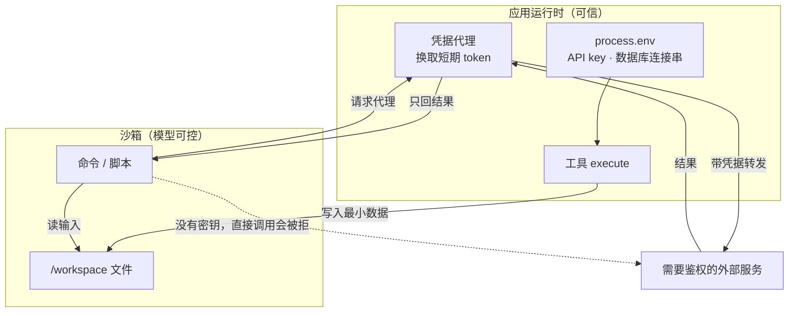

# 第 5 章 沙箱

> 每个 agent 有且只有一个沙箱，根目录是 `/workspace`。模型能在这里跑命令、读写文件，但看不到你的任何密钥。这一章讲怎么配置它、怎么用它、以及什么情况下它并不安全。

## 5.1 沙箱是什么

一个隔离的文件系统 + 进程环境：

- `bash` 工具在里面执行 shell
- `read_file` / `write_file` 读写里面的文件
- 你自己的工具通过 `ctx.getSandbox()` 拿句柄操作它

没有手写 `sandbox.ts` 时，eve 自动挑一个可用后端。开发机上通常是 `just-bash`（纯 JS，秒级启动，但**没有真正的进程隔离**）。

## 5.2 三个使用层次

### 层次一：什么都不做，让内置工具用

模型自己决定 `bash`、`read_file`、`write_file`。你只需要把参考文件放进去：

```text
agent/sandbox/
└── workspace/
    ├── runbook.md          → /workspace/runbook.md
    └── config/service.yaml → /workspace/config/service.yaml
```

顶层条目会自动告知模型「这里有这些文件」，模型需要时自己 `read_file`。

### 层次二：在工具里用

```ts
// agent/tools/analyze_trace.ts
import { defineTool } from "eve/tools";
import { z } from "zod";

export default defineTool({
  description: "分析一条分布式 trace 的关键路径，返回耗时最长的三个 span。",
  inputSchema: z.object({
    traceId: z.string().regex(/^[0-9a-f]{32}$/),
  }),
  async execute({ traceId }, ctx) {
    const sandbox = await ctx.getSandbox();

    // 1. 应用侧取数据（带密钥），只把数据写进沙箱
    const trace = await fetchTrace(traceId);
    await sandbox.writeTextFile({
      path: `traces/${traceId}.json`,
      content: JSON.stringify(trace),
    });

    // 2. 沙箱里跑脚本
    const result = await sandbox.run({
      command: `python3 /workspace/scripts/critical_path.py traces/${traceId}.json`,
    });
    if (result.exitCode !== 0) {
      throw new Error(`分析失败（退出码 ${result.exitCode}）：${result.stderr}`);
    }
    return JSON.parse(result.stdout);
  },
});
```

**这是推荐的结构**：取数在应用侧，计算在沙箱侧。按这个结构写，数据库密码不会进入沙箱。

`sandbox.run()` 返回 `{ exitCode, stdout, stderr }`。**非零退出码不会抛异常**，必须自己检查。

`sandbox` 上的方法（相对路径都相对 `/workspace`）：

| 方法 | 参数 | 返回 / 说明 |
| --- | --- | --- |
| `run` | `{ command, workingDirectory?, env?, abortSignal? }` | `{ exitCode, stdout, stderr }`，不抛错 |
| `spawn` | 同上 | 长驻进程句柄：`pid?` / `stdout` / `stderr` / `wait()` / `kill()` |
| `writeTextFile` | `{ path, content, abortSignal? }` | 自动建父目录、覆盖已有文件 |
| `writeBinaryFile` | `{ path, content: Uint8Array, abortSignal? }` | 同上，二进制 |
| `readTextFile` | `{ path, encoding?, startLine?, endLine?, abortSignal? }` | `string \| null`，**文件不存在返回 `null` 不抛错** |
| `readBinaryFile` | `{ path, abortSignal? }` | `Uint8Array \| null` |
| `removePath` | `{ path, force?, recursive?, abortSignal? }` | 删文件或目录 |
| `resolvePath` | `(path: string)` | 相对路径 → 绝对路径，不做 IO |
| `stop` | — | 停算力，保留持久状态；下次回调会重新打开 |
| `delete` | `{ reason? }` | 连持久状态一起永久删除 |

```ts
await sandbox.writeTextFile({ path, content });
const text = await sandbox.readTextFile({ path });      // 可能是 null
const bytes = await sandbox.readBinaryFile({ path });
const abs = sandbox.resolvePath("traces");              // /workspace/traces
const proc = await sandbox.spawn({ command, env: { DEBUG: "1" } });
await sandbox.removePath({ path: "tmp", recursive: true });
await sandbox.stop();
await sandbox.delete();
```

`readTextFile` 的 `startLine` / `endLine` 是 **1 基、闭区间**；`endLine` 超过文件末尾会读到 EOF，不报错。读大日志用它们分页，别一次读整个文件。

### 层次三：定义自己的环境

```ts
// agent/sandbox/sandbox.ts
import { DefaultSandbox, defineSandbox } from "eve/sandbox";

export const environment = DefaultSandbox.environment({
  prepare: async (sandbox) => {
    const r = await sandbox.run({
      command: "sudo apt-get update && sudo apt-get install -y jq python3-venv",
    });
    if (r.exitCode !== 0) throw new Error(r.stderr);
  },
});

export default defineSandbox(() => environment.open());
```

`prepare` 只在**构建可复用环境**时跑一次，不是每个会话都跑。之后每个会话从这份快照/镜像/模板启动。

`environment` 这个命名导出是必需的——`eve build` 在会话存在之前就要准备环境输入。

各后端的 `environment(...)` 选项大同小异，以 Docker 为例：

| 字段 | 类型 | 默认 | 说明 |
| --- | --- | --- | --- |
| `image` | `string` | eve 的沙箱镜像 | 基础容器镜像 |
| `env` | `Record<string, string>` | 无 | 烘进模板和运行容器的环境变量 |
| `pullPolicy` | `"if-not-present" \| "always" \| "never"` | `"if-not-present"` | 镜像拉取策略 |
| `prepare` | `(sandbox) => void \| Promise<void>` | 无 | 幂等初始化，结果烘进准备好的镜像 |

`environment.open(options)` 的选项在打开**活容器**时生效：

| 字段 | 类型 | 默认 | 说明 |
| --- | --- | --- | --- |
| `networkPolicy` | `"allow-all" \| "deny-all" \| { allow: {…} }` | `"allow-all"` | 出站策略。allow-list 和按域名注入 header 只有 Vercel Sandbox 支持；Docker 只认两个粗粒度值 |

`DefaultSandbox` 的选项按环境选中的后端解释；它至少接受 `prepare`，其余字段透传给具体后端。

## 5.3 选哪个后端

| Provider | 隔离强度 | 启动成本 | 能跑原生进程 | 适用 |
| --- | --- | --- | --- | --- |
| `just-bash` | 无（纯 JS 虚拟 FS） | 毫秒 | 否 | 只想让模型读写文本、跑简单 shell |
| `Docker` | 容器级 | 秒 | 是 | 本地开发、自托管 |
| `microsandbox` | 轻量 VM | 秒 | 是 | 本地要更强隔离 |
| `Vercel Sandbox` | 托管 VM | 秒 | 是 | 部署在 Vercel |
| `DefaultSandbox` | 自动选 | — | 取决于选中者 | 不想操心时 |

明确写死 Docker：

```ts
// agent/sandbox/sandbox.ts
import { defineSandbox } from "eve/sandbox";
import { DockerSandbox } from "eve/sandbox/docker";

export const environment = DockerSandbox.environment(); // 默认镜像
// 或 DockerSandbox.image("ghcr.io/acme/agent@sha256:...")
// 或 DockerSandbox.dockerfile() 用同目录的 Dockerfile

export default defineSandbox(() => environment.open({ networkPolicy: "deny-all" }));
```

**这一点最容易忽略**：`just-bash` 跑不了 Python，也装不了包。你在笔记本上装了 Python 不会让沙箱里有 Python。要让模型跑 Python，必须上 Docker / microsandbox / Vercel Sandbox。

用 Docker 前先确认守护进程可用：

```bash
docker info
```

### Vercel Sandbox 额外提供两样东西

**活沙箱名字。** `environment.open()` 和 `ctx.getSandbox(environment)` 返回的会话有一个只读 `name`，在 stop/resume 之间保持不变。用它给 Vercel 的 git-credential-broker 授权，把凭据限定在这一个沙箱上：

```ts
const sandbox = await ctx.getSandbox(environment);
const sandboxName = sandbox.name;
```

**Drive 挂载。** Drive 是独立于沙箱的持久存储，沙箱停了文件还在。先创建或取回 Drive，再通过 `mounts` 挂到绝对路径：

```ts
import { defineSandbox } from "eve/sandbox";
import { Drive, VercelSandbox } from "eve/sandbox/vercel";

const REGION = "iad1";

export const environment = VercelSandbox.environment({ region: REGION });

export default defineSandbox(async () => {
  const drive = await Drive.getOrCreate({ name: "agent-workspace", region: REGION });
  return environment.open({ mounts: { "/data": drive } });
});
```

- 这是读写挂载。别挂到 eve 管理的 `/workspace` 上。
- 环境和 Drive 用同一个 region，否则快照和沙箱不在同一处。
- 一个 Drive 同时只能有一个读写挂载。eve 每个会话一个沙箱，所以固定名字只适合「同一时刻只有一个会话在用」。会话可能重叠时，按 owner 或租户派生一个稳定的 Drive 名。
- 要给多个沙箱共享某个时间点的视图，挂 `drive.snapshot()`（只读）。没写过任何文件的空 Drive 不能挂快照。
- 每个沙箱最多四个互不重叠的绝对挂载路径。

## 5.4 装依赖的正确姿势

沙箱默认镜像里有 Python，但没有 matplotlib。要装就在 `prepare` 里装进虚拟环境：

```ts
export const environment = DefaultSandbox.environment({
  prepare: async (sandbox) => {
    const commands = [
      "sudo apt-get update && sudo apt-get install -y python3 python3-venv",
      "python3 -m venv /workspace/.venv",
      "/workspace/.venv/bin/python -m pip install matplotlib==3.10.8",
      "/workspace/.venv/bin/python -c \"import matplotlib.pyplot; print('ok')\"",
    ];
    for (const command of commands) {
      const r = await sandbox.run({ command });
      if (r.exitCode !== 0) {
        throw new Error(`准备失败（${r.exitCode}）：${r.stderr || r.stdout}`);
      }
    }
  },
});
```

三个细节：

1. 安装和执行用**同一个** Python 环境（`/workspace/.venv/bin/python`），别用系统 Python 装、虚拟环境里跑。
2. `prepare` 需要网络访问软件源。如果你配了 `deny-all` 网络策略，准备阶段会失败。
3. 每条命令都检查 `exitCode`。装包失败静默通过，后面会得到莫名其妙的「模块不存在」。

验证装好了：

```text
在沙箱里运行 /workspace/.venv/bin/python -c "import matplotlib; print(matplotlib.__version__)"
```

## 5.5 网络策略

```ts
export default defineSandbox(() => environment.open({ networkPolicy: "deny-all" }));
```

| 值 | 含义 |
| --- | --- |
| `"allow-all"` | 沙箱可以访问任意网络 |
| `"deny-all"` | 不能出网 |
| 域名白名单 | 仅 Vercel Sandbox 支持 |

也可以在运行时改（需要传环境句柄，因为通用句柄不暴露 provider 特有方法）：

```ts
import { environment } from "../sandbox";

const sandbox = await ctx.getSandbox(environment);
await sandbox.setNetworkPolicy("deny-all");
```

注意 `just-bash` 没有 `setNetworkPolicy()`——它本来就不隔离网络，因为它没有真正的网络栈。

**默认建议：`deny-all`。** 模型能任意发 HTTP 请求意味着它能外传数据。需要联网的步骤（装包、调公开 API）在 `prepare` 里做，或给具体域名开白名单。

## 5.6 生命周期

```text
会话创建 → 首次 ctx.getSandbox() → 从环境模板启动沙箱
    ↓
turn 之间保持（文件系统保留）
    ↓
sandbox.stop()  → 停算力，状态保留，下次访问恢复
sandbox.delete() → 状态清空，下次重新从模板启动
    ↓
会话终结 → provider 的 onSessionEnd() 释放资源
```

要点：

- 沙箱是**会话级**的，不是 turn 级的。同一个会话的多轮对话看到同一个 `/workspace`。
- 不同会话之间不共享。想跨会话复用算力要自定义 provider（不建议，除非你清楚隔离边界）。
- 修改沙箱定义（代码、Dockerfile、环境选项、workspace 文件）会产生**新的环境代次**。已有会话保留旧状态，新会话用新的。

在钩子里主动释放算力：

```ts
// agent/hooks/stop-after-turn.ts
import { defineHook } from "eve/hooks";

export default defineHook({
  events: {
    async "turn.completed"(_event, ctx) {
      const sandbox = await ctx.getSandbox();
      await sandbox.stop();     // 停算力，文件还在
    },
  },
});
```

适合「一轮用完就长时间空闲」的场景，省沙箱费用。

## 5.7 文件进出沙箱

### 进：workspace 种子

```text
agent/sandbox/workspace/schema.sql  →  /workspace/schema.sql
```

eve 在准备新环境代次时复制这些文件。**已运行会话的状态不会被后来的种子覆盖**——想生效要开新会话。

### 进：用户上传和工具产物

用户消息里的文件、工具用 `toolOutputPart.file` 返回的文件，都会落到 `/workspace/.eve/attachments/<hash>/`，历史里只留引用。

模型看到的标签长这样：

```text
Attached file /workspace/.eve/attachments/9f2c/report.pdf (application/pdf)
```

字节会不会真的传给模型，取决于类型：

| 类型 | 会不会传字节 |
| --- | --- |
| PNG / JPEG / GIF / WebP，≤ 3 MiB，单边 ≤ 8000px | 会 |
| PDF，≤ 20 MiB | 会 |
| CSV、HEIC、音频、视频等 | 不会，只给路径 |

所以让模型处理 CSV 时，它会用 `read_file` 或 `bash` 去读，而不是「看见」内容。音频要转写就自己加工具。

### 出：把结果拿出来

沙箱路径**不是**下载链接，也不是你笔记本上的文件。要拿到产物，在工具里读成字节：

```ts
const png = await sandbox.readBinaryFile({ path: "chart.png" });
return { pngBase64: Buffer.from(png).toString("base64") };
```

然后用 `toModelOutput` 只给模型一句描述，把字节留给客户端：

```ts
toModelOutput({ chart }) {
  return { type: "text", value: `已生成 ${chart}，PNG 在工具结果里供客户端保存。` };
},
```

大文件不要走工具结果（会随会话事件一起持久化）。上传到对象存储，返回带鉴权的下载 URL。

## 5.8 子代理的沙箱

两种子代理，两种行为：

| 类型 | 沙箱 |
| --- | --- |
| 内置 `agent` 工具创建的根副本 | **复用父级沙箱**，文件写入立即可见 |
| 声明式子代理（`agent/subagents/<name>/`） | **自己的沙箱**，除非显式声明共享 |

要共享父级沙箱：

```ts
// agent/subagents/reviewer/sandbox.ts
import { defineParentSandbox } from "eve/sandbox";

export default defineParentSandbox();
```

共享之后，这个子代理不能再声明自己的 workspace 或技能文件。

## 5.9 安全边界：什么在沙箱里，什么不在

| 东西 | 在沙箱里？ |
| --- | --- |
| `process.env` | 否 |
| 你的 API key、数据库连接串 | 否 |
| `agent/lib/` 的代码 | 否 |
| 技能文件 | 是，只读挂载在 `$HOME/.agents/skills/` |
| workspace 种子 | 是，可写 `/workspace` |
| 模型写的脚本、下载的数据 | 是 |

内置环境在每次 `run()` 和 `spawn()` 时注入 `AI_AGENT=eve`，让 `vercel` 这类 CLI 跳过交互提示。

沙箱里**没有** `process.env`。`environment({ env })` 会把变量烘进模板、所有会话共享；`run({ env })` 只对单次调用生效，但沙箱进程仍然读得到。两种都不该放密钥——只要值进了沙箱，就当成模型能看到。详见[附录 C](appendix-c-env-and-secrets.md)。

如果沙箱里的进程需要访问需要鉴权的服务，用凭据代理（credential brokering），不要把 token 写进沙箱文件。原则：**凭据只在应用侧，沙箱只拿结果**。



三条线要分清：**实线是允许的数据流**，**虚线是被边界挡住的路**。模型能改的是沙箱里的命令和文件，改不了 `process.env`，也拿不到连接凭据。

## 5.10 自定义 provider

需要接自己的容器平台时：

```ts
import type { SandboxSession } from "eve/sandbox";
import { defineSandboxProvider } from "eve/sandbox/provider";

export const AcmeSandbox = defineSandboxProvider<
  { image: string; prepare?: (s: SandboxSession) => Promise<void> },
  { networkPolicy?: "allow-all" | "deny-all" },
  { templateId: string },
  { remoteId: string; version: 1 },
  SandboxSession
>({
  name: "acme",
  environment(options) {
    // 下面四个是你自己写的适配层，官方示例里同样省略了实现
    const client = createAcmeClient(options);
    const adapt = (tmp: AcmeTemporary) => toSandboxSession(tmp);
    const createHandle = (remote: AcmeRemote) => toSandboxSession(remote);
    const sessionIdentity = (id: string, artifact: { templateId: string }, live: unknown) =>
      `${id}:${artifact.templateId}:${JSON.stringify(live ?? {})}`;

    return {
      async prepare(ctx) {
        const tmp = await client.createTemporary({
          files: await ctx.files.list(),
          resources: ctx.resources,
        });
        await options.prepare?.(adapt(tmp));
        return { templateId: (await tmp.capture()).id };
      },
      async start(ctx, liveOptions, artifact) {
        const remote = await client.open({
          identity: sessionIdentity(ctx.session.id, artifact, liveOptions),
          networkPolicy: liveOptions?.networkPolicy,
          templateId: artifact.templateId,
        });
        return { handle: createHandle(remote), state: { remoteId: remote.id, version: 1 } };
      },
      async resume(_ctx, artifact, state) {
        return createHandle(
          await client.resume({ id: state.remoteId, templateId: artifact.templateId }),
        );
      },
      async onSessionEnd(_ctx, _artifact, state, { reason }) {
        await client.delete({ id: state.remoteId, reason });
      },
    };
  },
});
```

契约要点：

- `prepare()` 返回可 JSON 序列化的 artifact。
- `start()` 每个持久沙箱会话调一次，返回句柄 + 最小可序列化状态。
- 进程重启只调 `resume()`，必须能接回已有原生资源；接不回来就失败，不要重建（重建会丢副作用）。
- `onSessionEnd()` 做幂等清理，不要依赖活句柄。

## 5.11 常见注意事项

**注意：以为有 Python，结果 `python3: not found`。**
你用的是 `just-bash`。换 Docker 或 Vercel Sandbox。

**注意：`prepare` 里 `sudo apt-get` 失败，但没报错。**
没检查 `exitCode`。每条命令都要检查。

**注意：改了 workspace 种子，老会话看不到。**
种子只在新环境代次生效。开新会话。

**注意：`sandbox.run()` 失败但代码继续跑。**
它不抛异常。必须判断 `exitCode !== 0`。

**注意：把数据库密码写进沙箱脚本。**
模型能 `read_file` 那个脚本。取数在应用侧做。

**注意：`deny-all` 之后 `prepare` 装不了包。**
准备阶段需要出网。要么保持 `allow-all` 准备完再收紧，要么用白名单。

**注意：图表 PNG 超过 1 MiB 塞进工具结果。**
工具结果随会话事件持久化，会拖慢一切。控制在 1 MiB 内，或改走对象存储。

**注意：以为沙箱是安全边界，其实用 `just-bash`。**
它没有进程隔离。真正跑不可信代码必须上容器或 VM。

## 5.12 练习

1. 在 `agent/sandbox/workspace/` 放一个 `runbook.md`，让模型读它并总结要点。
2. 用 Docker 起一个沙箱，在 `prepare` 里装 `jq`，然后让模型用 `bash` 调 `jq` 处理 JSON。
3. 写一个工具，用沙箱里的 Python 算一组数的分位数，返回结果并把中间文件路径也返回。
4. 把网络策略改成 `deny-all`，观察哪些操作会失败，写下你的取舍。

## 延伸阅读

- [Sandbox](https://eve.dev/docs/sandbox)
- [Docker Sandbox](https://eve.dev/docs/sandbox/docker)
- [Security Model](https://eve.dev/docs/concepts/security-model)

---

上一章：[04 工具](04-tools.md) · 下一章：[06 上下文控制](06-context-control.md)
