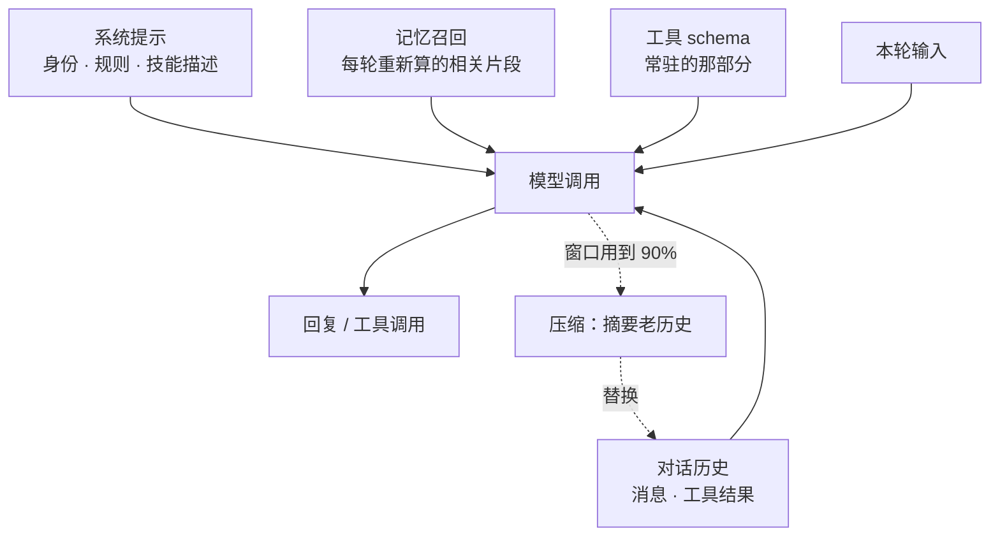

# 第 6 章 上下文控制

> agent 的行为问题和账单问题，八成出在上下文。这一章讲清楚什么内容该放哪一层、什么时候该压缩、怎么设上限。

## 6.1 一条原则

**把信息放在能起作用的最窄的那一层。**

永久规则放系统提示；偶发流程放技能；运行时要读的文件放工作区；专家工作放子代理；跨会话事实放记忆。全都塞进 `instructions.md` 是最贵的做法，也是行为最不稳定的做法。

## 6.2 七个层次

| 需求 | 用什么 | 模型什么时候看到 |
| --- | --- | --- |
| 永久身份、规则、约束 | 系统角色 instructions | **每次**模型调用 |
| 属于对话历史的应用上下文 | 用户角色 instructions | 在生命周期边界写进历史一次 |
| 只在某些任务里用的流程 | 技能 | 先只看到描述，加载后看到全文 |
| 类型化动作、外部操作 | 工具 / 连接 | 看到 schema，调用后看到结果 |
| 文件、命令执行 | 沙箱工作区 | 先看到目录提示，需要时自己读 |
| 独立上下文的专家 | 子代理 | 只看到子代理的最终回复 |
| 跨会话的事实与偏好 | memory 槽 | 每轮召回的相关片段 |
| 本会话的工作数据 | `defineState` | 不进上下文，除非工具把它返回给模型 |

最后一行容易误解：`defineState` 是给**代码**用的，模型看不见里面的东西。要让它看见，得有个工具读出来返回。

拼到一次模型调用里，是这样几股流：



五股流里只有 `HIS` 会无限增长，所以压缩只动它。系统提示、工具 schema、召回块都是每轮重算的，不占历史。

## 6.3 instructions：两种角色，差别很大

```md
<!-- agent/instructions.md -->
你是值班助手。
```

```ts
// agent/instructions.ts
import { defineInstructions } from "eve/instructions";

export default defineInstructions({
  content: "以下是本次导入的客户简报：……",
  role: "user",       // 默认是 "system"
});
```

`defineInstructions` 只有两个字段：

| 字段 | 类型 | 默认 | 说明 |
| --- | --- | --- | --- |
| `content` | `string` | 必填 | 指令正文 |
| `role` | `"system" \| "user"` | `"system"` | 放进系统提示还是对话历史 |

| | 系统角色 | 用户角色 |
| --- | --- | --- |
| 位置 | 对话历史**之外** | 写进对话历史 |
| 生效频率 | 每次模型调用 | 在边界处追加一次 |
| 会不会被压缩 | 不会 | 会，可能被摘要替代 |
| 会不会被 clear 清掉 | 不会 | 会 |
| 适合 | 身份、硬规则 | 导入的简报、检索到的资料 |

一个实际的组合：

```text
agent/
├── instructions.md              # 系统角色：身份 + 三条硬规则
└── instructions/
    ├── 10-team-context.ts       # 用户角色：当前值班表、在班人员
    └── 20-recent-incidents.ts   # 用户角色：最近三天的事故摘要
```

目录里的条目按文件名 `localeCompare` 排序，根目录文件排最前。系统角色按顺序拼接；用户角色按顺序进入新会话历史。

动态化（按调用者、租户、渠道变化）：

```ts
// agent/instructions/tenant-brief.ts
import { defineDynamic, defineInstructions } from "eve/instructions";

export default defineDynamic({
  events: {
    "session.started": async (_event, ctx) => {
      const tenant = ctx.session.auth.current?.attributes.tenantId;
      if (typeof tenant !== "string") return null;     // 返回 null 表示不贡献内容
      const brief = await loadTenantBrief(tenant);
      return defineInstructions({ content: brief, role: "user" });
    },
  },
});
```

指令解析器只支持 `session.started` 和 `turn.started`，**不支持** `step.started`。

## 6.4 压缩（compaction）

上下文快满时，eve 把较早的对话总结成一段检查点，保留进度、决策、约束和引用。

默认阈值是模型上下文窗口的 90%，而且 eve 会把压缩提示本身的固定开销算进去，所以实际触发比「90% 的对话量」更早。

调早一点：

```ts
// agent/agent.ts
export default defineAgent({
  model: "anthropic/claude-sonnet-5",
  compaction: { thresholdPercent: 0.75 },
});
```

`compaction` 的三个字段：

| 字段 | 类型 | 默认 | 说明 |
| --- | --- | --- | --- |
| `thresholdPercent` | `number` | `0.9` | 主模型上下文窗口用到多少比例时触发 |
| `model` | 模型 ID / 模型对象 | 当前 turn 的模型 | 只用于生成摘要的模型，可以换更便宜的 |
| `modelContextWindowTokens` | `number` | 查 Gateway | 摘要模型的上下文窗口，用于未收录的模型 |

压缩前 eve 会先试着缩短老的工具结果。如果省不出足够空间，才真正做摘要。

三个必须知道的行为：

1. **用户角色指令会被当普通历史处理**，可能被摘要替代。系统角色不受影响。
2. **记忆槽的召回内容不参与摘要**，压缩后会重新召回。
3. **压缩成功后会话会换到一条新的 workflow run**（同部署、同 session ID、同事件流），避免单条 run 的历史无限增长。

## 6.5 compact / clear / reset 的区别

| 操作 | 做什么 | 保留什么 | 用在什么时候 |
| --- | --- | --- | --- |
| `compact()` | 摘要历史 | 会话身份、系统提示、工具、状态、沙箱 | 对话很长但想继续 |
| `clear()` | 删除模型消息历史 | 同上（历史没了） | 换话题，但保留同一会话 |
| `reset()` | 终止会话 | 什么都不保留，ID 作废 | 彻底重来 |

`clear()` 会清掉：静态和动态用户角色指令、召回的 memory 记录、框架的记忆锁和重放簿记。它**不会**删除 memory provider 外部存储里的数据，也不会重跑指令定义或解析器。

三个都有 HTTP 路由和客户端方法：

```bash
curl -X POST http://localhost:2000/eve/v1/session/<id>/compact
curl -X POST http://localhost:2000/eve/v1/session/<id>/clear
curl -X POST http://localhost:2000/eve/v1/session/<id>/reset \
  -H 'content-type: application/json' -d '{"reason":"换个话题"}'
```

如果 turn 正在跑，压缩请求会排队等它结束。

## 6.6 上限：真正控制成本的地方

```ts
// agent/agent.ts
export default defineAgent({
  model: "anthropic/claude-sonnet-5",
  limits: {
    maxInputTokensPerSession: 200_000,
    maxOutputTokensPerSession: 20_000,
    maxTokenCostUsdPerSession: 1.5,
    sessionTimeoutMs: 7 * 24 * 60 * 60 * 1_000,
  },
});
```

| 字段 | 默认 | 说明 |
| --- | --- | --- |
| `maxInputTokensPerSession` | 根会话 4000 万 | 累积输入 token 上限 |
| `maxOutputTokensPerSession` | 不设 | 累积输出 token 上限 |
| `maxTokenCostUsdPerSession` | 不设 | 模型 token 成本上限（美元），不含工具和基础设施 |
| `sessionTimeoutMs` | 30 天 | 会话寿命，`false` 关闭 |

**达到上限时的行为值得记住**：越界的那次调用会跑完（因为用量是调用结束后才知道），然后 eve 暂停 turn，发一个确定性的续期提示，给两个选项——**Continue** 给一份新的额度并继续同一个 turn，**Stop** 走标准取消路径结束这个 turn。这不是错误，是用户决策。

无人值守的会话（markdown 定时任务、没有输入代理的委派运行）不会弹提示，下一次模型调用直接失败，错误码 `SESSION_TOKEN_LIMIT_REACHED` 或 `SESSION_TOKEN_COST_LIMIT_REACHED`。**定时任务必须自己设额度，并且接受失败。**

子代理的额度规则：每个子代理从父级剩余额度里分一份（按同一 step 启动的 agent 任务数均分），子代理的花费计回父级。所以一个失控的子代理能烧掉父级的全部预算。

## 6.7 提示缓存

eve 对 AI Gateway 模型和它认识的 Anthropic 模型自动开缓存。两个实践建议：

1. **把稳定内容放前面。** 系统提示 → 工具定义 → 早期历史 → 新消息。前缀越稳定，缓存命中率越高。
2. **别频繁切模型。** 缓存是按模型分的，切一次就要按未命中价重新读一遍整段对话。动态模型解析器优先用 `session.started`，不要用 `step.started`。

Anthropic 直连模型想用 1 小时缓存：

```ts
export default defineAgent({
  model: bedrock(process.env.BEDROCK_INFERENCE_PROFILE_ARN!),
  modelContextWindowTokens: 200_000,
  modelOptions: { promptCache: { anthropic: { ttl: "1h" } } },
});
```

不是每个 Claude 模型都支持 1 小时缓存。**Gateway 模型上写 `promptCache` 会被拒绝**，那种情况改用 `providerOptions.gateway.caching`。

## 6.8 一个完整的上下文设计

以 opsbot 为例：

```text
系统提示（每轮都发，控制在 80 行内）
├── 身份：你是值班助手
├── 三条硬规则：不编造、危险动作要确认、中文回答
└── 工具使用偏好：先查指标再查日志

用户角色指令（新会话写一次）
└── 当前值班表 + 最近事故摘要（由 session.started 动态生成）

技能（按需）
├── incident-runbook    排障流程
├── postmortem          事故复盘模板
└── change-review       变更审查清单

工具（常驻 schema）
├── read_logs / query_metrics / get_service_status
├── restart_service（审批）
└── compute_error_budget（沙箱）

工作区（按需读）
├── /workspace/runbook.md
└── /workspace/slo/*.yaml

记忆（每轮召回）
└── profile 槽：用户偏好、常用服务名

状态（模型看不见）
└── 当前事故编号、本轮已查过的服务
```

对照检查：如果你发现自己在系统提示里写「第一步……第二步……」，那是技能；写「昨天张三说要关注 payment-api」，那是记忆或用户角色指令；写「查询日志请调 read_logs」，那是工具的 description 该干的事。

## 6.9 常见坑

**坑：系统提示越写越长，模型反而更不听话。**
长提示里的中间条目最容易被忽略。把流程拆成技能，把事实拆成记忆。

**坑：把整个文件树粘进提示词。**
放 `agent/sandbox/workspace/`，让模型自己 `read_file`。提示词里只说「工作区有 runbook.md」。

**坑：以为 `clear()` 会重置一切。**
`defineState` 的值、沙箱文件、会话身份都还在。要全清用 `reset()` 开新会话。

**坑：动态指令用 `step.started`。**
不支持。只有 `session.started` 和 `turn.started`。

**坑：没设 `maxTokenCostUsdPerSession`，一个循环跑掉几十美元。**
尤其是模型陷入「工具失败 → 重试 → 再失败」的循环。设上限，并且给工具写可操作的错误信息。

**坑：压缩之后模型忘了用户的原始要求。**
压缩提示会尽量保留约束和决策，但不是保证。重要的约束写在系统提示里（不进历史，不会被压缩）。

## 6.10 练习

1. 把 opsbot 的 `instructions.md` 压到 80 行以内，把排障流程挪进技能（下一章做）。
2. 加一个用户角色的动态指令，在 `session.started` 时写入当前值班人。
3. 设 `maxTokenCostUsdPerSession: 0.5`，故意让它跑一个长循环，观察续期提示长什么样。
4. 用 `curl` 调一次 `compact`，看事件流里的 `compaction.requested` 和 `compaction.completed`。

## 延伸阅读

- [Context Control](https://eve.dev/docs/concepts/context-control)
- [Instructions](https://eve.dev/docs/instructions)
- [Default Harness](https://eve.dev/docs/concepts/default-harness)
- [Agent Configuration](https://eve.dev/docs/agent-config)

---

上一章：[05 沙箱](05-sandbox.md) · 下一章：[07 技能](07-skills.md)
