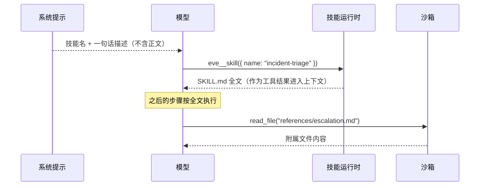

# 第 7 章 技能

> 技能是按需加载的 Markdown 流程。平时只占一行描述，模型需要时才把全文拉进上下文。它不增加任何执行能力——只增加「怎么做」。

## 7.1 为什么要有技能

把排障流程写进系统提示的后果：

- 每一轮都付这份 token，哪怕用户只是在打招呼
- 流程越长，模型越容易忽略中间的步骤
- 改流程等于改系统提示，风险大、影响面广

技能解决这三件事：描述常驻（几十字），正文按需（几千字），改动隔离。

## 7.2 最小技能

```md
<!-- agent/skills/triage.md -->
先确认影响面，再定位原因，最后给动作建议。

1. 用 query_metrics 看错误率和延迟，确认是全局还是单服务。
2. 用 read_logs 看最近 15 分钟的错误行，按错误类型归类。
3. 如果错误集中在某个下游依赖，查该依赖的状态页。
4. 输出：结论一句话、证据三条、建议动作一条。
```

文件名就是技能名（`triage`）。没写 frontmatter 时，eve 取正文第一行非空、非代码块的行作为描述——这里会取到「先确认影响面……」，作为路由提示太弱。

所以**加描述**：

```md
---
description: 线上故障的初步分诊流程。当用户报告服务异常、错误率上升、延迟抖动时使用。
---

先确认影响面，再定位原因，最后给动作建议。
……
```

描述要写成「什么时候该触发」，不是「这是什么」。对比：

| 差 | 好 |
| --- | --- |
| `description: 排障手册` | `description: 线上故障的初步分诊流程。当用户报告服务异常、错误率上升或延迟抖动时使用。` |
| `description: SQL 相关` | `description: 编写和优化只读分析查询。当用户要求统计、对比或导出数据时使用。` |

## 7.3 打包技能

流程需要附带参考文件、脚本、模板时，用目录：

```text
agent/skills/incident-runbook/
├── SKILL.md
├── references/
│   ├── escalation.md
│   └── slo-definitions.md
└── scripts/
    └── collect_context.sh
```

```md
<!-- agent/skills/incident-runbook/SKILL.md -->
---
description: 完整的线上事故处理手册。当确认是生产事故、需要按流程升级和记录时使用。
---

# 事故处理手册

## 第一步：定级

按 `references/slo-definitions.md` 判断 P0/P1/P2。

## 第二步：收集上下文

运行 `scripts/collect_context.sh <service>`，把输出贴进事故记录。

## 第三步：升级

按 `references/escalation.md` 的矩阵通知对应负责人。

## 第四步：记录

用下面的模板写时间线：

- T+0 发现
- T+? 定位
- T+? 缓解
- T+? 恢复
```

要点：

- 打包技能的 `SKILL.md` **必须**有 `description` frontmatter（没有文件名 slug 可退）。
- 技能文件在沙箱里挂到 `$HOME/.agents/skills/<skill>/`，`$HOME` 不可用时退回 `/workspace/skills/<skill>/`。
- `SKILL.md` 里写 `references/checklist.md` 这样的相对路径，相对于该 `SKILL.md` 所在目录。
- 模型用沙箱文件工具（`read_file`、`bash`）读这些附属文件。**工具和钩子没有技能文件 API**，你的代码需要同样的数据就从 `lib/` import。

只有访问附属文件才需要沙箱。列出技能、加载指令都不需要沙箱——正文来自编译产物和会话状态。

## 7.4 加载机制

1. eve 扫描 `agent/skills/`，把每个技能的名字和描述写进系统提示。
2. 模型判断相关（或用户直接点名），调用 `eve__skill({ name })`。
3. 技能的 Markdown 作为这次调用的结果进入当前 turn 的上下文。

有技能的 agent 一定有 `eve__skill` 工具。加载会记一个 `load-skill` 动作，评测里可以用 `t.loadedSkill` 断言。



关键在第一步：常驻上下文的只有**名字和描述**，正文在真正需要时才进来。所以一个技能写 200 行，平时只花一行描述的钱。

**加载技能只加指令，不加执行面。** 工具在加载前后都可见。想要类型化的运行时行为，写工具。

## 7.5 deferred：连描述也不放进去

技能很多时（比如装了二十个社区技能），描述本身就成了负担：

```md
---
description: 填写和校验 PDF 表单。
deferred: true
---
```

deferred 技能不在上下文里出现名字，只在目录提示里说明「存在 deferred 技能，有这些命名空间」。模型用 `eve__search` 找，找到后用 `eve__skill` 加载。

```text
模型：eve__search({ query: "pdf 表单" })
→ { results: [{ skill: "pdf-forms", description: "…", path: "…/SKILL.md" }], searched: 18, remaining: 0 }

模型：eve__skill({ name: "pdf-forms" })
→ 技能全文
```

## 7.6 用 TypeScript 写技能

需要拼装内容、带类型、内联附属文件时：

```ts
// agent/skills/postmortem.ts
import { defineSkill } from "eve/skills";
import { renderTemplate } from "../lib/templates";

export default defineSkill({
  description: "生成事故复盘文档。当事故已恢复、需要产出复盘时使用。",
  markdown: renderTemplate("postmortem"),
  files: {
    "references/template.md": "# 复盘模板\n\n## 时间线\n\n## 根因\n\n## 改进项\n",
  },
});
```

`markdown` 会被写成 `SKILL.md`，`files` 的每个条目成为同目录的兄弟文件。

`defineSkill` 的字段：

| 字段 | 类型 | 必填 | 说明 |
| --- | --- | --- | --- |
| `description` | `string` | 是 | 告诉模型**什么时候**用这个技能。会被放进技能列表 |
| `markdown` | `string` | 是 | 技能正文，加载后作为指令返回给模型 |
| `files` | `Record<string, string \| 文件内容>` | 否 | 附属文件，挂到技能目录下（脚本、模板、参考数据） |
| `deferred` | `boolean`，默认 `false` | 否 | 不进技能列表，模型用 `eve__search` + `eve__skill` 找到 |
| `license` | `string` | 否 | 元数据，展示用 |
| `metadata` | `Record<string, string>` | 否 | 自定义元数据，原样保留 |

`description` 和 `markdown` 的写法要求不同：前者是给模型的「路由信号」，一句话说清触发条件；后者是给模型的「操作手册」，可以长。

静态 `defineSkill` 在编译期求值，结果进清单；动态的才保留为运行时入口。

**先用纯 Markdown，撞到限制再升级到 `defineSkill`。** 大部分技能一辈子不需要 TypeScript。

## 7.7 动态技能：按调用者给不同的手册

```ts
// agent/skills/team-playbook.ts
import { defineDynamic, defineSkill } from "eve/skills";

const PLAYBOOKS: Record<string, string> = {
  growth: "按订单日期聚合收入，用美元报告，按套餐对比客户。",
  finance: "把订单收入与每日、客户汇总核对，标注为毛收入（数据集无退款）。",
};

export default defineDynamic({
  events: {
    "session.started": async (_event, ctx) => {
      const team = ctx.session.auth.current?.attributes.team;
      const key = Array.isArray(team) ? team[0] : team;
      const body = key ? PLAYBOOKS[key] : undefined;
      if (!body) return null;                     // 没有团队 → 没有技能

      return defineSkill({
        description: `回答 ${key} 团队的分析问题时使用，包含该团队的固定口径。`,
        markdown: `# ${key} 团队手册\n\n${body}`,
      });
    },
  },
});
```

三个关键点：

1. 团队来自 `ctx.session.auth.current.attributes`，即**鉴权层盖章的声明**，不是消息内容。所以一个租户没法通过改写消息借用别人的手册。
2. 解析器在 `session.started` 跑一次，结果对整个会话有效。改团队要开新会话。
3. 返回 `null` 表示不提供这个技能。

## 7.8 技能的作用域

技能属于声明它的那个 agent：

- 根 agent 的 `skills/` 对子代理不可见
- 子代理的 `skills/` 对根 agent 不可见
- 要共享，打成扩展包（extension）并在每个 agent 里挂载

共享代码放 `lib/`，共享流程放扩展。

## 7.9 安装社区技能

```bash
eve registry search react --registry @skills
eve add @skills/vercel-labs/agent-skills/vercel-react-best-practices
```

`@skills` 指向 [skills.sh](https://skills.sh)。这些是社区作者写的项目文件，**装之前看源码，装之后看 diff**。技能能往上下文里注入任意文本，包括误导性的指令。

## 7.10 技能 vs 工具 vs 子代理

| 你需要 | 用什么 |
| --- | --- |
| 让模型知道「怎么做一件事」 | 技能 |
| 让模型能「执行一件事」 | 工具 |
| 让模型「换个身份/工具面做一件事」 | 子代理 |
| 让模型「按调用者不同规则做事」 | 动态技能 |
| 让模型「读到一份大文件」 | 工作区种子 |

判断口诀：**技能改变模型的想法，工具改变世界，子代理改变上下文。**

## 7.11 常见注意事项

**注意：技能里写「运行 `python analyze.py`」，但沙箱是 `just-bash`。**
技能只是文本，它描述的动作需要真实工具支持。写流程前先确认工具和沙箱具备条件。

**注意：打包技能没写 `description`。**
编译失败。目录形式的技能必须有描述。

**注意：以为加载技能后模型就能调用新工具。**
不会。技能不增加工具。要让技能里提到的工具存在，先写工具。

**注意：技能名带大写或空格。**
只允许 ASCII 字母、数字、下划线、短横线，字母或数字开头，≤ 64 字符。

**注意：把密钥写进技能正文。**
技能正文进模型上下文，等于把密钥发给模型供应商。

**注意：动态技能在 `turn.started` 里读消息内容判断团队。**
不要从消息里取身份。用 `auth.current.attributes`。

## 7.12 练习

1. 把第 2 章 `instructions.md` 里的排障流程挪进 `agent/skills/triage.md`，加一个明确的 description。
2. 做一个打包技能，带 `references/` 下的两个文件，让模型按需读。
3. 给技能加 `deferred: true`，用 `eve__search` 找它，观察上下文里少了什么。
4. 写一个按 `auth.current.attributes.team` 分发的动态技能，用 dev 环境的假鉴权验证路由。

## 延伸阅读

- [Skills](https://eve.dev/docs/skills)
- [Dynamic Capabilities](https://eve.dev/docs/guides/dynamic-capabilities)
- [Context Control](https://eve.dev/docs/concepts/context-control)

---

上一章：[06 上下文控制](06-context-control.md) · 下一章：[08 状态与长期记忆](08-state-and-memory.md)
