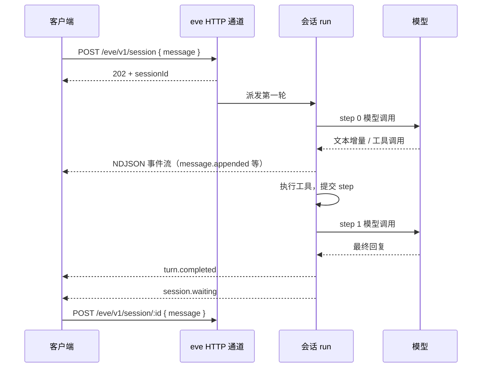

# 第 9 章 会话协议

> 每个 eve 应用都暴露同一套 HTTP API：建会话、发消息、看事件流、取消、清空、压缩、重置。这一章讲清协议本身，以及怎么用 TypeScript 客户端而不是手搓 POST。

## 9.1 路由表

| 方法 | 路径 | 作用 |
| --- | --- | --- |
| `GET` | `/eve/v1/health` | 存活检查，公开 |
| `GET` | `/eve/v1/info` | 编译后 agent 的完整快照 |
| `POST` | `/eve/v1/session` | 建会话（可带首条消息） |
| `POST` | `/eve/v1/session/:id` | 追问 / 回答审批 |
| `POST` | `/eve/v1/session/:id/cancel` | 取消进行中的 turn |
| `POST` | `/eve/v1/session/:id/clear` | 清空模型消息历史 |
| `POST` | `/eve/v1/session/:id/compact` | 压缩上下文 |
| `POST` | `/eve/v1/session/:id/reset` | 终止会话 |
| `GET` | `/eve/v1/session/:id/stream` | NDJSON 事件流 |

所有会话操作只用 `sessionId` 寻址，没有别的句柄。通道（Slack 线程等）有自己的 continuation token，但那不出通道边界。

## 9.2 建会话

只建不聊：

```bash
curl -X POST http://localhost:2000/eve/v1/session
# {"ok":true,"sessionId":"wrun_A","status":"accepted"}
```

建并说第一句：

```bash
curl -X POST http://localhost:2000/eve/v1/session \
  -H 'content-type: application/json' \
  -d '{"message":"payment-api 现在正常吗？"}'
```

返回 `202` + `sessionId`（body 和 `x-eve-session-id` 头都有）。

`POST /eve/v1/session` 的请求体：

| 字段 | 类型 | 说明 |
| --- | --- | --- |
| `message` | `string \| UserContent` | 第一条消息。不带则只建会话 |
| `context` | `string[]` | 持久化到历史的用户角色上下文，后续轮次也能看到 |
| `clientContext` | `string \| string[] \| object` | 只对本轮生效，不写历史；**要求同时带 `message`** |
| `outputSchema` | JSON Schema | 要求这一轮产出结构化结果；同样要求带 `message` |
| `operationId` | `string` | 幂等键，同一 principal 重试拿到同一个会话；匿名不能用 |
| `stubs` | `ToolStub[]` | 工具桩，固定给这个会话 |

追问 `POST /eve/v1/session/:id` 的请求体接受 `message` 或 `inputResponses` **二选一**（回答人工输入时用后者），可附带 `context` / `clientContext` / `outputSchema` / `turnPolicy`。

两个细节：

- 只建会话时，`session.started` 不会立刻发，要等第一条消息。因为会话级初始化需要消息才能决定第一轮的上下文。
- 立刻追问可能收到 `409 session_not_ready`，此时用有界退避重试。TypeScript 客户端会自己重试最多 20 秒。

幂等创建（网络重试安全）：

```bash
curl -X POST http://localhost:2000/eve/v1/session \
  -H "Authorization: Bearer $TOKEN" \
  -H 'content-type: application/json' \
  -d '{"message":"生成周报","operationId":"weekly-2026-10-20"}'
```

同一个 principal 用同一个 `operationId` 重试，拿到的是同一个会话，不会重复启动。匿名调用不能用 `operationId`。

## 9.3 事件流

一次完整交互里，四个参与者之间的消息是这样走的：



注意事件流是**单向**的：客户端不往流里写东西，追问和应答都走独立的 POST。流只负责把 run 里发生的事按顺序吐出来。

```bash
curl http://localhost:2000/eve/v1/session/wrun_A/stream
```

一行一个 JSON。核心事件：

| 事件 | 含义 |
| --- | --- |
| `session.started` | 会话建立 |
| `turn.started` | 新 turn 开始 |
| `message.received` | 输入到达（含纯文本和结构化 parts） |
| `step.started` | 一次模型调用开始 |
| `actions.requested` | 模型请求了动作（含工具调用），在执行前就流出 |
| `action.result` | 工具返回 |
| `message.appended` / `message.completed` | 助手文本增量 / 定稿 |
| `reasoning.appended` / `reasoning.completed` | 推理增量 / 定稿 |
| `input.requested` | 停下来等人（审批或提问） |
| `approval.candidate` | 有人提交了审批，服务端开始校验（配了 `response` 策略时才有） |
| `approval.settled` | 审批落定：`approved` / `cancelled` |
| `input.resolved` | 人已应答，服务端已接受 |
| `turn.waiting` | turn 停泊（`on: "input"` 或 `"tasks"`），**没结束** |
| `turn.completed` / `turn.failed` / `turn.cancelled` | turn 的三种结局 |
| `session.waiting` | 会话空闲，可以接下一句 |
| `task.started` / `task.settled` | 任务（子代理等）开始 / 结束 |
| `compaction.requested` / `compaction.completed` | 压缩 |
| `authorization.required` / `authorization.completed` | 连接需要 OAuth |

完整表见[附录 B](appendix-b-events-and-cli.md)。

### 事件信封

```json
{
  "type": "message.completed",
  "data": {
    "message": "payment-api 正常，p99 82ms。",
    "finishReason": "stop",
    "sequence": 0,
    "stepIndex": 0,
    "turnId": "turn_0"
  },
  "meta": { "id": "evt_01KYJBZA88B4M9XN3RTC5FDGHJ", "at": "2026-10-20T01:04:11.912Z" }
}
```

`meta.id` 是 `evt_` 前缀的 ULID，写进持久流时生成一次，**重连和回绕都返回同一个 id**。所以它是落库去重的天然主键：

```sql
insert into agent_events (id, session_id, type, data, emitted_at)
values ($1, $2, $3, $4, $5)
on conflict (id) do nothing;
```

但它**不覆盖重试**：step 被打断重跑时，新一次尝试会发**新的 id**。所以「去重」和「幂等」是两件事，第 10 章讲。

### 增量 vs 定稿

`message.appended` 只带**新增**的文本（`messageDelta`），要自己累加。`message.completed` 带该块的权威全文。重连时如果本地丢了累加状态，就等 `completed`。

一个 turn 里 `message.completed` 可能出现多次（模型先说话、再调工具、再说结论）。区分「工具前的话」和「最终答复」看 `data.finishReason`。

## 9.4 用 TypeScript 客户端

别手搓 POST 和 NDJSON 循环。

```ts
import { Client } from "eve/client";

const client = new Client({ host: "http://127.0.0.1:2000" });

// 先探活
const health = await client.health();
console.log(health.status, health.workflowId);

// 建会话并等这一轮跑完
const { response } = await client.sessions.create({
  message: "payment-api 现在正常吗？",
});
const turn = await response.result();

if (turn.status === "failed") throw new Error("这一轮失败了");
if (turn.inputRequests.length > 0) {
  console.log("需要人处理：", turn.inputRequests.map((r) => r.prompt));
}
console.log(turn.message);
for (const event of turn.events) {
  if (event.type === "action.result") console.log(event.data.result);
}
```

需要鉴权时：

```ts
const client = new Client({
  host: "https://opsbot.example.com",
  auth: { bearer: async () => await getAccessToken() },
  redirect: "manual",        // 别把 Authorization 转发到别的域
});
```

`Client` 的构造参数：

| 字段 | 类型 | 必填 | 说明 |
| --- | --- | --- | --- |
| `host` | `string` | 是 | agent 的基址。query 参数会带到每个请求 |
| `auth` | `{ bearer }` / `{ basic: { username, password } }` / `{ vercelOidc: { token } }` | 否 | 每次请求前解析，token 刷新回调会被反复调用 |
| `headers` | `Record<string, string> \| () => …` | 否 | 每个请求都带的头；传函数可每次重新计算 |
| `redirect` | `"follow" \| "manual" \| "error"` | 否 | 带凭据的客户端用 `"manual"` 或 `"error"`，避免把 Authorization 转发到别的域 |

`create()` / `send()` 的选项：

| 字段 | 类型 | 说明 |
| --- | --- | --- |
| `message` | `string \| UserContent` | 本轮输入。`create()` 必填 |
| `outputSchema` | Standard Schema / JSON Schema | 要求这一轮产出结构化结果，落到 `result.data` |
| `turnPolicy` | `"steer" \| "queue"` | turn 进行中收到新消息时怎么办，默认 `"steer"` |
| `clientContext` | `string \| string[] \| JsonObject` | 只对本轮生效的页面上下文，不写历史 |
| `stubs` | `ToolStub[]` | 工具桩，仅 `create()` 可传，固定给这个会话 |
| `streamReconnectPolicy` | `{ reconnect: boolean }` | 自己管游标时关掉自动重连 |
| `signal` | `AbortSignal` | 取消这次请求 |
| `headers` | `Record<string, string>` | 只对这个请求生效，覆盖客户端级同名头 |

`response.result()` 返回的 turn：

| 字段 | 类型 | 说明 |
| --- | --- | --- |
| `status` | `"completed" \| "waiting" \| "failed"` | 这一轮怎么结束的。被取消的 turn 报 `"waiting"` |
| `message` | `string \| undefined` | 最终助手文本；没有终态 `message.completed` 时为 `undefined` |
| `data` | `TOutput \| undefined` | 请求了 `outputSchema` 时的结构化结果 |
| `events` | `MessageStreamEvent[]` | 这一轮收到的全部事件 |
| `inputRequests` | `InputRequest[]` | 边界处仍待处理的人工输入（更早的可能还开着） |
| `sessionId` | `string` | 本轮的会话 ID，总是有值 |

`turnId` 不在返回值里——从 `turn.started` 事件里取，取消时要用它。要按工具调用断言，扫 `events` 里的 `actions.requested` / `action.result` 自己配对。

流式消费。`create()` 返回 `{ session, response }`，**要迭代的是 `response`**，不是 `session`：

```ts
const { session, response } = await client.sessions.create({
  message: "查一下错误率",
});
console.log("会话", session.id);

for await (const event of response) {
  switch (event.type) {
    case "message.appended":
      process.stdout.write(event.data.messageDelta);
      break;
    case "action.result":
      console.log("\n[工具]", event.data.result.toolName);
      break;
    case "turn.completed":
      console.log("\n[done]");
      break;
  }
}
```

`session.stream()` 是另一件事：它按会话游标**接上已有的流**，用于重连或读历史，不会发起新的一轮：

```ts
// 读已记录的历史，不跟随
for await (const event of session.stream({ follow: false })) {
  console.log(event.type);
}

// 从第 120 个事件继续
for await (const event of session.stream({ startIndex: 120 })) {
  // ...
}
```

`response.result()` 等到本轮 settle，返回 `{ message, data, status, events, inputRequests, ... }`。`data` 是请求了 `outputSchema` 时的结构化结果，`message` 是普通文本回复。

## 9.5 追问：steer 还是 queue

默认 `turnPolicy: "steer"`。含义：

- 助手**还没开始输出**时，打断正在进行的模型生成，把你的新消息并进**同一个 turn**，`turnId` 不变。
- 正在执行的工具会**安全跑完**并提交结果，然后才应用你的修正。
- 助手已经开始输出后，steering 等到下一个已提交的 workflow 边界生效，已经流出的文本保留。

```ts
await session.send("等一下，只看 payment-api", { turnPolicy: "queue" });
```

`queue` 的含义是「等当前 turn 结束再处理」。注意：如果 turn 正在等人审批，来自**该 turn 服务对象**的消息即使 `queue` 也会 steering 并撤销审批——因为等人审批的 turn 不可能自己结束。

多个 steering 消息按到达顺序保留，可能在下一个边界合并成一个输入。

## 9.6 回答审批和提问

```bash
curl -X POST http://localhost:2000/eve/v1/session/wrun_A \
  -H 'content-type: application/json' \
  -d '{"inputResponses":[{"requestId":"req_A","optionId":"approve"}]}'
```

- 一次请求只能带 `message` 或 `inputResponses` 之一。
- `requestId` 来自 `input.requested` 事件。
- 拒绝时带上理由：`{"requestId":"req_A","optionId":"cancel","text":"只批准三件套"}`，模型会看到这段引用，并标明是拒绝人写的。
- 纯文本追问如果匹配某个选项 ID、标签或序号，也会被当作回答（`approve` / `cancel` / `continue`）。
- 有多个待答请求时，一条文本只回答**第一个**。要一次答多个，发多条或用结构化响应。

客户端侧：提交不等于批准。要等 `approval.settled` 或 `input.resolved` 才算服务端接受。

## 9.7 取消、清空、压缩、重置

```bash
# 取消（异步，等流里的 turn.cancelled → session.waiting）
curl -X POST http://localhost:2000/eve/v1/session/wrun_A/cancel \
  -H 'content-type: application/json' -d '{"turnId":"turn_3"}'

curl -X POST http://localhost:2000/eve/v1/session/wrun_A/clear
curl -X POST http://localhost:2000/eve/v1/session/wrun_A/compact
curl -X POST http://localhost:2000/eve/v1/session/wrun_A/reset \
  -H 'content-type: application/json' -d '{"reason":"换个话题"}'
```

| 操作 | 边界事件 | 说明 |
| --- | --- | --- |
| cancel | `turn.cancelled` → `session.waiting` | 不是失败。已流出的内容保留，未完成的助手输出丢弃 |
| clear | `context.cleared` → `session.waiting` | 删模型消息历史，保留会话身份、状态、沙箱 |
| compact | `compaction.requested` → `compaction.completed` → `session.waiting` | 摘要，不追加用户消息 |
| reset | 会话终结 | ID 作废，永远不会复用 |

取消会连带取消所有工作中的任务（`task.settled` 带 `status: "cancelled"`）。带 `turnId` 可以防止迟到的取消请求误杀新的 turn。

## 9.8 重连与回绕

```bash
# 从第 120 个事件继续
curl "http://localhost:2000/eve/v1/session/wrun_A/stream?startIndex=120"

# 读最后 1 条（通常是 session.waiting）
curl "http://localhost:2000/eve/v1/session/wrun_A/stream?startIndex=-1"

# 只读到当前末尾，不跟随
curl "http://localhost:2000/eve/v1/session/wrun_A/stream?startIndex=0&follow=false"
```

- 非负 `startIndex` 是**绝对事件计数**。
- 负数从末尾往前数。尾部相对读取不会自动重连，也不推进已存游标。
- `follow=false` 在服务端就在持久末尾截断，适合「读历史再决定」的场景。它对 stranded 会话也能用。
- 会话结束后，World 只按保留期留着它的流。超过保留期再读返回 `410`，`code: "session_expired"`。历史已经没了，TypeScript 客户端在第一个响应就失败，不会重试几十秒。

## 9.9 子代理的事件

子代理有自己的会话流。父会话上会出现：

- `task.started`（`kind: "agent"`）：调用返回收据
- `agent.started`：子会话打开，带 `sessionId` 和 `streamPath`
- `task.settled`：子代理这一轮的回复作为 `output`

要跟子代理的详细过程，用 `agent.started` 拿 `streamPath` 再开一条流：

```ts
const started = events.find((e) => e.type === "agent.started");
const child = session.agent(started);
for await (const e of child.stream()) { /* 子代理的 step / 工具事件 */ }
```

子代理的审批和提问会**代理到父会话**上，回答通过父会话直接路由给子代理，不会触发父级模型。

## 9.10 在进程内读会话

钩子、工具、定时任务里想读别的会话，不用走 HTTP：

```ts
import { sessions } from "eve/server";

for await (const event of sessions.attach(sessionId).stream({
  startIndex: -2000,
  follow: false,
  signal: AbortSignal.timeout(5_000),
})) {
  await saveEvent(event.meta.id, event);
}
```

注意：`sessions` 读任何 ID 都**不做通道鉴权**，传进来的 ID 必须先校验归属。

## 9.11 常见注意事项

**注意：只看 `turn.completed` 就以为拿到了完整回复。**
一个 turn 里可能有多次 `message.completed`。最终答复要取最后一个 `finishReason: "stop"` 的块，或直接看 `turn.message`（客户端已处理）。

**注意：重连后重复处理事件。**
按 `meta.id` 去重。不要用「内容相同」判断。

**注意：把 `turn.waiting` 当成结束。**
它表示 turn 还开着，在等人或在等任务。收到它就断开连接会丢掉后续事件。

**注意：`clear` 之后以为能重新触发动态指令。**
不会重跑指令定义或解析器。

**注意：用 `reset` 想「重开一段对话」。**
`reset` 是终止，ID 作废。想在同一会话里换话题用 `clear`，想全新会话就新建。

**注意：匿名调用带 `operationId`。**
不允许。幂等创建需要已认证的 principal。

## 9.12 练习

1. 用 `curl` 走完「建会话 → 看流 → 追问 → 取消」四步，记录每步的事件顺序。
2. 用 `Client` 写一个脚本，发一句话，打印所有工具调用名和耗时。
3. 故意在模型输出中途发一条 steering 消息，对比 `queue` 的行为差异。
4. 用 `follow=false` 读一个已完成会话的完整历史，统计事件类型分布。

## 延伸阅读

- [Sessions, Runs & Streaming](https://eve.dev/docs/concepts/sessions-runs-and-streaming)
- [eve channel](https://eve.dev/docs/channels/eve)
- [Client SDK](https://eve.dev/docs/guides/client/overview)

---

上一章：[08 状态与长期记忆](08-state-and-memory.md) · 下一章：[10 持久化执行](10-durability.md)
