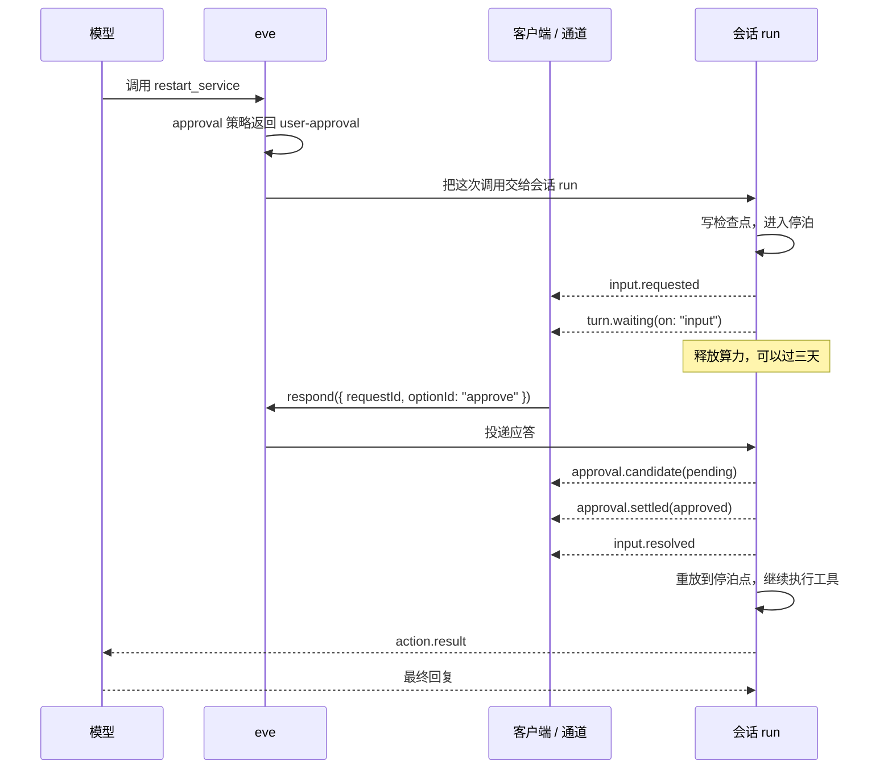

# 第 11 章 人机协同

> 两种停顿：工具要人批准（approval），模型要人回答（question）。两者共用同一套「暂停 → 停泊 → 恢复」协议，turn 不会断，`turnId` 不变。

## 11.1 两种停顿，一套协议

| | approval | question |
| --- | --- | --- |
| 谁发起 | 工具定义里的策略（在 `execute` 之前） | 模型（调用 `ask_question` 或 workflow 工具里的 `ctx.ask`） |
| 停在哪 | 工具还没开始跑 | 工具跑到一半 |
| 人看到什么 | 批准 / 拒绝 | 选项或自由文本 |
| 拒绝的后果 | 工具不执行，模型收到拒绝理由 | 模型拿到 `cancelled` 或新消息 |

共同点：都发 `input.requested`，都让 turn 进入 `turn.waiting(on: "input")`，都由 `input.resolved` 恢复，`turnId` 不变。

## 11.2 approval 只有两种形态

这是全章最容易看晕的地方。`approval` 的类型只有两个分支：

```ts
// eve/tools/approval 的类型（简化）
type ToolApproval<T> =
  | ApprovalPolicy<T>                                  // 形态一：函数
  | {
      request: ApprovalPolicy<T>;                      // 形态二：对象
      response?: ApprovalResponsePolicy<T>;
      prompt?: ApprovalPrompt<T>;                      // ({ input, toolName, callId }) => string
    };
```

| 形态 | 长什么样 | 能表达什么 |
| --- | --- | --- |
| **函数** | `approval: always()` 或 `approval: myPolicy` | 只决定「要不要停」 |
| **对象** | `approval: { request, prompt?, response? }` | 要不要停 + 给人看什么 + 谁有资格批 |

关键点：`always()` / `once()` / `never()` / `auto()` **本身就是一个函数**（返回 `ApprovalPolicy`），所以它们既能直接当 `approval`，也能放进对象的 `request` 字段。这不是两种写法，是同一个东西的两个位置。

### 本章的写法约定

为了避免同一份代码里混用，本章统一按这三条来：

```ts
// ① 只需要「要不要停」→ 直接放 helper 调用
approval: always()

// ② 需要文案或审批人 → 对象形态，request 里放 helper
approval: {
  request: always(),
  prompt: ({ input }) => `重启 ${input.service}？`,
}

// ③ 需要按输入/调用者判断 → 具名策略函数，再放进去
const costBasedApproval: ApprovalPolicy<{ sql: string }> = ({ toolInput }) => /* … */;
approval: costBasedApproval

// ③ 同时还要文案 → 具名函数进 request
approval: { request: costBasedApproval, prompt: describeCost }
```

另外两条格式约定：`approval` 字段固定放在 `inputSchema` 之后、`execute` 之前；策略函数一律具名（`const xxx: ApprovalPolicy<T> = ...`），不写内联箭头——内联箭头在需要类型标注或复用时没法处理。

### 同一个工具的三种写法

```ts
// 版本 A：只 gate
export default defineTool({
  description: "重启一个服务的所有实例。",
  inputSchema: z.object({ service: z.string() }),
  approval: always(),
  async execute({ service }) { return restart(service); },
});

// 版本 B：加文案（形态从函数升级为对象）
export default defineTool({
  description: "重启一个服务的所有实例。",
  inputSchema: z.object({ service: z.string() }),
  approval: {
    request: always(),
    prompt: ({ input }) => `重启 ${input.service}？约 10-30 秒不可用。`,
  },
  async execute({ service }) { return restart(service); },
});

// 版本 C：按输入决定，再加文案
const restartApproval: ApprovalPolicy<{ service: string }> = ({ toolInput }) =>
  toolInput?.service.startsWith("payment-") ? "user-approval" : "not-applicable";

export default defineTool({
  description: "重启一个服务的所有实例。",
  inputSchema: z.object({ service: z.string() }),
  approval: {
    request: restartApproval,
    prompt: ({ input }) => `重启 ${input.service}？约 10-30 秒不可用。`,
  },
  async execute({ service }) { return restart(service); },
});
```

三个版本是递进关系，不是三选一：**需要哪一层就停在哪一层**。

## 11.3 四个现成策略

| Helper | 行为 | 返回 |
| --- | --- | --- |
| `never()` | 从不要求审批 | `"not-applicable"` |
| `once()` | 同一会话内第一次要求，之后自动放行 | 首次 `"user-approval"`，之后 `"not-applicable"` |
| `always()` | 每次调用都要 | `"user-approval"` |
| `auto()` | 用决策模型判断这次调用的风险 | `"approved"` 或 `"user-approval"` |

### 默认值是最危险的设定

不写 `approval` 就等于 `never()`。源码里就是这一句：

```ts
if (definition.approval === undefined) return;   // 没有策略 = 不拦
```

涉及资金、删除、对外发消息、改变生产状态的工具，必须显式挂策略。

### `once()` 记的是什么

`once()` 判断的是「这个工具名是否已经在本会话的 `approvedTools` 集合里」。所以：

- 同一会话内第二次调用同一个工具，自动放行。
- **同一个 step 里并发发起三个调用，三个都会弹**——因为批准记录要等已存在的待批请求全部解决后才写入。
- 想按输入粒度记忆（比如「这个服务批过一次，换个服务还要再批」），用工具定义上的 `approvalKey`：

```ts
approvalKey: ({ service }) => `restart:${service}`,
```

### `auto()` 的细节

```ts
approval: auto({
  model: "typesafe-ai/jev",        // 默认值
  instructions: "判断这笔退款是否需要财务审批。",
  criteria: {
    clear: "可以自动执行。",
    caution: "必须人工审核。",
  },
}),
```

实现上的几个硬约束：

- 决策模型只看工具名和输入，输入序列化后超过 **64 KiB** 直接要求人工（不截断后判断）。
- 决策调用有 **30 秒**超时；超时、抛错、返回不合法，一律按 `user-approval` 处理（fail closed）。
- `clear` → `"approved"`（自动执行），`caution` → `"user-approval"`。
- 工具输入会发给决策模型的供应商。敏感数据要么别用 `auto()`，要么先把输入裁剪干净。

## 11.4 自定义策略：函数形态

### 能拿到什么

`ApprovalContext` 在 `ToolContext` 的基础上，多了判断所需的字段：

| 字段 | 用途 |
| --- | --- |
| `session.auth.current` | 当前 turn 的调用者 |
| `session.auth.initiator` | 创建会话的人 |
| `toolName` | 最终运行时工具名（连接工具带 `<connection>__` 前缀） |
| `toolInput` | 校验过的输入；**可能是 `undefined`** |
| `approvedTools` | 本会话已批准的工具集合（`once()` 靠它） |
| `callId` | 本次调用的 ID |
| `abortSignal` | turn 被取消时触发，异步判断要用它 |
| `toolAnnotations` | 仅连接工具：服务端声明的 `readOnlyHint` 等提示 |

### 能返回什么

| 返回 | 含义 |
| --- | --- |
| `"user-approval"` | 停下来等人 |
| `"not-applicable"` | 直接执行 |
| `"approved"` | 自动批准（不弹窗） |
| `"denied"` | 自动拒绝 |
| `{ type: "denied", reason }` | 带理由的拒绝，模型能看到理由 |
| `true` / `false` | 兼容旧写法：`true` = 要审批，`false` = 直接执行 |

### 一个完整的策略

```ts
// agent/tools/refund_charge.ts
import { defineTool } from "eve/tools";
import { type ApprovalPolicy } from "eve/tools/approval";
import { z } from "zod";

type RefundInput = { tenantId: string; chargeId: string; amount: number };

// 跨租户直接拒绝；同租户超过 1000 才要人批
const refundApproval: ApprovalPolicy<RefundInput> = ({ session, toolInput }) => {
  const callerTenant = session.auth.current?.attributes.tenantId;

  if (callerTenant === undefined || callerTenant !== toolInput?.tenantId) {
    return { type: "denied", reason: "调用者无权访问该租户。" };
  }
  return (toolInput.amount ?? 0) > 1000 ? "user-approval" : "not-applicable";
};

export default defineTool({
  description: "给一笔收费退款。",
  inputSchema: z.object({
    tenantId: z.string(),
    chargeId: z.string(),
    amount: z.number().positive(),
  }),
  approval: refundApproval,
  async execute({ chargeId, amount }) {
    return refund(chargeId, amount);
  },
});
```

**身份只从 `session.auth` 取，绝不从 `toolInput` 取。** 上面用 `toolInput.tenantId` 只是为了和调用者身份做**比对**，不是把它当身份。

`current` 和 `initiator` 的区别：共享 Slack 线程里，张三创建了会话（initiator），李四接着说话（current）。按「谁在操作」判断用 `current`，按「会话归谁」判断用 `initiator`。

## 11.5 提示文案与审批人：对象形态

对象形态只多两个可选字段，其余和函数形态一样。

### `prompt`：审批人看到什么

```ts
approval: {
  request: always(),
  prompt: ({ input, toolName, callId }) =>
    `重启 ${input.service}？\n影响：全部实例滚动重启，约 10-30 秒不可用。`,
},
```

`prompt` 收到三个东西：校验过的 `input`、最终的 `toolName`、`callId`。默认文案是「Approve <工具标签>?」，信息量太低——审批人需要知道自己在批什么，尤其是影响范围。

Slack 会把完整工具输入折叠成 **Tool input** 块，审批人还能展开看原始结构。

### `response`：谁有资格批

默认只有**发起这个 turn 的人**能批准或取消。要改：

```ts
import { type ApprovalResponsePolicy } from "eve/tools/approval";

// 只有 on-call 组能批；其他人提交会被拒绝，请求保持待处理
const onCallOnly: ApprovalResponsePolicy<RefundInput> = ({ response }) => {
  const roles = response.principal.attributes.roles;
  const isOnCall = Array.isArray(roles) && roles.includes("oncall");

  return isOnCall
    ? { status: "allowed" }
    : { status: "rejected", reason: "只有 on-call 可以批准退款。" };
};
```

`response` 策略收到的字段：

| 字段 | 含义 |
| --- | --- |
| `request.requestId` / `callId` / `toolName` / `toolInput` | 待批的调用 |
| `request.principal` | **发起**这次调用的人（未认证时为 `null`） |
| `response.decision` | `"approve"` 或 `"cancel"` |
| `response.principal` | **提交**这次应答的人 |
| `session` | 会话身份与血缘（`id`、`initiator`、`parent`、`turn`） |
| `auth` | 绑定到应答者的 `getToken` / `requireAuth` |

四条行为：

- `{ status: "allowed" }` 接受这个决定。
- `{ status: "rejected", reason }` 让请求**保持待处理**，其他合格审批人还能处理。
- 策略对 `approve` 和 `cancel` 都会跑。只想限制批准，就对 `cancel` 直接放行。
- 被拒绝时不会发 `session.waiting`，turn 继续挂着。

### 只允许发起人自己批

```ts
import type { SessionAuthContext } from "eve/context";

function samePrincipal(a: SessionAuthContext, b: SessionAuthContext): boolean {
  return (
    a.authenticator === b.authenticator &&
    a.issuer === b.issuer &&
    a.principalType === b.principalType &&
    a.principalId === b.principalId
  );
}

const requesterOnly: ApprovalResponsePolicy = ({ request, response }) =>
  request.principal !== null && samePrincipal(response.principal, request.principal)
    ? { status: "allowed" }
    : { status: "rejected", reason: "只有发起人可以批准。" };
```

比较四个字段，不能只比 `principalId`——两个认证系统里可能都有 `u_42`。

## 11.6 审批 ≠ 借用身份

这是设计上最值得注意的一点：

> 审批只是**同意**。批准后的工具调用仍然以**发起人**的身份、连接和凭据运行，审批人的权限不会被借出去。

```ts
// 只有明确需要「以审批人身份操作」时才用 ctx.approval
async execute({ repo }, ctx) {
  const admin = await ctx.approval?.responder.getToken(github);
  if (admin === undefined) throw new Error("需要 IT 管理员批准。");
  return grantAccess(repo, ctx.session.auth.current, admin.token);
}
```

- `ctx.approval` 只存在于**经过审批的 `defineTool` 调用**里。不需要审批的调用没有它，workflow 工具也没有。
- `ctx.session.auth.current` 始终是**发起人**，不会变成审批人。
- `ctx.approval.responder.getToken()` **不会**发起登录。审批人没 token 时抛 `ConnectionAuthorizationFailedError`，`reason: "approver_authorization_required"`。

这个字段从 `eve@0.79.1` 起可用。更早的版本上写 `ctx.approval` 会类型报错，只能退回到在 `approval.response` 里把审批人记到自己的存储，工具执行时再查。

## 11.7 defineWorkflowTool：能挂起的工具

前面所有例子都是 `defineTool`。它的 `execute` 在一次 step 里跑完，跑完之前 turn 一直等着。需要**在工具内部持久等待**（等人、等 webhook、等定时），或者**让对话先继续、结果稍后送到**时，用 `defineWorkflowTool`。

### 和 defineTool 的差别

| | `defineTool` | `defineWorkflowTool` |
| --- | --- | --- |
| 执行位置 | 发起它的那个 step 内 | 独立的 durable workflow run |
| 能否持久等待 | 否，只能阻塞 turn | 是，`ctx.ask` / `sleep` / webhook |
| 等待时占算力 | 占（turn 卡在这里） | 不占（workflow 挂起，进程可退） |
| 对话能否继续 | 不能 | `task` 入口可以 |
| 可用 `ctx.getSandbox()` | 可以 | **不可以** |
| 可用 `ctx.ask` / `ctx.agent` | 不可以 | 可以 |

一个判断口诀：**工具里需要「等」，而且等的可能是几小时甚至几天 → workflow 工具；否则用 `defineTool`。**

### 三个入口点，只能选一个

```ts
// ① execute：阻塞 turn，跑完才回话
async execute(input, ctx) { "use workflow"; /* … */ return result; }

// ② task：立刻返回收据，结果稍后以 task.result 消息送达
async task(input, ctx) { "use workflow"; /* … */ return result; }

// ③ serve：可续接的任务，模型可以按 taskId 继续给它发消息
async serve(receive, ctx) { "use workflow"; /* … */ }
```

`defineWorkflowTool` 的字段：

| 字段 | 类型 | 必填 | 说明 |
| --- | --- | --- | --- |
| `description` | `string` | 是 | 模型靠它决定调不调 |
| `inputSchema` | Standard Schema / JSON Schema | 是 | 入参。**必须是 JSON 对象**，不能是数组或标量 |
| `execute` | `(input, ctx) => Promise<T> \| AsyncIterable<T>` | 三选一 | 阻塞 turn，跑完才回话 |
| `task` | 同上 | 三选一 | 立刻返回收据，结果稍后以 `task.result` 送达 |
| `serve` | `(receive, ctx) => Promise<T>` | 三选一 | 可续接任务，模型可按 `taskId` 追加消息 |
| `outputSchema` | JSON Schema | 否 | 返回值类型 |
| `approval` | `ApprovalPolicy \| { request, response?, prompt? }` | 否 | 审批。**在 workflow 启动之前生效** |
| `approvalKey` | `(input) => string` | 否 | 审批记忆的键 |
| `toModelOutput` | `(output) => ToolModelOutput` | 否 | 模型看到的投影（`task` 投影的是结果，不是收据） |
| `deferred` | `boolean`，默认 `false` | 否 | 不进工具列表 |
| `availableInSubagents` | `boolean`，默认 `true` | 否 | `false` 时委派会话拿不到 |
| `label` | `{ start, delta?, complete? }` | 否 | UI 活动文案 |

**没有 `endsTurn`**：workflow 工具在构建期拒绝它（和 `execution` 一样，后者会提示改用 `task`）。

| 入口 | 模型看到什么 | 什么时候用 |
| --- | --- | --- |
| `execute` | 普通工具调用，等结果 | 流程必须拿到结果才能继续（比如「部署完再告诉我成功没」） |
| `task` | 立刻收到 `Started task deploy-4hd8sa. Its result will arrive in a <task_result> message.` | 长任务，模型可以先干别的 |
| `serve` | 收据里带 `taskId`，之后可以继续发消息 | 需要来回改（比如「草案 → 按意见修改 → 再改」） |

`task` 和 `serve` 的调用都会变成 task：turn 在任务跑完之前不能结束；模型用 `eve__task_wait` 等结果、`eve__task_cancel` 停任务；取消时 run 最多等 30 秒让 body 收尾。

#### `serve` 长什么样

`serve` 不接收输入，而是从 `receive()` 一个个取调用：

```ts
type Plan = { summary: string };

export default defineWorkflowTool({
  description: "起草发布计划，并按意见修改。",
  inputSchema: z.object({ request: z.string() }),

  async serve(receive, ctx) {
    "use workflow";
    let plan: Plan | undefined;

    for (;;) {
      const { input, abortSignal } = await receive();   // 第一次是发起调用，之后是按 taskId 续接
      try {
        plan = await revise(plan, input.request, { signal: abortSignal });
        ctx.reply(plan);          // 交回一次结果，任务回到空闲
      } catch (error) {
        if (!abortSignal.aborted) throw error;          // 被取消就等下一次调用
      }
    }
  },
});
```

三条 `serve` 特有的规则：

- **`receive()` 的第一次调用立刻返回**（就是启动任务的那次），不产生等待。之后每次按 `taskId` 到达的调用按顺序返回。
- **eve 会自动往模型输入里加一个可选的 `taskId`**，并在工具描述里补一句说明。所以 `inputSchema` 里**不能**自己声明 `taskId`，构建会失败。
- **`taskId` 必须指向这个工具启动过、且还没结束的任务**，否则调用失败（`UNKNOWN_TASK`）。任务结束后用旧 `taskId` 会失败；不带 `taskId` 才是开新任务。

### 五条硬规则

```ts
export default defineWorkflowTool({
  description: "…",
  inputSchema: z.object({ service: z.string() }),

  async execute({ service }, ctx) {
    "use workflow";                    // ① 必须是第一句
    const plan = await buildPlan(service);   // ② 副作用放 step
    await sleep("10m");                // ③ 持久等待
    return applyPlan(plan);
  },
});

async function buildPlan(service: string) {
  "use step";                          // ④ 标记为持久步骤
  // process.env、时钟、随机、Node API 都在这里
}
```

1. **`"use workflow"` 必须是执行体的第一条语句。** 缺了是构建错误，即使同模块别的函数有。
2. **`"use step"` 标记顶层 `async function`。** 副作用、`process.env`、时钟、随机数、Node API 只能放这里。
3. **workflow 主体会被重放，必须确定性。** 等待之后还要用的值放局部变量——重放会重建它们，但不会重跑已完成的 step。
4. **只能定义一个入口点。** `execute` / `task` / `serve` 三选一，多写或都不写会在定义时抛错。
5. **输入必须是 JSON 对象，且只能静态定义。** 不能从 `defineDynamic` 返回；`defineWorkflowTool` 也不接受 `endsTurn` 和 `execution`（后者会提示改用 `task`）。

从 `workflow` 导入的是 `sleep`、`createHook`、`createWebhook`、`FatalError`；`start`、`getRun`、`resumeHook` 属于 `workflow/api`，只能在 step 里用。类型提示要在 `tsconfig.json` 的 `types` 里加 `eve/workflow-modules`。

### 上下文：workflow 里能拿到什么

| 字段 | 说明 |
| --- | --- |
| `ctx.session` | 会话身份、turn、auth |
| `ctx.callId` / `ctx.toolName` | 本次调用 |
| `ctx.abortSignal` | 调用被取消 / steering 时触发 |
| `ctx.ask(request, options?)` | 问人，返回 `{ status, optionId?, text? }` |
| `ctx.agent(name)` | 开一个子代理会话（`.send()` → `.result()`） |
| `ctx.agents` | 可调用的 agent 注册表 |
| `ctx.getToken(provider)` / `requireAuth` | 连接凭据 |

`serve` 的 `ctx` 没有 `callId` 和 `abortSignal`——这两个随每次 `receive()` 拿到的调用传入，因为一个 serve 任务会服务很多次调用。

**没有 `ctx.getSandbox()`。** workflow 主体和 `"use step"` 函数都不在沙箱上下文里。需要跑命令就把它写成一个普通工具，让模型去调；或者在 step 里调外部服务。

`"use step"` 函数如果直接收 `ctx`，拿到的是更窄的 `WorkflowStepToolContext`：只有 `session`、`callId`、`toolName`、`abortSignal`、`getToken`、`requireAuth`。`ctx.ask`、`ctx.agent`、`ctx.agents` 只能在 workflow 主体里用。

### 进度与返回值

`execute` / `task` 可以写成 async generator：

| 写法 | 行为 |
| --- | --- |
| `yield value` | 发 `action.partial` 快照，**不进模型历史** |
| `return value` | 工具结果 |
| 没有 `return` | 用最后一次 `yield` 当结果；一次都没 yield 就是 `null` |
| `return null` | 同样回退到最后一次 `yield` |

```ts
async *execute({ note, delay }, ctx) {
  "use workflow";
  yield { status: "准备提醒" };     // 进度
  await sleep(delay);               // 持久等待
  return { reminder: note };        // 结果
}
```

注意：`yield` **不是等待**。它只是把快照交出去然后继续执行。要挂起必须 `await` 一个工作流操作（`ctx.ask`、`sleep`、hook、webhook）。

### 错误与取消

- 抛错 → 这个调用失败，模型收到错误；run 按 step 重试策略处理（第 10 章）。
- `FatalError`（从 `workflow` 导入）→ 标记为不可重试的失败：跳过 step 重试，直接让这次调用失败。
- `ctx.abortSignal` 在取消、steering、turn 失败、会话结束时触发。清理放 `try/finally`：

```ts
async execute({ projectId }, ctx) {
  "use workflow";
  const jobId = await submitRender(projectId);
  try {
    return await waitForRender(jobId, ctx.abortSignal);
  } finally {
    await cancelRender(jobId);      // 取消时也要收尾
  }
}
```

steering 只影响 `execute` 调用，**不会中断 `task`**。

### 审批挂在哪一层

这是最容易设计错的地方。`defineWorkflowTool` 也接受 `approval`，而且**审批在 workflow 启动之前**：

```ts
export default defineWorkflowTool({
  description: "把服务部署到生产环境。",
  inputSchema: z.object({ service: z.string(), version: z.string() }),
  approval: {
    request: always(),
    prompt: ({ input }) => `部署 ${input.service}@${input.version} 到生产？`,
  },
  async execute({ service, version }, ctx) {
    "use workflow";                   // 批准之后才走到这里
    return deploy(service, version);
  },
});
```

对比两种「确认」：

| | `approval`（工具级） | `ctx.ask`（流程内） |
| --- | --- | --- |
| 时机 | 调用之前，workflow 还没启动 | workflow 跑到中途 |
| 被拒绝 | 工具完全不执行 | 由 body 自己决定怎么处理 |
| 适合 | 「这个动作能不能做」 | 「做到这一步了，下一步选哪个」 |

一个部署工具通常两个都要：`approval` 管「要不要部署」，`ctx.ask` 管「部署到一半发现指标异常，继续还是回滚」。

### 完整例子：带审批、进度、两步确认的部署

```ts
// agent/tools/deploy_service.ts
import { defineWorkflowTool } from "eve/tools";
import { always } from "eve/tools/approval";
import { sleep } from "workflow";
import { z } from "zod";

type Plan = { id: string; summary: string };

export default defineWorkflowTool({
  description: "把服务部署到指定环境。部署前需要人工批准，过程中可能再次确认。",
  inputSchema: z.object({
    service: z.string(),
    environment: z.enum(["preview", "production"]),
    version: z.string(),
  }),

  // 第一道关：动作本身要不要做
  approval: {
    request: always(),
    prompt: ({ input }) =>
      `部署 ${input.service}@${input.version} 到 ${input.environment}？`,
  },

  async *execute({ service, environment, version }, ctx) {
    "use workflow";

    yield { phase: "生成部署计划" };
    const plan: Plan = await buildPlan(service, version);

    // 第二道关：计划没问题吗
    const ok = await ctx.ask({
      prompt: `部署计划：\n${plan.summary}\n\n开始执行？`,
      display: "confirmation",
      options: [
        { id: "go", label: "开始部署", style: "primary" },
        { id: "stop", label: "取消", style: "danger" },
      ],
    });
    if (ok.status !== "answered" || ok.optionId !== "go") {
      return { deployed: false, reason: "operator cancelled" };
    }

    yield { phase: "部署中" };
    const result = await applyPlan(plan);       // "use step"

    yield { phase: "观察指标" };
    await sleep("5m");                          // 持久等待，不占算力
    const health = await checkHealth(service);  // "use step"

    if (!health.ok) {
      const rollback = await ctx.ask({
        prompt: `部署后错误率 ${health.errorRate}%，回滚？`,
        display: "confirmation",
        options: [
          { id: "rollback", label: "回滚", style: "danger" },
          { id: "keep", label: "保持观察" },
        ],
      });
      if (rollback.status === "answered" && rollback.optionId === "rollback") {
        await rollbackDeploy(plan);             // "use step"
        return { deployed: false, rolledBack: true, health };
      }
    }

    return { deployed: true, environment, health };
  },
});

async function buildPlan(service: string, version: string): Promise<Plan> {
  "use step";
  return computePlan(service, version);
}

async function applyPlan(plan: Plan): Promise<{ url: string }> {
  "use step";
  return runDeploy(plan);      // 幂等：用 plan.id 做上游幂等键
}

async function checkHealth(service: string) {
  "use step";
  return fetchHealth(service);
}

async function rollbackDeploy(plan: Plan): Promise<void> {
  "use step";
  return rollback(plan);
}
```

这个例子里，三个机制各司其职：

- `approval` 拦住「不该部署」。
- `ctx.ask` 处理「部署到一半的判断」。
- `sleep` + `yield` 让流程能挂 5 分钟观察指标，同时给用户看进度。

## 11.8 提问：`ask_question` 与 `ctx.ask`

两个东西经常被混：

| | `ask_question`（工具） | `ctx.ask()`（workflow 内） |
| --- | --- | --- |
| 谁调用 | 模型 | 你的 workflow body |
| 返回给谁 | 模型，`{ status: "answered", answer }` | 代码，`{ status: "answered", optionId?, text? }` |
| 返回字段 | `answer`（选项 label 或用户原话） | `optionId` / `text` |
| 适合 | 模型自己判断需要澄清 | 流程需要人做个决定 |

装 `ask_question`：

```bash
eve add tool/ask_question
```

```ts
// agent/tools/ask_question.ts
import { askQuestion } from "eve/tools/ask_question";

export default askQuestion();
```

模型调用时传 `{ question, options? }`：

| 字段 | 类型 | 必填 | 说明 |
| --- | --- | --- | --- |
| `question` | `string` | 是 | 问题本身，要带足够上下文 |
| `options` | `{ label: string; description: string }[]` | 否 | 两到三个互斥选项；不传就是开放式问题 |

选项不带 `id`——`ask_question` 内部把 `label` 当标识，模型拿到的是 `answer`（选项 label 或用户原话）。用户永远可以自己打字回答，所以不需要「其他」选项。

`ctx.ask` 的完整签名：

```ts
const answer = await ctx.ask(
  {
    prompt: string,
    display?: "confirmation" | "select" | "text",
    options?: { id: string; label: string; description?: string; style?: "primary" | "danger" | "default" }[],
    allowFreeform?: boolean,
  },
  { signal?: AbortSignal },
);
// { status: "answered"; optionId?: string; text?: string }
// | { status: "cancelled" }
// | { status: "unavailable" }
```

请求对象的字段：

| 字段 | 类型 | 必填 | 说明 |
| --- | --- | --- | --- |
| `prompt` | `string` | 是 | 展示给人看的完整问题 |
| `display` | `"confirmation" \| "select" \| "text"` | 否 | 渲染提示：确认框 / 下拉 / 文本框 |
| `options` | `{ id, label, description?, style? }[]` | 否 | 选项。`id` 是回传值，`label` 是人看到的 |
| `allowFreeform` | `boolean` | 否 | 允许不选选项直接打字 |

选项的 `style` 取值 `"primary"` / `"danger"` / `"default"`，只影响按钮样式。**`id` 要能单独读得通**（`approve` 而不是 `opt1`），因为回传只带 `id`；有人在旧界面上答晚了，模型会把这个 `id` 当成一条新消息收到。

第二个参数目前只有 `signal`。

三个返回值的含义：

- `answered`：人选了选项（`optionId`）或打了字（`text`）。
- `cancelled`：问题被撤回（signal 中止、调用被取消、serve 已经 reply）。
- `unavailable`：会话无法请求输入（定时任务）。**这时不要重试，按默认路径继续。**

## 11.9 暂停与恢复协议



第 3 步和第 4 步之间的时间可以是任意长。这中间**没有任何进程在等**——run 的状态在存储里，进程可以退出、重启、换部署。恢复时不是「接着内存里的调用栈」，而是从检查点重放到停泊点（第 10 章）。

补充规则：

- 每个请求有 `kind`：`tool-approval`、`question`、`session-limit`。客户端按 `kind` 决定怎么渲染。
- 审批是**异步确认**：提交后要等 `approval.settled` 或 `input.resolved` 才算数。
- **第一个答案决定结果**（`eve@0.81` 起）。重复提交被丢弃，不会因为双击而把已取消的审批改回批准：先 Cancel 再 Approve，结果仍是取消。随决定一起发的备注（比如为什么取消）照常进模型。
- 带 `requester` 的调用，未认证的应答会被拒绝并给出反馈，不能抢在发起人前面替他决定。调用没有 `requester` 时，未认证应答按 `none()` 给匿名调用者的身份记录。
- 一个 turn 可以同时等多个请求。普通文本消息只回答**第一个**未答的请求。
- 审批请求时，来自该 turn 服务对象的不匹配消息会 steering 并撤销审批（`input.resolved` 的 `outcome: "ignored"`）。同一批里已经批准的调用仍会执行。
- 取消 turn 会撤回它的审批（`outcome: "cancelled"`），之后再回答那个请求不会批准任何东西。
- 卡片上的按钮所属会话已经失效（例如 run 在 eve 之外被取消）时，Slack / Teams / Telegram / Discord 一致地把按钮换成 `No longer active`，并私下告诉点击的人重新发一条消息。

## 11.10 客户端怎么接

浏览器里用 `eve/react` 的 `openConversationInputs()`，它已经帮你过滤掉 settled 的请求：

```tsx
import { openConversationInputs } from "eve/react";

const pending = openConversationInputs(agent.data).map((input) => input.request);

await agent.respond([
  { requestId: pending[0].requestId, optionId: "approve" },
]);
```

用 `Client` 的话，从 turn 结果的 `inputRequests` 里拿 `requestId`，`respond` 收的是**数组**：

```ts
const { session, response } = await client.sessions.create({
  message: "把 payment-api 重启一下",
});
const turn = await response.result();

const request = turn.inputRequests[0];
if (request) {
  const after = await session.respond([
    { requestId: request.requestId, optionId: "approve" },
  ]);
  await after.result();
}
```

拒绝时带理由：

```ts
await session.respond([
  { requestId: request.requestId, optionId: "cancel", text: "只批准三件套，别全量重启" },
]);
```

用原生 HTTP 就是：

```bash
curl -X POST http://localhost:2000/eve/v1/session/wrun_A \
  -H 'content-type: application/json' \
  -d '{"inputResponses":[{"requestId":"req_A","optionId":"approve"}]}'
```

拒绝时：

```json
{"inputResponses":[{"requestId":"req_A","optionId":"cancel","text":"只批准三件套，别全量重启"}]}
```

理由会引用给模型，并标明是拒绝人写的。

## 11.11 定时任务里的审批

定时任务用应用身份（`authenticator: "app"`、`principalId: "eve:app"`、`principalType: "runtime"`）跑。想让自动化跳过审批、但人来调时仍然要批：

```ts
const skipForSchedules: ApprovalPolicy = ({ session }) => {
  const auth = session.auth.current;
  return auth?.authenticator === "app" &&
    auth.principalId === "eve:app" &&
    auth.principalType === "runtime"
    ? "not-applicable"
    : "user-approval";
};
```

**危险**：跳过审批意味着非幂等的副作用会在 step 重放时再触发一次。配幂等键一起用。

反过来，markdown 形式的定时任务**根本不能请求输入**。如果它调到需要审批的工具，会话直接失败，不会挂起等待。这是有意的：没人看着的任务不应该无限期挂着。

## 11.12 完整例子：三道关

```ts
// agent/tools/rollback_deploy.ts
import { defineTool } from "eve/tools";
import { type ApprovalPolicy, type ApprovalResponsePolicy } from "eve/tools/approval";
import { z } from "zod";

type RollbackInput = { service: string; version: string; reason: string };

// 第二道：谁能批
const onCallOnly: ApprovalResponsePolicy<RollbackInput> = ({ response }) => {
  const roles = response.principal.attributes.roles;
  return Array.isArray(roles) && roles.includes("oncall")
    ? { status: "allowed" }
    : { status: "rejected", reason: "只有 on-call 可以批准回滚。" };
};

// 第一道：要不要批（这里恒为要，留出按服务细分的扩展点）
const rollbackApproval: ApprovalPolicy<RollbackInput> = () => "user-approval";

export default defineTool({
  description: "把服务回滚到指定版本。会重启全部实例。",
  inputSchema: z.object({
    service: z.string(),
    version: z.string().regex(/^v\d+\.\d+\.\d+$/),
    reason: z.string().min(10),
  }),
  approval: {
    request: rollbackApproval,
    prompt: ({ input }) =>
      `回滚 ${input.service} 到 ${input.version}？\n原因：${input.reason}\n` +
      `影响：滚动重启，约 30 秒部分不可用。`,
    response: onCallOnly,
  },
  label: { start: ({ service, version }) => `回滚 ${service} 到 ${version}` },
  async execute({ service, version, reason }, ctx) {
    const res = await fetch(`${process.env.OPS_API}/deployments/rollback`, {
      method: "POST",
      headers: {
        "content-type": "application/json",
        "idempotency-key": `rollback:${ctx.callId}`,   // 第三道：防重放
      },
      body: JSON.stringify({
        service,
        version,
        reason,
        requestedBy: ctx.session.auth.current?.principalId,
      }),
    });
    if (!res.ok) throw new Error(`回滚失败：${res.status} ${await res.text()}`);
    return { service, version, rolledBack: true };
  },
});
```

三个设计点：

1. `prompt` 写清影响范围——审批人需要知道自己在批什么。
2. `response` 限制谁能批——不能只靠「发起人」。
3. `execute` 传幂等键——审批不能防重放。

## 11.13 常见注意事项

**注意：以为不写 `approval` 就是安全的。**
默认 `never()`。危险工具必须显式声明。

**注意：把 `approval` 写成对象却忘了 `request`。**
对象形态里 `request` 是必填的。只想要文案？`request: always()` 也得写。

**注意：审批之后模型「忘了」之前的上下文。**
不会。审批是停泊不是重启，`turnId` 和上下文都保留。如果你看到上下文丢失，多半是别的地方 clear 或压缩了。

**注意：在共享 Slack 线程里，任何人都能批准。**
默认只有发起人能批。如果自定义了 `response` 策略又一律放行，就变成谁都能批。

**注意：用审批代替幂等。**
重放时审批已通过，工具会再跑。两者都要。

**注意：`ctx.approval` 在 workflow 工具里取。**
workflow 工具不接收 `ctx.approval`。需要审批人身份就用 `defineTool`。

**注意：`once()` 以为只弹一次。**
同一个 step 里并发发起三个调用时，三个请求都会弹。授权要等所有已存在的待批请求都解决之后才生效。

**注意：在 workflow body 里调 `ctx.getSandbox()`。**
workflow 上下文没有沙箱。要跑命令就写普通工具。

**注意：用 `yield` 当等待。**
`yield` 只发进度快照，不会挂起。要挂起就 `await sleep(...)` 或 `await ctx.ask(...)`。

**注意：在 `"use step"` 里调 `ctx.ask`。**
step 拿到的是窄上下文，没有 `ask`。提问要写在 workflow 主体里。

**注意：定时任务调用了要审批的工具，任务一直挂着。**
markdown 定时任务会直接失败。handler 形式的任务看它发到哪个通道。

**注意：`ask_question` 的选项写成四个以上。**
协议建议两到三个。太多选项在文本通道上无法渲染成可用 UI。

## 11.14 练习

1. 给 `restart_service` 依次改成三个版本（只 gate → 加文案 → 按服务名判断），观察每次的行为差异。
2. 把 `refundApproval` 改成具名策略，加一条「跨租户直接 denied」，用两个租户的假鉴权验证。
3. 加一个 `response` 策略，只允许 `roles` 含 `oncall` 的人批准，并验证其他人提交后请求仍然待处理。
4. 写一个 `defineWorkflowTool`，用 `approval` 做入口关、`ctx.ask` 做流程内确认、`sleep` 做持久等待，然后用 `Ctrl+C` 重启验证能续上。
5. 把同一个部署工具改成 `task` 入口，观察模型收到的收据和后续的 `task.result` 消息。

## 延伸阅读

- [Human-in-the-Loop](https://eve.dev/docs/human-in-the-loop)
- [Workflows as Tools](https://eve.dev/docs/tools/workflows)
- [Tools](https://eve.dev/docs/tools)
- [Multi-tenant Approvals](https://eve.dev/docs/patterns/multi-tenant-approvals)

---

上一章：[10 持久化执行](10-durability.md) · 下一章：[12 子代理](12-subagents.md)
