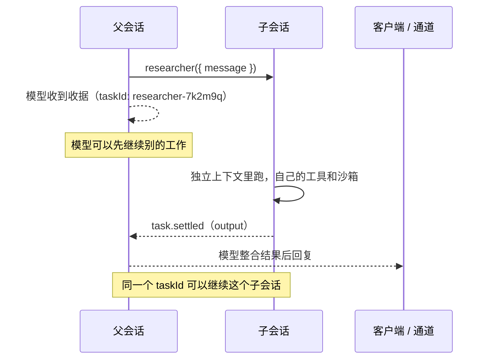

# 第 12 章 子代理

> 子代理是「另一个上下文里的 agent」。它的工作历史不会污染主对话，只把结论回传。三种形态：内置的根副本、声明的专家、远程部署。

## 12.1 为什么需要子代理

主 agent 的上下文是有限资源。三件事会把它撑爆：

| 问题 | 后果 |
| --- | --- |
| 一次排查要读 200 行日志 | 日志进了主对话，后面每一轮都在付这份 token |
| 工具面太宽（读、写、删都有） | 模型更容易误用危险工具 |
| 三件独立的事只能串行做 | 总时长翻倍 |

子代理分别对应这三种情况：**隔离上下文**、**收窄工具面**、**并行**。

代价是：子代理看不到父级的对话历史。所有它需要的信息必须打包进 `message`。这是设计上的硬边界，不是配置项。

## 12.2 三种子代理

| 形态 | 怎么来 | 上下文 | 工具面 | 沙箱 |
| --- | --- | --- | --- | --- |
| 内置 `agent` 工具 | 根会话默认就有 | 全新，看不到父级历史 | 继承父级（除根专属） | **复用父级** |
| 声明式子代理 | `agent/subagents/<name>/` | 全新，自己的指令 | 自己声明的 | 自己的 |
| 远程子代理 | `defineRemoteAgent` 指向另一个部署 | 全新，对方配置 | 对方的 | 对方的 |

三者对模型来说长得一样：都是一个 `{ message, taskId? }` 形状的工具。

## 12.3 内置 `agent` 工具

根会话不用配置就有。模型这样调用：

```ts
{
  message: string;   // 子代理需要的一切
  taskId?: string;   // 续接已有子代理
}
```

### 副本继承什么

内置 `agent` 创建的是根 agent 的**副本**：

| 继承 | 不继承 |
| --- | --- |
| 指令、连接、技能、钩子 | 对话历史（全新） |
| 工具（除了根专属的 `agent`） | `defineState` 的值（全新） |
| 沙箱（**共用同一个**） | 通道、定时任务 |

沙箱共用意味着：副本写的文件父级立刻能读到。好处是交接文件方便，坏处是并行开三个副本时，它们会往同一个目录里写。**给并行副本分配不重叠的写入范围。**

### 为什么它是根专属的

副本不能再调 `agent`，声明式子代理也拿不到它。如果一个陈旧的或强制的递归调用真的走到执行，eve 直接拒绝，不会启动新的子会话。

不想要这个能力：

```ts
// agent/agent.ts
export default defineAgent({
  model: "anthropic/claude-sonnet-5",
  tool: false,
});
```

注意 `tool: false` 只影响**模型能不能看到这个工具**。workflow 工具里仍然可以用 `ctx.agent("agent", ...)` 调根副本——`ctx.agents` 注册表不受影响。

### 什么时候用它

- 三件独立的事要并行（共享沙箱，注意写入范围）
- 想让一段探索过程不污染主对话，但需要同样的能力
- 临时委派，不想为它建目录

## 12.4 声明式子代理

需要**不同的提示、不同的工具面、不同的沙箱**时，建目录：

```text
agent/subagents/log-analyst/
├── agent.ts              # 必需，且必须写 description
├── instructions.md       # 可选
├── tools/                # 自己的工具
├── skills/               # 自己的技能
├── sandbox/              # 自己的沙箱 + workspace 种子
└── subagents/            # 可以再嵌套
```

```ts
// agent/subagents/log-analyst/agent.ts
import { defineAgent } from "eve";

export default defineAgent({
  description:
    "深入分析日志的专家。给它服务名、时间窗和怀疑方向，" +
    "它返回错误聚类、时间线和高置信度根因假设。不做修复建议。",
  model: "anthropic/claude-sonnet-5",
});
```

`description` 是**必填**的：父级模型靠它决定要不要委派。编译期会拒绝没写的子代理。

工具名就是目录名（`log-analyst`）。名字 `agent` 保留给内置副本，不能用。

子代理的 `agent.ts` 用的是同一个 `defineAgent`，但只有这几个字段对它有实际意义：

| 字段 | 类型 | 必填 | 说明 |
| --- | --- | --- | --- |
| `description` | `string` | **是** | 父模型看到的工具描述。写清输入、输出、边界 |
| `model` | 模型 ID / 模型对象 / `defineDynamic` | 是 | 子代理自己的模型，可以和父级不同 |
| `tool` | `true \| "deferred" \| false` | 否 | 是否暴露给父模型，默认 `true` |
| `reasoning` | `"low" \| "medium" \| "high" \| …` | 否 | 子代理自己的推理强度 |
| `limits` | 同 `defineAgent` | 否 | 子代理的额度。默认取父级剩余额度，且永远不会超过它 |
| `build` | `{ externalDependencies?: string[] }` | 否 | 打包控制 |
| `defaultTools` | `boolean` | 否 | 是否加可选默认工具 |

`instructions.md`、`tools/`、`skills/`、`sandbox/` 是目录约定，不写进 `agent.ts`。

### 隔离边界：什么都不继承

这是最容易误解的地方。**声明式子代理不继承父级任何手写能力。**

| 槽位 | 内置 `agent` 副本 | 声明式子代理 |
| --- | --- | --- |
| 指令 | 继承（同一 agent 的副本） | 自己的，或框架默认 |
| 工具 | 继承（除根专属） | 自己的 |
| 连接 | 继承 | 自己的 |
| 技能 | 继承 | 自己的 |
| 沙箱 | **复用父级** | 自己的，或框架默认 |
| 钩子 | 继承 | 自己的 |
| 扩展 | 继承 | 自己的 |
| state | 全新 | 全新 |
| 通道 / 定时任务 | 根专属 | 根专属 |

所以「我明明在根 agent 里配了 Linear 连接，子代理怎么用不了」——它就是不继承。要么在子代理目录里再声明一遍，要么把共享能力打成扩展包，在两个 agent 里各挂一次。

### 可见性：三种隐藏方式

| 写法 | 模型能看到 | 代码还能调 |
| --- | --- | --- |
| 默认 | 是 | 是 |
| `tool: "deferred"` | 不在工具列表，但能用 `eve__search` 找到 | 是 |
| `tool: false` | 否 | 是（`ctx.agent("name")`） |
| 同名 `disableTool()` | 否 | 是（`ctx.agent("name")`） |

`tool: false` 和 `disableTool()` 的区别在于**同名冲突的处理**：

- 默认情况下，`agent/subagents/researcher/` 和 `agent/tools/researcher.ts` 同名会冲突，静态的在构建时直接报错。
- 如果你就是想用一个手写工具包装这个子代理，把子代理设成 `tool: false`，手写工具成为模型可见的入口，`ctx.agent("researcher")` 仍然指向子代理。
- 用 `disableTool()` 则彻底移除模型可见的那一面。

### 嵌套

声明式子代理可以在自己的 `subagents/` 下再声明子代理。**没有深度限制**——嵌套到你的目录树为止。框架不设 `maxSubagentDepth`。

### 按条件暴露

```ts
// agent/subagents/finance/agent.ts
import { defineAgent, defineDynamic } from "eve";

export default defineDynamic({
  events: {
    "session.started": (_event, ctx) =>
      ctx.session.auth.current?.attributes.plan === "enterprise"
        ? defineAgent({
            description: "分析财务和会计数据。",
            model: "anthropic/claude-sonnet-5",
          })
        : null,          // 不给这个会话
  },
});
```

只支持 `session.started` 和 `turn.started`。返回 `null` 或 `undefined` 表示不暴露。

打包配置（`build.externalDependencies`）必须写在**外层** `defineDynamic` 上，因为它要在解析器运行之前生效。

## 12.5 模型看到的是一次任务

每个工具化的子代理都被压成同一个形状：

```ts
{
  message: string;   // 子代理需要的一切
  taskId?: string;   // 续接
}
```

工具描述 = 子代理的 `description` + 一句框架追加的说明（「它看不到你的对话；用 `taskId` 可以续接」）。所以你写 `description` 时不用重复这两句。

一次委派在两个会话和一条通道之间是这样走的：



`task.started` / `task.settled` 出现在**父会话的流**上，`agent.started` 带着子会话的 `streamPath`。父级模型看到的是收据和结果，看不到子会话的中间步骤。

### 收据

调用立刻返回收据，不是结果：

```text
Started task researcher-7k2m9q. Its result will arrive in a <task_result> message.
Started task researcher-7k2m9q. Its result will arrive in a <task_result> message. To send it another message, call researcher again with taskId researcher-7k2m9q.
Sent to task researcher-7k2m9q. Its reply will arrive in a <task_result> message.
```

任务 id 的格式是 **工具名 + 6 个字符**。模型靠它续接。

### 结果

子代理的回复以 `<task_result>` 块的形式到达，包在 `task.result` 消息里：

```text
<task_result id="researcher-7k2m9q" tool="researcher" status="completed">{"rootCause":"…"}</task_result>
```

到达时机：下一个 step 边界、`eve__task_wait` 返回之后、或停泊的 turn 恢复时。一条消息里的所有结果共享 **50 KB / 2000 行**预算，超了截断并标 `[truncated]`。

### turn 不会在任务运行时结束

模型如果提前写完了文本，eve 会挂住 turn（`turn.waiting`，`on: "tasks"`），等结果到了再继续。子会话里的提前输出会被标成 `finishReason: "tool-calls"`，通道不会把它当成最终回复发出去。

模型有两个工具：

| 工具 | 作用 |
| --- | --- |
| `eve__task_wait({ timeoutSeconds? })` | 主动挂起等任意任务出结果；已经有结果就立刻返回 |
| `eve__task_cancel({ taskId })` | 停掉任务的当前工作，保留会话 |

框架还会往对话里注入一条 `[Tasks]` 注记，列出正在跑和空闲的任务及 `taskId`，所以模型知道该续哪个。

## 12.6 继续同一个子代理

子代理答完不会销毁，它**停在那里保留会话和历史**。

```text
模型：log-analyst({ message: "先看 payment-api 最近一小时" })
  → taskId: log-analyst-4hd8sa

模型：log-analyst({ message: "再看它的下游 inventory", taskId: "log-analyst-4hd8sa" })
  → 同一个子代理，带着上一轮的上下文
```

规则：

| 情况 | 行为 |
| --- | --- |
| 不传 `taskId` | 开新子代理 |
| 传一个不存在或已结束的 `taskId` | `UNKNOWN_TASK` |
| 传给正在工作的子代理 | 加入它当前的 turn，那一轮的最终回复同时结算两个调用 |
| 传 `taskId` 时子代理刚好答完 | 消息开启它的下一轮，那一轮的回复结算两个调用 |
| `eve__task_cancel({ taskId })` | 取消当前 turn，保留对话，之后还能续 |

**每次续接用发送者的鉴权。** 后续 turn 可以由另一个人发起，子代理按那个人的身份运行。

生命周期：父级为每个子代理保留到**父会话结束**，然后重置本地子会话、给远程子会话发认证过的重置请求。远程重置是尽力而为——对方部署不可达时，子代理会挂到它自己的会话超时。

## 12.7 用 workflow 工具编排

需要「等结果再决定下一步」时，从 workflow 工具里调。`ctx.agent(name)` 返回的是**会话**，不是结果：

```ts
// agent/tools/review_and_ship.ts
import { defineWorkflowTool } from "eve/tools";
import { z } from "zod";

export default defineWorkflowTool({
  description: "先让评审子代理审查改动，通过后再发布。",
  inputSchema: z.object({ pr: z.number() }),

  async execute({ pr }, ctx) {
    "use workflow";

    const reviewer = ctx.agent("code-reviewer");
    const response = await reviewer.send(
      `审查 PR #${pr}，判断是否可以发布。`,
      {
        outputSchema: z.object({
          approved: z.boolean(),
          issues: z.array(z.string()),
        }),
        signal: ctx.abortSignal,
      },
    );
    const { data, status, error } = await response.result();

    if (status === "failed") {
      return { shipped: false, reason: error?.message ?? "review failed" };
    }
    if (data === undefined || !data.approved) {
      return { shipped: false, issues: data?.issues ?? [] };
    }
    return { shipped: true, result: await ship(pr) };
  },
});

async function ship(pr: number) {
  "use step";
  return doShip(pr);
}
```

三个容易混的点：

1. **authored workflow 工具里 `ctx.agent(name)` 返回会话**（`.send()` → `.result()`）。只有在**模型写的运行时程序**里（`workflow({ maxSubagents })` 工具的 `js` 输入），`ctx.agent(name, { message, outputSchema })` 才直接 resolve 成结果。同名不同形。
2. `result()` 返回 `{ data, message, status, error? }`。请求了 `outputSchema` 就有 `data`，否则看 `message`。
3. 取消 turn 会中止这次 send（传 `signal: ctx.abortSignal`），子代理的 turn 报 `cancelled`，`status` 是 `"waiting"` 而不是 `"failed"`。

`ctx.agent(name)` 只收一个名字。`session.send(message, options)` 的选项：

| 选项 | 类型 | 说明 |
| --- | --- | --- |
| `outputSchema` | Standard Schema / JSON Schema | 要求这一轮返回结构化结果，落到 `result.data` |
| `signal` | `AbortSignal` | 中止这一轮。turn 仍会报告，状态是 `waiting` |

`result()` 的返回值：

| 字段 | 类型 | 说明 |
| --- | --- | --- |
| `data` | `TOutput \| undefined` | 请求了 `outputSchema` 时的结构化结果 |
| `message` | `string \| undefined` | 没请求结构化输出时的最终文本 |
| `status` | `"waiting" \| "completed" \| "failed"` | 子会话的走向。取消后是 `waiting` |
| `error` | `{ message } \| undefined` | 只在 `failed` 时出现 |

### 并行

```ts
const [a, b] = await Promise.all([
  ctx.agent("log-analyst").send(`分析 ${svcA} 的错误日志`).then((r) => r.result()),
  ctx.agent("log-analyst").send(`分析 ${svcB} 的错误日志`).then((r) => r.result()),
]);
```

每次 `ctx.agent(name)` 都是一个**新会话**，所以并行要各开一个。想续接同一个，复用同一个 session 对象。

### 路由

`ctx.agents` 是当前可调用的 agent 注册表（含描述）：

```ts
const target = ctx.agents["log-analyst"] ? "log-analyst" : "agent";
```

在委派出去的根副本里，`ctx.agents` **不含** `agent`——防止路由器递归选到自己。

## 12.8 远程子代理与 workspace peer

### 远程子代理

专家在另一个部署里：

```ts
// agent/subagents/weather.ts
import { defineRemoteAgent } from "eve";
import { vercelOidc } from "eve/agents/auth";

export default defineRemoteAgent({
  url: "https://weather-agent.example.com",
  description: "回答天气、温度、预报、风、雨、雪的问题。",
  auth: vercelOidc(),
});
```

用法和本地子代理一样。`defineRemoteAgent` 的字段：

| 字段 | 类型 | 必填 | 说明 |
| --- | --- | --- | --- |
| `url` | `string \| () => string` | 是 | 目标基址。传函数可在运行时解析 |
| `description` | `string` | 是 | 模型可见，决定什么时候委派 |
| `auth` | 出站鉴权 | 否 | `vercelOidc()`、`bearer(...)` 或自定义 |
| `headers` | `Record<string, string> \| () => …` | 否 | 额外请求头 |
| `path` | `string` | 否 | 目标路径，默认 `/eve/v1/session` |
| `forwardPrincipal` | `boolean`，默认 `false` | 否 | 转发调用者身份，**只在对方信任你时开** |
| `tool` | `true \| "deferred" \| false` | 否 | `false` 时只允许 `ctx.agent()` 调用 |

跨部署升级要注意：两个部署的 eve 版本要一起升，否则续接和重置行为可能不兼容。

### workspace peer

在 Vercel agent workspace 里，把另一个成员暴露成远程子代理：

```ts
// agents/foreman/agent/subagents/research.ts
import { defineWorkspaceAgent } from "eve";

export default defineWorkspaceAgent({
  name: "research",          // agents/research 目录名
});
```

`defineWorkspaceAgent` 的字段：

| 字段 | 类型 | 必填 | 说明 |
| --- | --- | --- | --- |
| `name` | `string` | 是 | 对端在 `agents/` 下的目录名，必须精确匹配 |
| `description` | `string` | 否 | 覆盖对端根 `defineAgent` 的 `description` |
| `transport` | `{ url, auth?, headers? }` | 否 | 显式路由。不传则按环境自动选 |
| `forwardPrincipal` | `boolean`，默认 `false` | 否 | 转发调用者身份 |
| `tool` | `true \| "deferred" \| false` | 否 | 是否暴露给父模型 |

- 文件名是模型看到的工具名，`name` 指向 `agents/` 下的成员。
- 描述默认取对方的根 `defineAgent({ description })`，可以用 `description` 覆盖。
- 不传 `transport` 时，eve 按环境选：本地 `vercel dev` 直接路由，Vercel 部署用当前部署 + 调用者的 OIDC。
- 离开这两个环境就要显式给 `transport`（`url` + `auth`/`headers`）。
- `eve dev` 只启动选中的 agent，要跨 agent 调就得显式 transport。

## 12.9 事件与可观测

父会话的流上会出现：

| 事件 | 含义 |
| --- | --- |
| `task.started`（`kind: "agent"`） | 调用开始一个任务，带 `taskId`、`callId`、`turnId`、`name` |
| `agent.started` | 子会话打开，带 `sessionId`、`streamPath`、`taskId` |
| `task.settled` | 任务结束，`output` 是子代理这一轮的回复 |
| `input.requested` / `authorization.*` | 从子代理代理上来的交互请求 |

跟子代理的详细过程：

```ts
const started = events.find((e) => e.type === "agent.started");
const child = session.agent(started);
for await (const e of child.stream()) {
  // 子代理的 step、工具调用
}
```

`agent.started.data.streamPath` 是子会话自己的流（远程子代理是父级代理的一条流，由父级向远程部署认证）。

审批和提问会**代理到父会话**，回答通过父会话直接路由给子代理，不会触发父级模型。唯一的例外是工具审批：由子代理自己判定（它的 `response` 策略可能拒绝回答问题的人），所以父会话上的审批会一直开着，直到子代理 settle。

### 重试预算

子代理的模型调用对可恢复的 provider 故障（含流开始后的过载错误）**最多尝试 3 次**，默认只重跑当前未提交的那次调用，之前已提交的 step、工具结果、沙箱工作都保留。

## 12.10 完整例子

```text
agent/subagents/log-analyst/
├── agent.ts
├── instructions.md
├── tools/
│   ├── search_logs.ts
│   └── cluster_errors.ts
└── sandbox/
    └── workspace/
        └── log-schema.md
```

```md
<!-- agent/subagents/log-analyst/instructions.md -->
你是日志分析专家。父级会给你一个服务名、时间窗和怀疑方向。

工作方式：
1. 先用 search_logs 拉取原始错误行，不要超过 200 行。
2. 用 cluster_errors 按错误签名聚类。
3. 输出固定三段：时间线、聚类结果、根因假设（按置信度排序）。

不要给建议动作——那是父级的职责。只给事实和假设。
```

```ts
// agent/subagents/log-analyst/agent.ts
import { defineAgent } from "eve";

export default defineAgent({
  description:
    "日志分析专家。输入服务名、时间窗、怀疑方向；" +
    "输出时间线、错误聚类、按置信度排序的根因假设。不做修复建议。",
  model: "anthropic/claude-sonnet-5",
  reasoning: "high",
});
```

父级看到的工具描述会自动补上「它看不到你的对话，`taskId` 可续接」，所以父级知道要把上下文打包进 `message`。

## 12.11 什么时候不该用

| 情况 | 用什么 |
| --- | --- |
| 只是多一个可选流程 | 技能（更轻，同上下文） |
| 需要不同身份/工具面/沙箱 | 声明式子代理 |
| 需要并行做几件独立的事 | 内置 `agent` 副本（注意共享沙箱） |
| 需要结构化输出当函数用 | workflow 工具 + `ctx.agent` + `outputSchema` |
| 跨团队/跨部署复用 | 远程子代理 |

**不要**把子代理当审批边界。它继承或声明自己的工具，权限控制要放在工具本身的 `approval`、连接审批、路由鉴权上，在工具能被调到的每个地方都放。

## 12.12 常见注意事项

**注意：子代理读不到父级的 `defineState`。**
设计如此。每个子代理一份全新状态。要传递就写进 `message`。

**注意：声明式子代理没有父级的工具，模型却以为有。**
隔离边界。要用就在子代理目录里重新声明，或打成扩展包挂载。

**注意：并行开三个副本都往同一个文件写。**
内置副本共享沙箱。给每个副本分配不重叠的目录。

**注意：`description` 写成「日志分析」。**
父级模型不知道什么时候该用它。写清输入、输出、边界。

**注意：子代理和手写工具同名。**
静态冲突在构建时报错。要么改子代理名，要么设 `tool: false` 让手写工具包装它。

**注意：以为 `task.settled` 之后就断了。**
子代理会话还在，可以继续用 `taskId`。

**注意：在子代理里放 `schedules/`。**
不支持。定时任务只能在根 agent。

**注意：`ctx.agent` 写成 `ctx.agent(name, { message })`。**
authored workflow 工具里返回会话，要 `.send()`。直接传对象的形式只存在于模型写的运行时程序。

## 12.13 练习

1. 建一个 `log-analyst` 声明式子代理，给它一个自己的工具，验证父级模型看不到那个工具。
2. 让父级连开两个内置副本处理两个服务，观察 `task.started` 和 `agent.started`。
3. 用 `taskId` 续接同一个子代理，确认它记得上一轮。
4. 写一个 workflow 工具，用 `ctx.agent` + `outputSchema` 拿结构化结果，再据结果分支。
5. 把子代理设成 `tool: false`，用手写工具包装它，验证 `ctx.agent("log-analyst")` 仍然可用。

## 延伸阅读

- [Subagents](https://eve.dev/docs/subagents)
- [Tasks](https://eve.dev/docs/tools/tasks)
- [Workflows as Tools](https://eve.dev/docs/tools/workflows)
- [Remote Agents](https://eve.dev/docs/guides/remote-agents)

---

上一章：[11 人机协同](11-human-in-the-loop.md) · 下一章：[13 连接](13-connections.md)
