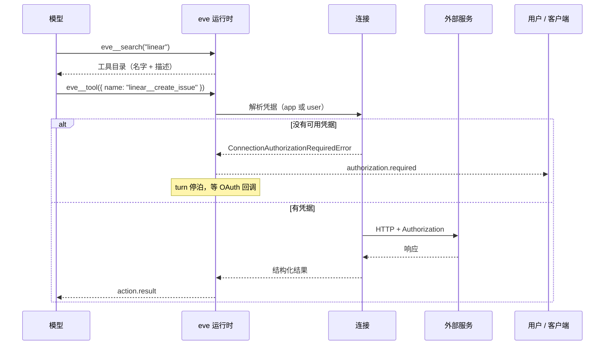
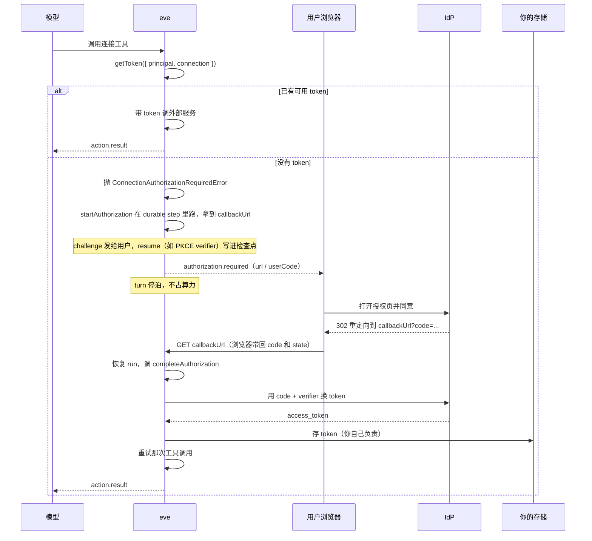

# 第 13 章 连接

> 连接把外部服务的能力交给模型，但不把 URL 和 token 交给模型。模型用 `eve__search` 找到工具，用 `eve__tool` 调用，凭据由 eve 在应用侧注入。

## 13.1 为什么不直接写工具

接一个外部服务，自己写 `defineTool` 也能做。但有三件事要重复劳动：

| 问题 | 自己写工具 | 用连接 |
| --- | --- | --- |
| 工具 schema | 每个接口手写一遍 | 服务端（MCP）或 OpenAPI 文档提供 |
| 凭据注入 | 每个工具自己读环境变量 | 连接统一管，模型看不到 |
| 工具发现 | 全部塞进工具列表 | 按需搜索，不占常驻上下文 |
| 工具增删 | 改代码重新部署 | 服务端加工具，客户端自动看到 |

连接适合「服务已经有一套接口，你想把整片能力开放给模型」。如果只是三五个固定操作，自己写工具更可控。

**连接不是通道。** 通道是用户找 agent（入站），连接是 agent 找服务（出站）。一个 agent 可以同时有多个通道和多个连接，互不影响。

## 13.2 两种连接怎么选

| | MCP | OpenAPI |
| --- | --- | --- |
| 工具从哪来 | 服务端动态发布 | 文档里的每个 operation |
| schema 谁维护 | 服务端 | 文档作者 |
| 适合 | 服务已有 MCP server；工具集会变 | 服务有 OpenAPI 3.x / Swagger 2.0 |
| 典型 | Linear、GitHub、内部 MCP 网关 | 内部 REST API、SaaS 开放平台 |

判断很简单：**有 MCP server 就用 MCP；只有 HTTP 文档就用 OpenAPI；两个都有，看哪个语义更全。**

## 13.3 连接在模型眼里长什么样

### 不在工具列表里

连接的工具**不占**模型的常驻工具列表。模型通过三个目录工具访问：

```text
eve__search({ query: "linear" })            → 该连接的工具列表
eve__search({ query: "create_issue" })      → 按名字匹配
eve__search({ query: "linear__" })          → 只看这个命名空间
eve__tool({ name: "linear__create_issue", input: {...} })
```

为什么这么设计：一个 Linear 连接可能有 40 个工具，全塞进列表就是每轮 40 份 schema。按需搜索只在真的要用时付费。

一次连接调用穿过四个边界：



凭据只在第 3 步注入，模型的输入里**只有业务参数**。这也是为什么连接工具的 schema 里永远看不到 token 字段。

### 命名

文件名就是连接名。`agent/connections/linear.ts` 注册为 `linear`，它的工具对模型显示为 `linear__list_issues`。

**连接名会占住整个 `<name>__` 前缀。** 有 `linear` 连接，就不能再有叫 `linear__foo` 的工具、子代理或别的连接，编译期报冲突。

### description 决定模型能不能找到

连接的 `description` 和连接名一起列在上下文里，是模型决定「搜哪个连接」的主要信号。写清这个连接能做什么，而不是写「Linear 连接」：

```ts
description: "Linear 工作区：issue、项目、周期、评论。支持按负责人、状态、标签筛选。"
```

### 搜索的行为

- `eve__search` **从不**主动要求登录。OAuth 服务如果匿名列不出工具，它只返回一条以连接名命名的结果（如 `linear`），模型要显式用 `eve__tool({ name: "linear" })` 触发登录。
- 工具加载超过 **10 秒**的连接会出现在 `unavailable` 里，其它连接的结果照常返回。
- 通过 `eve__tool` 发起的调用，事件和审批里显示的是**被调用条目**的名字（`linear__list_issues`），不是 `eve__tool`。

## 13.4 MCP 连接

```ts
// agent/connections/linear.ts
import { defineMcpClientConnection } from "eve/connections";

export default defineMcpClientConnection({
  url: "https://mcp.linear.app/mcp",
  description: "Linear 工作区：issue、项目、周期、评论。",
  auth: {
    credentialOwner: "app",
    getToken: async () => ({ token: process.env.LINEAR_API_TOKEN! }),
  },
  tools: { allow: ["search_issues", "get_issue"] },
});
```

`url` 必须支持 **Streamable HTTP** 或 **SSE**。老的 stdio server 要先包一层 HTTP 网关。

`defineMcpClientConnection` 的字段：

| 字段 | 类型 | 必填 | 说明 |
| --- | --- | --- | --- |
| `url` | `string` | 是 | MCP 端点，Streamable HTTP 或 SSE |
| `description` | `string` | 是 | 目录里的路由信号，模型靠它决定搜哪个连接 |
| `auth` | `{ credentialOwner, getToken }` / `connect(...)` / `defineInteractiveAuthorization(...)` | 否 | 出站凭据；与 `headers` 至少给一个（公开服务可都不给） |
| `headers` | `Record<string, string> \| 回调` | 否 | 非 Bearer 方案（API key 头等），可与 `auth` 并用 |
| `tools` | `{ allow: string[] }` 或 `{ block: string[] }` | 否 | 工具过滤，**二选一** |
| `approval` | `ApprovalPolicy \| { request, response?, prompt? }` | 否 | 连接级审批 |
| `protocolVersionDiscovery` | `boolean`，默认 `true` | 否 | 是否先走 `server/discover` |
| `toolCall` | `{ providedArguments }` | 否 | 应用侧注入的参数，模型看不到 |
| `instanceKey` | `string` | 动态认证连接必填 | 稳定、非密钥的实例标识 |
| `forwardPrincipal` | `boolean`，默认 `false` | 否 | 把用户身份转发给对端（对端是 eve 的 `mcpChannel` 时有用） |
| `experimental_events` | `{ onEvent, onGap?, onTerminated? }` | 否 | 订阅服务端事件（实验），见本节末尾 |

### 协议发现

eve 默认走 `server/discover` 发现协议版本。服务器只支持老的 `initialize` 握手时：

```ts
protocolVersionDiscovery: false,
```

关掉之后客户端跳过 discover，从 `initialize` 开始，提议 `2025-11-25` 并协商一个支持的版本。这个设置对动态解析器返回的连接同样生效。

### 工具过滤

```ts
tools: { allow: ["search_issues", "get_issue"] },
```

`allow` 和 `block` **只能选一个**。优先用 `allow`——白名单比黑名单可靠，尤其是服务端有写工具时。

### 应用侧参数

有些 server 要求每次调用都带应用自己的参数（比如 agent profile）。用 `toolCall.providedArguments`：

```ts
export default defineMcpClientConnection({
  url: "https://store.example.com/api/ucp/mcp",
  description: "商店目录、购物车、结算、订单。",
  toolCall: {
    providedArguments: {
      meta: ({ session }) => ({
        "ucp-agent": {
          profile: `https://agent.example.com/.well-known/ucp?session=${encodeURIComponent(session.id)}`,
        },
      }),
    },
  },
});
```

- 这些键会从模型可见的 schema 里**移除**，在调用前注入。模型改不了。
- 值可以是 JSON、Promise 或回调；回调拿到会话上下文、远端裸 `toolName`、以及一个重放稳定的 `callId`（远端需要幂等键时用它）。
- 审批策略只看模型写的输入，看不到注入的值。

### 结果大小

MCP 工具返回服务端的 `structuredContent`；没有就返回文本（工具声明了 output schema 时按 JSON 解析）。图片、音频、资源以文件形式交给模型，`isError: true` 的调用直接失败。

**MCP 连接没有 `toModelOutput`。** 结果太大只能从源头解决：

1. 优先用服务端提供的搜索 / 摘要工具；
2. 让服务端返回一个句柄，再分页取小块；
3. 控制不了服务端时，用自己写的工具替换那一个 operation，把完整数据存到外部，只把需要的字段投影给模型；同时用 `tools.block` 把原 MCP 工具挡掉，避免模型看到两个重复工具。

### 凭据刷新

`getToken` 不是「连上时取一次」。eve 在**每个 MCP HTTP 请求之前**解析凭据，包括已经建好客户端之后的请求：

- 缓存 token 的 `expiresAt` 已过 → 再调一次 `getToken`。
- 服务端回 `401` → 驱逐缓存的 token（并调用 provider 的 `evict` 钩子），再取一次，重试该请求**一次**；还不行才走登录流程。
- 服务端回 `403` → 是权限问题，**不刷新、不重试**，直接把错误交给模型。

驱逐只清 eve 缓存的 access token，并调用你自己的 `evict`。要不要留 refresh grant 做静默续期，是 provider 自己的决定。缺 grant、替换来的 token 又被拒，仍然走正常授权流程。

### 订阅服务端事件（实验）

MCP 连接可以盯住服务端的事件，事件到了就跑你的代码。上游订阅由 Vercel Connect 持有，转发给 agent，eve 执行回调。

前提三条，缺一条都不行：

- 连接是**静态**声明的，且 `auth` 是静态的 `connect()` provider。动态连接和 auth 解析器不支持。
- `@vercel/connect@2.5.2` 或更新。
- 服务端支持 Streamable HTTP 上的事件。

```ts
// agent/connections/bird.ts
import { connect } from "@vercel/connect/eve";
import { defineMcpClientConnection } from "eve/connections";

export default defineMcpClientConnection({
  url: "https://mcp.bird.com/",
  description: "Bird：邮件、短信、联系人。可以盯一个邮箱的新邮件。",
  auth: connect("bird/bird"),
  experimental_events: {
    async onEvent({ event, origin, auth, attachSession }) {
      if (event.name !== "email_mailbox.message_received") return;
      await attachSession(origin.sessionId).send(
        [
          "你盯的那个邮箱来了一封新邮件：",
          JSON.stringify(event.data),
          "如果是 bug 报告，查一下发件人之前的线程，起草一封回复说明我们已知什么、接下来做什么，发之前先问我。",
        ].join("\n\n"),
        { auth, turnPolicy: "queue" },
      );
    },
  },
});
```

`onEvent` 必填。定义它**不等于**订阅：订阅是模型在运行时发起的，它用 `eve__search` 找到三个动作：

| 动作 | 输入 | 结果 |
| --- | --- | --- |
| `events_subscribe_<hash>` | `{ arguments, ttlMs }` | `{ id, status, expiresAt, … }` |
| `events_get_subscription` | `{ id }` | 订阅，结束后为 unknown |
| `events_unsubscribe` | `{ id }` | `{ id, status: "stopping" }` |

服务端提供几个事件，就有几个 subscribe 动作，描述里写着事件名。`ttlMs` 必填：`120000`（2 分钟）到 `31536000000`（365 天）之间的整数，或者 `null` 表示一直盯到手动停。

回调的语义要记牢：

- 回调**在任何会话之外**运行，身份是当初订阅的那个用户（`auth`）。不调 `attachSession(sessionId).send(...)` 就什么都不会进会话，而 `attachSession` 从不新建会话。
- 每次投递都是一个独立的 durable workflow，所以回调可能并发、乱序、重复执行。副作用用 `deliveryId` 去重（当 `Idempotency-Key` 用）。
- 订阅比创建它的会话活得久。结束条件只有三个：手动停、`expiresAt` 到期、上游订阅终止。
- 同一个事件、同样的参数、同一个会话再订阅一次，返回已有的订阅；别的会话订同一个事件会拿到自己的一份。
- `tools.allow` / `tools.block` 对这三个动作同样生效。用了 allow 列表就得把 `events_subscribe_<hash>` 的准确名字抄进去。`toolCall.providedArguments` 对事件动作不适用。

漏事件和订阅终止各有回调：

```ts
experimental_events: {
  async onEvent({ event }) { /* … */ },
  async onGap({ origin, auth, attachSession }) {
    await attachSession(origin.sessionId).send("有事件漏了，重新检查一下邮箱。", { auth });
  },
  async onTerminated({ origin, auth, error, attachSession }) {
    await attachSession(origin.sessionId).send(`盯邮箱的任务结束了：${error.message}`, { auth });
  },
},
```

接收端是 eve 挂的 `POST /eve/v1/hooks/:connectionName`（跟着配置的 agent 前缀或 public 前缀）。它只接受 Connect 的投递令牌，也只接受仍然活着的订阅的投递，订阅结束后回 `410`。回调的身份永远来自保存下来的订阅，不来自事件载荷。

### 排查

| 现象 | 先查什么 |
| --- | --- |
| `principal_required` | 用户作用域的 `connect("...")` 没有认证用户。改通道鉴权，或换成 app 作用域 |
| 模型找不到远端工具 | 改 `description`，再检查 `tools.allow` / `tools.block` |
| 本地 OAuth 正常，部署后失败 | Connect 连接器是否挂到了部署的项目，`connect("...")` 里的 UID 是否对 |
| 服务端拒绝请求 | MCP URL、transport、auth scheme、必需 header、`providedArguments` |

## 13.5 OpenAPI 连接

```ts
// agent/connections/crm.ts
import { defineOpenAPIConnection } from "eve/connections";

export default defineOpenAPIConnection({
  spec: "https://api.example.com/openapi.json",
  baseUrl: "https://api.example.com",
  description: "CRM 的客户、联系人、商机。",
  auth: {
    credentialOwner: "app",
    getToken: async () => ({ token: process.env.CRM_TOKEN! }),
  },
  operations: { allow: ["listAccounts", "getAccount"] },
});
```

`defineOpenAPIConnection` 的字段：

| 字段 | 类型 | 必填 | 说明 |
| --- | --- | --- | --- |
| `spec` | `string \| object` | 是 | HTTPS URL 或内联已解析的文档 |
| `description` | `string` | 是 | 目录里的路由信号 |
| `baseUrl` | `string` | 否 | 覆盖文档里的 `servers` / `host` |
| `auth` | 同 MCP | 否 | 出站凭据 |
| `headers` | `Record<string, string> \| 回调` | 否 | 非 Bearer 方案 |
| `operations` | `{ allow: string[] }` 或 `{ block: string[] }` | 否 | 按 `operationId` 过滤，**二选一** |
| `approval` | 同 MCP | 否 | 连接级审批 |
| `toolCall` | `{ providedArguments }` | 否 | 应用侧注入的参数 |
| `instanceKey` | `string` | 动态认证连接必填 | 稳定、非密钥的实例标识 |

### spec 从哪来

| 方式 | 什么时候用 |
| --- | --- |
| URL（运行时抓取） | 服务方维护契约、经常更新 |
| 内联已解析对象 | 私有 API、需要钉版本、手写的小契约 |

URL 必须是 `https`（本地开发允许 loopback 的 `http`），重定向后会重新校验。

### baseUrl 的解析顺序

不传 `baseUrl` 时：

- OpenAPI 3.x：第一个可用的 `servers` 条目
- Swagger 2.0：`schemes` + `host` + `basePath`

要钉环境就显式传。解析出来的地址也必须是 `https`（loopback 除外），因为调用会带凭据。

### 工具命名

每个 operation 一个工具，名字取 `operationId`，报告为 `<connection>__<operationId>`，比如 `crm__listAccounts`。没有 `operationId` 时，eve 用 `<method>_<清洗过的路径>` 生成确定性名字——过滤时要用这个名字。

### 参数

path、query、header、cookie 参数都会变成工具的顶层输入。`in: "path"` 的值会被替换进 `{name}` 占位符。所以 spec 里必须声明对应的 path 参数，否则调用拼不出 URL。

path 参数的值不能正好是 `.` 或 `..`。eve 在 URL 解析之前就拒掉，否则规范化会悄悄改掉目标路由。这个检查也覆盖 `toolCall.providedArguments` 注入的值。其它值（包括带斜杠的）在替换时照常做 URL 编码。

### 返回值

统一是 `{ status, statusText, body }`。模型自己判断 `status`，eve 不会因为 4xx 就抛错——这一点和 MCP 的 `isError` 不同。

### 注解清理

`default` / `example` 和声明的类型冲突时会被丢掉（比如布尔字段写 `default: "false"`），避免错误示例误导模型。eve 不做类型转换。

## 13.6 凭据：app 还是 user

这个选择决定「谁来授权」。

| `credentialOwner` | 用在什么时候 | 前提 |
| --- | --- | --- |
| `"app"` | agent 用一份共享的服务 / 机器人凭据 | 无 |
| `"user"` | 每个终端用户授权自己的第三方账号 | 会话必须有 `principalType: "user"` |

```ts
// app 作用域：所有人共用一份 token
auth: { credentialOwner: "app", getToken: async () => ({ token: process.env.X! }) }
```

```ts
// user 作用域：每人一份
auth: {
  credentialOwner: "user",
  getToken: async () => ({ token: await getUserToken(ctx.session.auth.current) }),
}
```

`auth` 对象的字段：

| 字段 | 类型 | 必填 | 说明 |
| --- | --- | --- | --- |
| `credentialOwner` | `"app" \| "user"` | 否，默认 `"app"` | 凭据归 agent 还是终端用户 |
| `getToken` | `(ctx) => TokenResult \| Promise<TokenResult>` | 是 | 每次调用前取凭据 |
| `startAuthorization` | `(ctx) => { challenge, resume }` | 交互式 OAuth 时必填 | 生成授权链接 |
| `completeAuthorization` | `(ctx) => TokenResult` | 交互式 OAuth 时必填 | 用回调换 token |

`getToken` 在**运行时**执行，所以里面读 `process.env` 是安全的，值也不会进编译产物。反过来说，把 token 写成 `agent/connections/*.ts` 顶层的字面量，就会跟着连接定义一起被编译进去。环境变量本身的规则见[附录 C](appendix-c-env-and-secrets.md)。

`TokenResult` 只有三个字段：

| 字段 | 类型 | 说明 |
| --- | --- | --- |
| `token` | `string` | 作为 `Authorization: Bearer <token>` 发送 |
| `expiresAt` | `number` | 毫秒时间戳，建议值；运行时可能据此提前刷新 |
| `providerSubject` | `string` | 该凭据代表的服务账号标识，只在本 provider 内可比较 |

### 为什么定时任务会 `principal_required`

`credentialOwner: "user"` 的含义不是「稍后随便找个人授权」，而是「把凭据绑定到**当前会话已经认证的那个用户**」。

定时任务用应用身份（`runtime`）跑，`localDev()` 是合成身份，同项目运行时 token 也不是用户。这些会话没有终端用户，所以：

- 用户作用域的连接**直接失败**，`reason: "principal_required"`；
- **不会**启动 OAuth 流程。

两种解法：让入口通道认证真实用户，或把这个连接改成 app 作用域。

## 13.7 交互式 OAuth

### Vercel Connect

```bash
npm install @vercel/connect
vercel link
vercel connect create linear --name opsbot-linear
vercel connect attach <connector-uid> --yes
vercel env pull
```

```ts
import { connect } from "@vercel/connect/eve";

export default defineMcpClientConnection({
  url: "https://mcp.linear.app/mcp",
  description: "Linear 工作区。",
  auth: connect("linear/opsbot-linear"),   // 用户作用域，默认
});
```

流程：

```text
模型调工具
  → getToken 发现没有 token，抛 ConnectionAuthorizationRequiredError
  → eve 发 authorization.required，turn 停泊
  → 用户在浏览器完成授权，回调完成
  → 那次调用自己续跑，直接拿 token 重试，不再多一次模型调用
```

`eve@0.81` 起，被登录拦下的调用**留在自己的 step 里等**，回调到了自己跑完，结果以该调用的 `action.result` 返回。这比「重新问模型一次」少一次模型调用。

`authorization.required` 和 `authorization.completed` 都带 `grant` 和连接 principal 的身份；`failed` 的 `authorization.completed` 带 `retryable`。没有 `retryable` 的失败（老版本 eve 发的）按可重试处理。

不想要交互、让服务以 agent 身份操作：

```ts
auth: connect({ connector: "linear/opsbot-linear", principalType: "app" }),
```

app 作用域是**非交互**的。连接器没装好就直接失败，让运维去修。

### 什么时候才会弹登录

| 服务端行为 | eve 的反应 |
| --- | --- |
| 匿名请求就 401（Linear、GitHub、Notion 这类） | `eve__search` 只返回一条以连接名命名的结果；模型显式调它时才登录 |
| 匿名能列工具 | 搜索正常返回工具；调用被 401 或带 `WWW-Authenticate` 的错误时登录 |

登录会挂住 turn，直到用户完成、取消 turn、或发了别的消息（steering 会取消登录，`authorization.completed` 报 `declined`）。

带 `retryable: false` 的失败（用户明确拒绝）会让这个 turn **不再重复发起同一个登录**：同一 turn 里后续需要同一份授权的调用直接拿到那个失败，下一个 turn 才会重新问。

### 自建 OAuth

不用 Vercel Connect 时，用 `defineInteractiveAuthorization` 自己实现三个回调。整条流程是这样：



关键是中间那段停泊：`startAuthorization` 返回的 `resume` 会跟着检查点一起落盘，所以哪怕进程在用户授权期间重启，`completeAuthorization` 仍能拿到同一个 PKCE verifier。

`defineInteractiveAuthorization` 的字段：

| 字段 | 类型 | 必填 | 说明 |
| --- | --- | --- | --- |
| `getToken` | `({ principal, connection }) => Promise<TokenResult>` | 是 | 每次工具调用前跑。没有 token 就抛 `ConnectionAuthorizationRequiredError` |
| `startAuthorization` | `({ principal, connection, callbackUrl }) => Promise<{ challenge, resume? }>` | 交互式必填 | 生成授权链接；`challenge` 给人看，`resume` 跨停泊保存 |
| `completeAuthorization` | `({ principal, connection, callbackUrl, resume?, callback }) => Promise<TokenResult>` | 交互式必填 | 用回调参数换 token |
| `displayName` | `string` | 否 | 登录 UI 里显示的服务名，例如 `"Salesforce"` |
| `evict` | `({ principal, connection }) => void \| Promise<void>` | 否 | 下游 401 后清掉**你自己那层** token 缓存 |
| `principalType` | `"user"` | 固定 | 交互式 OAuth 只支持用户作用域，函数签名已经替你省略 |

三个回调拿到的参数：

| 参数 | 类型 | 出现在 | 说明 |
| --- | --- | --- | --- |
| `principal` | `{ type: "user", id, issuer?, attributes? }` | 三个回调 | 框架从会话解析出的身份，`issuer + id` 是缓存键 |
| `connection` | `{ url }` | 三个回调 | 连接声明的 MCP 地址 |
| `callbackUrl` | `string` | start / complete | 框架生成的回调地址，交给 IdP 当 `redirect_uri` |
| `resume` | 你声明的类型 | complete | `startAuthorization` 返回的那个值，跨停泊保留 |
| `callback` | `{ params, method, body? }` | complete | 只有回调参数和 body，**没有请求头**——cookie 和 `Authorization` 不跨 step |

`startAuthorization` 返回的 `challenge`：

| 字段 | 类型 | 说明 |
| --- | --- | --- |
| `url` | `string` | 用户要打开的授权地址；设备码流程里是验证地址 |
| `userCode` | `string` | 设备码流程里和 `url` 一起显示的短码 |
| `expiresAt` | ISO 字符串 | 授权窗口过期时间，会和配置的超时取较小值 |
| `instructions` | `string` | 没有 `url` 时（CIBA、推送审批）给人看的说明 |
| `displayName` | `string` | 这次登录显示的服务名；`auth.displayName` 优先于它 |

两个错误的分工：

| 错误 | 什么时候抛 | 效果 |
| --- | --- | --- |
| `ConnectionAuthorizationRequiredError(name)` | `getToken` 找不到可用凭据 | 发 `authorization.required`；交互式会停泊等回调，非交互式不停泊 |
| `ConnectionAuthorizationFailedError(name, { reason, retryable })` | 授权失败或被拒绝 | `reason` 会出现在 `authorization.completed` 和模型看到的错误里；`retryable: false` 表示别再弹 |

完整实现：

```ts
import {
  ConnectionAuthorizationFailedError,
  ConnectionAuthorizationRequiredError,
  defineInteractiveAuthorization,
  defineMcpClientConnection,
} from "eve/connections";

type Resume = { verifier: string; redirectUri: string };

export default defineMcpClientConnection({
  url: "https://mcp.linear.app/mcp",
  description: "Linear 工作区。",
  auth: defineInteractiveAuthorization<Resume>({
    displayName: "Linear",

    // 每次工具调用前都会跑：有 token 就放行，没有就要求授权
    getToken: async ({ principal }) => {
      const stored = await loadStoredToken(principal);
      if (stored === undefined) {
        throw new ConnectionAuthorizationRequiredError("linear");
      }
      return stored;                    // { token, expiresAt?, providerSubject? }
    },

    // 框架生成 callbackUrl 后调用：challenge 给人看，resume 跨停泊保存
    startAuthorization: async ({ callbackUrl }) => {
      const verifier = makePkceVerifier();
      return {
        challenge: {
          url: buildAuthorizeUrl({ callbackUrl, verifier }),
          instructions: "在浏览器里完成 Linear 授权后回到这里。",
        },
        resume: { verifier, redirectUri: callbackUrl },
      };
    },

    // 用户从 IdP 回来后调用：换 token 并落库
    completeAuthorization: async ({ principal, resume, callback }) => {
      if (callback.params.error) {
        throw new ConnectionAuthorizationFailedError("linear", {
          reason: callback.params.error,
          retryable: false,             // 用户明确拒绝，别再弹
        });
      }
      const result = await exchangeCode({
        code: callback.params.code!,
        verifier: resume!.verifier,
        redirectUri: resume!.redirectUri,
      });
      await saveStoredToken(principal, result);
      return result;
    },

    // 下游 401 之后，清掉你自己那一层缓存，下次 getToken 才会真刷新
    evict: async ({ principal }) => {
      await dropCachedToken(principal);
    },
  }),
});
```

四条必须记住的约束：

1. **eve 不替你存 token。** `completeAuthorization` 返回的 token 只在当前 workflow step 内复用。要持久化就自己存、自己读；读不到就再走一次授权。
2. **`startAuthorization` 和 `completeAuthorization` 必须成对出现**，只给一个会报定义错误。
3. **`principalType` 固定是 `"user"`。** app 作用域没有「人」可以打开浏览器，所以交互式流程不支持它。
4. **`resume` 必须 JSON 可序列化。** 它要跟着检查点过夜，塞 `Date`、`Map`、class 实例都会在恢复时丢信息。

## 13.8 审批

### 整个连接都审批

```ts
import { once } from "eve/tools/approval";

export default defineMcpClientConnection({
  url: "…",
  description: "…",
  auth: { /* … */ },
  approval: once(),
});
```

`never()` / `once()` / `always()` / `auto()` 的语义和工具一样（第 11 章）。

### 按工具名或输入审批

一刀切 `always()` 会在无害的读操作上也弹确认：

```ts
const DELETE_TOOLS = ["delete_draft", "delete_thread"];
const PUBLISH_TOOLS = ["create_draft", "edit_draft"];

const publishesNow = (input: unknown): boolean => {
  const body = (input as { requestBody?: { publish_at?: unknown } })?.requestBody;
  return typeof body?.publish_at === "string" && body.publish_at.length > 0;
};

export default defineMcpClientConnection({
  url: "https://mcp.example.com/mcp",
  description: "社交媒体发布：草稿、定时、管理。",
  auth: { credentialOwner: "app", getToken: async () => ({ token: process.env.SOCIAL_KEY! }) },
  approval: ({ toolName, toolInput }) => {
    if (DELETE_TOOLS.some((t) => toolName.includes(t))) return "user-approval";
    if (PUBLISH_TOOLS.some((t) => toolName.includes(t))) {
      return publishesNow(toolInput) ? "user-approval" : "not-applicable";
    }
    return "not-applicable";
  },
});
```

两个连接特有的细节：

1. **`toolName` 带前缀**（`social__delete_draft`），用 `.includes()` 或 `.endsWith()`，不要用 `===`。
2. **`toolInput` 是原始未校验的输入**，类型 `Record<string, unknown> | undefined`。schema 由远端定义，你不能假设结构，要防御式读取。

### 按服务端注解审批

```ts
approval: ({ toolAnnotations }) =>
  toolAnnotations?.readOnlyHint === true ? "not-applicable" : "user-approval",
```

`toolAnnotations` 来自服务端声明的 `readOnlyHint` / `destructiveHint`。**它是提示不是保证**，只在你信任那个服务端时用。

### 和审批人策略一起用

连接也支持 `{ request, response, prompt }` 的对象形态：

```ts
approval: {
  request: always(),
  prompt: ({ toolName, toolInput }) => `执行 ${toolName}：${JSON.stringify(toolInput)}`,
  response: ({ response }) =>
    response.principal.attributes.roles?.includes("oncall")
      ? { status: "allowed" }
      : { status: "rejected", reason: "只有 on-call 可以批准。" },
},
```

## 13.9 按调用者给不同连接

```ts
// agent/connections/accounts.ts
import { defineDynamic, defineMcpClientConnection } from "eve/connections";
import { listAccounts } from "../lib/accounts";

export default defineDynamic({
  events: {
    "session.started": async (_event, ctx) => {
      const accounts = await listAccounts(ctx.session.auth.current);
      return Object.fromEntries(
        accounts.map((a) => [
          a.slug,
          defineMcpClientConnection({
            url: a.mcpUrl,
            description: a.description,
            instanceKey: a.id,       // 稳定、非密钥的账号标识
            auth: a.auth,
          }),
        ]),
      );
    },
  },
});
```

- 返回单个定义时连接名来自文件名；返回 map 时每个 key 就是连接名。
- 需要认证的条目**必须**设 `instanceKey`。审批恢复时靠它确认「还是同一个目标」——缺失或改变会让重放失败。
- 解析器要幂等：审批恢复可能再跑一次。

## 13.10 完整例子：三个连接，三种凭据

```text
agent/connections/
├── linear.ts      # 用户 OAuth（每人一份）
├── crm.ts         # app token（共享）
└── accounts.ts    # 动态：按租户返回不同的 MCP
```

```ts
// linear.ts —— 用户自己的 Linear
import { connect } from "@vercel/connect/eve";
import { defineMcpClientConnection } from "eve/connections";

export default defineMcpClientConnection({
  url: "https://mcp.linear.app/mcp",
  description: "Linear：查询和创建 issue。",
  auth: connect("linear/opsbot-linear"),
  tools: { allow: ["search_issues", "get_issue", "create_issue"] },
  approval: ({ toolName }) =>
    toolName.endsWith("create_issue") ? "user-approval" : "not-applicable",
});
```

```ts
// crm.ts —— 公司共用的 CRM
import { defineOpenAPIConnection } from "eve/connections";

export default defineOpenAPIConnection({
  spec: "https://crm.example.com/openapi.json",
  baseUrl: "https://crm.example.com",
  description: "CRM：客户、联系人、商机。只读。",
  auth: {
    credentialOwner: "app",
    getToken: async () => ({ token: process.env.CRM_TOKEN! }),
  },
  operations: { allow: ["listAccounts", "getAccount", "listOpportunities"] },
});
```

```ts
// accounts.ts —— 每个租户自己的数据仓库 MCP
import { defineDynamic, defineMcpClientConnection } from "eve/connections";
import { getAccountToken, listAccounts } from "../lib/accounts";

export default defineDynamic({
  events: {
    "session.started": async (_event, ctx) => {
      const tenant = ctx.session.auth.current?.attributes.tenantId;
      if (typeof tenant !== "string") return null;      // 没有租户就没有这些连接

      const accounts = await listAccounts(tenant);
      return Object.fromEntries(
        accounts.map((account) => [
          account.slug,                                  // 成为连接名：acme__run_query
          defineMcpClientConnection({
            url: account.mcpUrl,
            description: `${account.name}（${account.region}）的数据仓库：查表、跑只读查询。`,
            instanceKey: account.id,                     // 稳定、非密钥
            auth: {
              credentialOwner: "app",
              getToken: async () => ({ token: await getAccountToken(account.id) }),
            },
            tools: { allow: ["list_tables", "run_query"] },
          }),
        ]),
      );
    },
  },
});
```

第三个用的是 13.9 的动态机制，这里是完整版本。它和前两个有四处不同，都是动态连接特有的：

1. **连接名来自 map 的 key**（`account.slug`），不是文件名。所以工具名是 `acme__run_query` 这种，审批策略里要用 `endsWith`。
2. **没有租户就返回 `null`**。这个会话看不到任何租户连接，而不是拿到一个空 URL 的连接。
3. **`instanceKey` 必须稳定**。审批恢复时 eve 用它确认「目标没换过」；换了就拒绝重放，而不是把请求发到另一个账号。
4. **解析器要幂等**。审批恢复可能再跑一次 `session.started`，`listAccounts` 不能有副作用。

三个连接的分工：

| 文件 | 凭据 | 谁能用 | 约束 |
| --- | --- | --- | --- |
| `linear.ts` | 用户 OAuth，每人一份 | 每个用户自己的 Linear | 创建 issue 要审批 |
| `crm.ts` | app token，一份共享 | 所有会话 | 只读操作白名单 |
| `accounts.ts` | 每个租户自己的 token | 该租户的会话 | 工具白名单 + `instanceKey` |

同样是「查数据」，三种凭据的边界完全不同：`linear` 看到的是**这个人**的 issue，`crm` 看到的是**公司**的客户，`accounts` 看到的是**这个租户**的数据仓库。

## 13.11 常见坑

**坑：模型说「我没有 Linear 工具」。**
连接工具不进工具列表。指令里写一句「需要 Linear 数据时先用 `eve__search` 查 `linear__`」。

**坑：`tools.allow` 和 `tools.block` 同时写。**
只能选一个。

**坑：`credentialOwner: "user"` 但通道是匿名的。**
报 `principal_required`。先让通道认证出 `principalType: "user"`。

**坑：定时任务用用户作用域连接。**
定时任务没有终端用户，必然失败。改 app 作用域，或让任务通过用户认证的通道派发。

**坑：`instanceKey` 用了 token 或 URL。**
必须是稳定、非密钥的标识。用账号 ID 或租户 ID。

**坑：审批策略里用 `toolName === "delete_issue"`。**
连接工具名带前缀。用 `endsWith`。

**坑：以为 MCP 结果能用 `toModelOutput` 收窄。**
MCP 连接没有这个能力。从服务端解决，或换自己写的工具。

**坑：信任 `readOnlyHint` 就放开所有读操作。**
注解是服务端自己声明的。对不可信服务端不能当安全保证。

**坑：自建 OAuth 以为 eve 会存 token。**
不会。`completeAuthorization` 里自己存，`getToken` 里自己读。

## 13.12 练习

1. 接一个公开 MCP server（本地跑一个也行），用 `eve__search` 找到工具并调用。
2. 用 `tools.allow` 只暴露两个只读工具，确认其它工具搜不到。
3. 写一个按 `readOnlyHint` 分流审批的策略，观察读操作不弹确认、写操作弹。
4. 用 `defineDynamic` 按租户返回不同的 MCP 连接，验证 `instanceKey` 的作用。
5. 把一个 OpenAPI 服务接进来，用 `operations.allow` 收窄到三个只读接口。

## 延伸阅读

- [Connections](https://eve.dev/docs/connections)
- [MCP Connections](https://eve.dev/docs/connections/mcp)
- [OpenAPI Connections](https://eve.dev/docs/connections/openapi)
- [Security Model](https://eve.dev/docs/concepts/security-model)

---

上一章：[12 子代理](12-subagents.md) · 下一章：[14 通道](14-channels.md)
