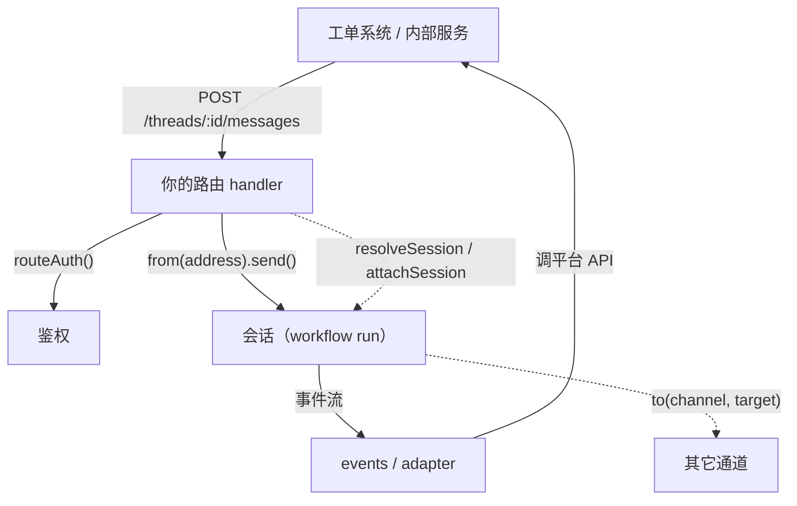

# 第 14 章 通道

> 通道决定 agent 在哪里和用户见面，也决定「谁在说话」。同一份 agent 代码可以同时挂到 HTTP、Slack、Discord、Telegram。这一章讲默认 HTTP 通道的鉴权，以及怎么接 Slack、写自定义通道。

## 14.1 通道解决两件事

1. **投递**：平台消息进来，转成 turn；回复出去，转成平台格式。
2. **身份**：把平台用户映射成 eve 的 principal，让工具能按人/租户隔离。

第二件比第一件重要。没有身份映射，所有「按用户」的逻辑都会退化成一个共享账号，记忆、审批、配额全部串号。

## 14.2 选哪个通道

| 你要的 | 用 |
| --- | --- |
| 网页聊天 | eve 通道 + `useEveAgent`（第 17 章） |
| 本地工具、SDK、`curl` | 默认 eve HTTP 通道 |
| Slack 的 @、DM、按钮 | `channel/slack` |
| Discord 斜杠命令、组件 | `channel/discord` |
| Teams 消息 + Adaptive Cards | `channel/teams` |
| Telegram bot | `channel/telegram` |
| 短信 / 电话转写 | `channel/twilio`、`channel/linq` |
| GitHub issue / PR | `channel/github` |
| Linear issue 委派 | `channel/linear` |
| MCP 客户端把 agent 当工具用 | `channel/mcp` |
| 内部 webhook、WebSocket | 自定义通道 |

## 14.3 默认 HTTP 通道

`agent/channels/eve.ts` 配置 `/eve/v1` 整个表面。不写这个文件，框架用默认源：`[vercelOidc(), localDev(), placeholderAuth()]`。

```ts
// agent/channels/eve.ts
import { eveChannel } from "eve/channels/eve";
import { localDev, vercelOidc } from "eve/channels/auth";

export default eveChannel({
  auth: [vercelOidc(), localDev()],
});
```

`eveChannel` 的字段（只有 `auth` 必填）：

| 字段 | 类型 | 默认 | 说明 |
| --- | --- | --- | --- |
| `auth` | `AuthFn \| AuthFn[]` | 必填 | 路由鉴权链，按顺序尝试 |
| `audience` | `ChannelAudience \| (input) => ChannelAudience` | 按调用者推导 | 追踪内容的可见性分类 |
| `turnPolicy` | `"steer" \| "queue"` | `"steer"` | turn 进行中收到新消息怎么办 |
| `uploadPolicy` | `UploadPolicyInput \| "disabled"` | 25 MB、所有类型 | 入站附件的大小和类型 |
| `fetchFile` | `(url, ctx) => bytes \| { bytes, … } \| null` | 无 | 把 URL 形式的附件取回；返回 `null` 表示「不是我的，你去下载」 |
| `cors` | `boolean \| { origin, methods, … }` | 不处理 | 浏览器 CORS |
| `onMessage` | `(ctx, message) => { auth, context?, title? }` | 用路由鉴权结果 | 派发前改写入站消息 |
| `events` | 事件处理器表 | 无 | 流事件钩子，参数是 `(event, channel, ctx)` |
| `trustedForwarders` | 谓词 | 无 | 允许哪些上游转发用户身份；不配就一律 403 |

### 鉴权链怎么走

`auth` 收一个 `AuthFn` 或数组，按顺序尝试。每个条目三种结果：

| 返回 | 结果 |
| --- | --- |
| 一个 `SessionAuthContext` | 接受，停止遍历 |
| `null` / `undefined` | 跳过，试下一个 |
| **抛异常** | 用特定状态码拒绝（`UnauthenticatedError` → 401，`ForbiddenError` → 403） |

全部跳过 → 401，`WWW-Authenticate` 头会列出配置里声明过的方案（`httpBasic()` 声明 `Basic`，token 类声明 `Bearer`）。

### helper 一览

| Helper | 作用 |
| --- | --- |
| `localDev()` | 只在 `eve dev` / `vercel dev` 进程里放行（看部署环境，不看请求头） |
| `vercelOidc()` | 验证 Vercel OIDC bearer，本地 CLI 和同团队部署互调靠它 |
| `none()` | 显式接受匿名流量，**只放最后一位**，只用于公开演示 |
| `httpBasic({ username, password }, { realm })` | 共享用户名密码，最省事的内部工具方案 |
| `jwtHmac(...)` / `jwtEcdsa(...)` / `oidc(...)` | 自签 JWT / 非对称 JWT / 任意 OIDC issuer |
| `placeholderAuth()` | 生产一律 401，脚手架占位 |
| `verifyHttpBasic(header, { username, password })` | 低层校验，返回 `{ ok, sessionAuth }` |
| `withAuthChallenges(fn, challenges)` | 给自定义 `AuthFn` 声明 401 的方案 |

`localDev()` 和 `vercelOidc()` 都**不**放行生产环境的浏览器用户和外部客户端。面向公众的应用必须接自己的鉴权。

鉴权函数是**运行时**入口：里面读 `process.env` 是安全的，值不会进编译产物，进程启动时从源码重新取。反过来说，别把密码写成模块顶层的常量——那是编译期求值。细节见[附录 C](appendix-c-env-and-secrets.md)。

### 一个可用的单用户方案

```ts
// agent/channels/eve.ts
import { eveChannel } from "eve/channels/eve";
import { httpBasic, localDev, vercelOidc } from "eve/channels/auth";

const username = process.env.OPS_USERNAME;
const password = process.env.OPS_PASSWORD;

export default eveChannel({
  auth: [
    // 配置缺失就不挂这条，让请求落到后面的条目并最终 401
    ...(username && password
      ? [httpBasic({ username, password }, { realm: "opsbot" })]
      : []),
    vercelOidc(),
    localDev(),
  ],
});
```

需要自己控制校验细节（同源检查、注入 `attributes`）时，用低层组合：

```ts
// agent/lib/auth.ts
import { verifyHttpBasic, withAuthChallenges } from "eve/channels/auth";

export const appAuth = withAuthChallenges(
  (request: Request) => {
    const username = process.env.OPS_USERNAME;
    const password = process.env.OPS_PASSWORD;
    if (!username || !password) return null;              // 配置缺失 → 关闭

    // 浏览器发起的跨站请求一律拒绝
    if (request.headers.has("origin") &&
        request.headers.get("sec-fetch-site") !== "same-origin") return null;

    const result = verifyHttpBasic(request.headers.get("authorization"), { username, password });
    if (!result.ok) return null;

    return {
      ...result.sessionAuth,
      attributes: { team: "ops" },
      issuer: "opsbot",
    };
  },
  [{ scheme: "Basic", parameters: { realm: "opsbot", charset: "UTF-8" } }],
);
```

要点：缺环境变量、缺凭据、凭据错误，全部 **fail closed**（返回 `null`，最终 401）。共享密码不提供每人独立身份，多人使用要换真的会话鉴权。

### CORS

默认不管 CORS。浏览器直连时才开：

```ts
export default eveChannel({
  auth: [...],
  cors: {
    origin: "https://app.example.com",
    methods: ["GET", "POST"],
    allowedHeaders: ["authorization", "content-type"],
  },
});
```

### 上传

```ts
export default eveChannel({
  auth: [...],
  uploadPolicy: { maxBytes: 100 * 1024 * 1024 },
  async fetchFile(url) {
    if (!url.startsWith("https://uploads.example.com/")) return null;
    const r = await fetch(url, {
      headers: { authorization: `Bearer ${process.env.UPLOADS_TOKEN}` },
    });
    if (!r.ok) throw new Error(`上传取回失败 ${r.status}`);
    return Buffer.from(await r.arrayBuffer());
  },
});
```

- 默认上限 25 MB、所有类型。超出返回 `413`，类型不允许返回 `415`。
- 内联 base64 还受宿主请求体限制。Vercel Functions 是 4.5 MB，所以 base64 文件大约 3.3 MB 就到顶。
- 大文件先传到自己的存储，把 URL 放进 file part，再用 `fetchFile` 在 workflow step 内取回——字节不经过请求体。
- `uploadPolicy` 覆盖 eve 为这个通道 staged 的**所有**文件，包括它自己下载的 URL。

`uploadPolicy` 只有两个字段（可以只给一个，其余用默认值）：

| 字段 | 类型 | 默认 | 说明 |
| --- | --- | --- | --- |
| `maxBytes` | `number` | 25 MB | 解码后的大小上限。`0` 等于拒绝所有附件 |
| `allowedMediaTypes` | `string[] \| "*"` | `"*"` | 精确值或通配（`image/*`）。不在列表里返回 415 |

整个值也可以直接给 `"disabled"`，拒绝一切附件。

### 请求级上下文

```ts
import { defaultEveAuth, eveChannel } from "eve/channels/eve";

export default eveChannel({
  auth: [...],
  onMessage(ctx, message) {
    return {
      auth: defaultEveAuth(ctx),
      context: [`HTTP 调用者 ${ctx.eve.caller?.principalId ?? "anonymous"} 说：${message}`],
    };
  },
  events: {
    "message.completed"(eventData, _channel, ctx) {
      console.log("回复完成", { sessionId: ctx.session.id });
    },
  },
});
```

- `context` 字符串会变成**持久的用户消息**进历史。
- 只想影响本轮、不写历史，返回 `clientContext`。它替换请求自带的 `clientContext`，进入这个 turn 的每次模型调用，但不进会话历史。
- `ctx.eve.clientContext` 是客户端**原样**发来的那份，没发就是 `undefined`。用它来校验或纠正客户端状态：

```ts
async onMessage(ctx) {
  const auth = defaultEveAuth(ctx);
  const plan = await getVerifiedPlan(auth);           // 以服务端为准
  return { auth, clientContext: [`用户的套餐是 ${plan}。`] };
},
```

`clientContext` 的形状和请求里的一样（`ClientContextValue`：字符串、字符串数组或 JSON 对象）。返回 `[]` 表示丢掉请求带来的上下文，不返回则保留。eve 给客户端提供的内容打 `Client context:` 标签，`onMessage` 返回的不打标签。`onMessage` 只对带消息的请求跑，纯输入应答沿用请求自己的上下文。
- `onMessage` 必须返回 auth 结果。

### audience

通道创建会话时给一个可观测性分类，决定追踪能不能记录内容：

| 会话创建者 | 默认 audience |
| --- | --- |
| 匿名 | `unknown` |
| `user` / `service` / `runtime` principal | `private` |
| 其它 principal 类型 | `unknown` |

`audience` 不影响谁能访问（那是 `auth` 的事），只影响内容捕获。公开演示站可以设 `audience: "public"`。

## 14.4 Slack

```bash
eve add channel/slack
```

推荐走 Vercel Connect，它托管 bot token、请求验签、token 轮换和多工作区安装：

```ts
// agent/channels/slack.ts
import { connectSlackCredentials } from "@vercel/connect/eve";
import { slackChannel } from "eve/channels/slack";

export default slackChannel({
  credentials: connectSlackCredentials("slack/opsbot"),
});
```

不想用 Connect 就自己管凭据：在 Slack app 里加 `app_mentions:read`、`chat:write`（DM 还要 `im:history`，附件要 `files:read`，长回复转摘要要 `files:write`），把 Request URL 指向 `https://<你的域名>/eve/v1/slack`。

Slack 通道自动处理：

- `@mention`、DM、slash command、快捷方式、交互回调
- 在线程里回复、打字指示器
- **把审批和提问渲染成按钮和下拉**
- 任务卡片（子代理/长任务的进度）
- 长回复自动转成 snippet

文本型通道（Twilio、GitHub、Linear、Chat SDK 系）只能一次显示一个请求，答完再显示下一个；Slack 这类有按钮的通道会把所有待答请求都摆出来。

### 排查

| 现象 | 先查什么 |
| --- | --- |
| @ 了没反应 | 事件订阅没开 `app_mention`，或 Request URL 指错，或部署在 Deployment Protection 后面 |
| 审批按钮点不动 | Interactivity 的 Request URL 没配 |
| DM 或线程回复不工作 | 加 `message.im` + `im:history`，重装 app |
| 长回复发不出 | 加 `files:write`，重装 app |
| 预览分支收不到 | 分支域名要能绕过 Deployment Protection，或加 `x-vercel-protection-bypass` |

## 14.5 其它平台

| 通道 | 命令 | 备注 |
| --- | --- | --- |
| Discord | `eve add channel/discord` | 服务器/频道 |
| Telegram | `eve add channel/telegram` | bot |
| Teams | `eve add channel/teams` | Adaptive Cards |
| GitHub | `eve add channel/github` | issue/PR，可 checkout 代码 |
| Linear | `eve add channel/linear` | issue 委派、Agent Sessions |
| Twilio | `eve add channel/twilio` | SMS/语音 |
| MCP | `eve add channel/mcp` | 把 agent 的工具发布成 MCP server |
| Web Chat | `eve add channel/web` | Next.js / TanStack Start 前端 |

配置文件都在 `agent/channels/<name>.ts`，配置项按平台不同。共同点：都会把平台用户映射成 principal。

## 14.6 自定义通道

### 先确认要不要自己写

| 你要的 | 更省事的做法 |
| --- | --- |
| 换个聊天界面 | `channel/web`，前端用 `useEveAgent`（第 17 章） |
| 让别的系统调 agent 的工具 | MCP 通道（14.7），或路由里的 `invokeTool` |
| 平台在内置列表里 | 直接用，别自己包一层 |
| 平台不在列表、内部系统、地址粒度特殊、鉴权特殊 | 自己写 `defineChannel` |

自己写要管四件事：路由、鉴权、地址映射、出站投递。内置通道的价值主要也在这四件上，不在「协议适配」。

### 一次请求的完整路径



六步：

1. 平台把请求打到 `route.path`。
2. Nitro 路由匹配，把 `:threadId` 填进 `params`，值已经 `decodeURIComponent` 过。
3. eve 组装 `RouteHandlerArgs`：`from`、`to`、`attachSession`、`waitUntil`……每个请求新建一份。
4. handler 自己鉴权，调 `from(address).send(...)`。
5. `send` 变成一条会话命令，写进那个 run 的 inbox。
6. 会话跑 turn、产出事件；通道的 `events` 把事件翻译成平台 API 调用。

第 3 步之后没有任何「通道注册」的魔法：路由就是一个普通 HTTP handler，eve 只给你上下文对象。

### 自定义通道没有 `auth` 字段

`defineChannel` 的字段表里没有 `auth`。不是漏了——`auth` 是 `eveChannel` 自己的字段，给 `/eve/v1` 那 23 条路由用。你写的路由是普通 HTTP 端点，**默认谁都能打**。

两条路：自己判 header，或者复用 eve 的鉴权链。`routeAuth` 的文档写得很直接：

> Channel factories that share this resolution policy (e.g. `eveChannel`, or a custom `defineChannel` route handler) should call `routeAuth` rather than re-implement the walk.

```ts
// agent/channels/internal.ts
import { httpBasic, routeAuth } from "eve/channels/auth";

const auth = await routeAuth(request, [httpBasic({ username, password })]);

// 通过时是 AuthResult，不通过时是一个拼好的 401/403 Response
if (auth instanceof Response) return auth;

await from(threadId).send(text, { auth });
```

内部系统常用共享密钥，没有用户名密码，写一个 `AuthFn` 就行：

```ts
const auth = await routeAuth(request, [
  async (req) => {
    const secret = req.headers.get("x-webhook-secret");
    // 返回 null 表示「这条不认」，交给下一个策略；全都不认才 401
    if (secret === undefined || secret !== process.env.WEBHOOK_SECRET) return null;

    return {
      attributes: { team: "support" },
      authenticator: "webhook-secret",
      principalId: "internal-ticketing",
      principalType: "service",
    };
  },
]);

if (auth instanceof Response) return auth;
```

`principalType` 决定默认 audience：`user` / `service` / `runtime` 是 `private`，匿名是 `unknown`（14.3 讲过）。

### 一个能跑的例子

```ts
// agent/channels/ticketing.ts
import { defineChannel, GET, POST } from "eve/channels";
import { routeAuth } from "eve/channels/auth";

interface TicketState {
  ticketId: string;
  lastAuthor: string | null;
}

// 省略两个 helper：webhookSecret() 返回一个校验 x-webhook-secret 的 AuthFn，
// ticketClient() 返回工单系统的 HTTP 客户端
export default defineChannel<TicketState>({
  // 通道级种子状态：每次 send 会在此基础上浅合并本次的 state
  state: { ticketId: "", lastAuthor: null },

  // 每个 step 调一次，返回的 ctx 会作为 events 的第二个参数
  context(state, session) {
    return {
      // 把平台客户端和会话绑在一起，事件处理器里直接用
      ticket: ticketClient(state.ticketId),
      sessionId: session.id,
      // 在 ctx 上改字段，step 结束时会写回 adapter.state
      markReplied(author: string) {
        state.lastAuthor = author;
      },
    };
  },

  routes: [
    POST("/tickets/:ticketId/messages", async (request, { from, params }) => {
      const auth = await routeAuth(request, [webhookSecret()]);
      if (auth instanceof Response) return auth;

      const body = (await request.json()) as { text: string; author: string };

      // 地址用「工单 id」：同一个工单的所有消息进同一个会话
      const session = await from(params.ticketId).send(body.text, {
        auth,
        state: { ticketId: params.ticketId, lastAuthor: body.author },
      });

      // 202：消息已受理，回复稍后从事件流来
      return Response.json({ sessionId: session.id }, { status: 202 });
    }),

    POST("/tickets/:ticketId/cancel", async (request, { from, params }) => {
      const auth = await routeAuth(request, [webhookSecret()]);
      if (auth instanceof Response) return auth;

      // cancel 不会新建会话：没有正在跑的 turn 时返回 { status: "no_active_turn" }
      return Response.json(await from(params.ticketId).cancel());
    }),

    GET("/tickets/:ticketId/stream", async (request, { resolveSession, params }) => {
      const auth = await routeAuth(request, [webhookSecret()]);
      if (auth instanceof Response) return auth;

      const session = await resolveSession(params.ticketId);
      if (session === undefined) return new Response("no session", { status: 404 });

      const stream = await session.getEventStream({ follow: true });
      return new Response(stream, {
        headers: { "content-type": "application/x-ndjson; charset=utf-8" },
      });
    }),
  ],

  // 出站：agent 的回复发回工单系统
  events: {
    "message.completed"(data, channel) {
      return channel.ticket.postReply(data.message);
    },
    "turn.failed"(data, channel) {
      return channel.ticket.postError(data.message);
    },
  },
});
```

`state` 的类型参数是必须的：`defineChannel<TState>` 让 `send({ state })` 有类型检查，也让 `context(state)` 里的 `state` 不是 `undefined`。

### routes 怎么写

八个构造器：`GET`、`HEAD`、`POST`、`PUT`、`PATCH`、`DELETE`、`OPTIONS`、`WS`。签名都是 `(path, handler)`。

**path 是应用 URL，不加通道名前缀。** `POST("/tickets/:id/messages")` 回答的是 `POST /tickets/:id/messages`，不是 `/ticketing/tickets/...`。

**有些路径不能占。** 宿主的固定路由（workflow webhook、dev 产物端点、cron）列在 `HOST_HTTP_INVENTORY` 里，撞上直接编译失败：`compile/reserved-route-collision`。默认通道的 `/eve/v1/session`、`/eve/v1/health` 不在这张表里，撞上不报错——先注册的赢，后一个只留一条 `shadowed` 诊断。所以别把自定义通道放到 `/eve/v1/*` 下。

**同一个通道里同一条路由写两遍**会编译失败：`compile/channel-route-duplicate`。

**参数用 `:name`。** 匹配由 Nitro 的路由器做，`params.name` 已经是解码后的值。

**handler 必须返回 `Response`。** 抛异常不会被框架转成 4xx，只会变成 500：

```ts
// packages/eve/src/internal/nitro/routes/channel-dispatch.ts:123
} catch (error) {
  // Without this a handler throw is only Nitro's default 5xx, with no eve
  // log. logError records the exception against the active request span,
  // so traceChannelRequest must not record the returned 500 again.
  const errorId = logError(log, "channel handler threw", error, {
    routeKey,
    channel: matchedChannel.name,
  });
  flushBackgroundTasks(event, routeArgs.backgroundTasks, routeKey, matchedChannel.name);
  return Response.json(
    { error: "Channel handler failed.", errorId, ok: false },
    { status: 500 },
  );
}
```

堆栈只进日志，响应里只有 `errorId`。要返回业务错误就自己 `Response.json(..., { status: 400 })`，别抛。

### 路由参数：`RouteHandlerArgs`

每个 handler 的第二个参数，一个请求一份。

| 参数 | 类型 | 什么时候用 |
| --- | --- | --- |
| `from` | `(address) => ChannelSource` | 按通道地址发消息，**只有 `send()` 会建会话** |
| `resolveSession` | `(address) => Promise<Session \| undefined>` | 只查当前持有者，不建会话 |
| `attachSession` | `(sessionId) => Session` | 钉死一个会话 ID，不做 IO |
| `to` | `(channel, target) => 句柄` | 往别的通道投递 |
| `params` | `Record<string, string>` | 路径参数，已解码 |
| `waitUntil` | `(promise) => void` | 平台要求立刻 ack 时，把后续工作挂在这里 |
| `requestIp` | `string \| null` | 做 IP 白名单时用 |
| `describe` | `() => Promise<AgentDescription>` | 返回 agent 名称、描述、会话外可跑的工具、技能清单 |
| `listSkillFiles` | `(skill) => Promise<…>` | 列技能文件 |
| `readSkill` | `(skill, path?) => Promise<Uint8Array>` | 读技能文件，默认 `SKILL.md`，单文件上限 512 KiB |
| `invokeTool` | `(name, input, opts) => Promise<…>` | 以指定身份在会话外跑一个工具 |

几个容易用错的：

**`waitUntil` 不是「后台线程」。** 它只是把 promise 交给宿主，让这次请求别提前结束。Vercel Functions 里函数返回后就不再执行，所以必须在响应前 `waitUntil(work)`。平台要求 3 秒内 ack（Slack 就是这样）时，标准写法是：

```ts
waitUntil(handleInBackground(request));
return new Response(null, { status: 200 });
```

**`describe` 和 `readSkill` 是给「agent 自描述」端点用的。** 比如让内部系统发现这个 agent 有哪些工具，不需要开一个会话。

**`invokeTool` 绕过模型。** 它按你给的身份直接跑工具，不经过 turn。用它做「内部系统直接调某个动作」，但要清楚：调用者拿到了工具的全部权限，`approval` 不会弹。

### `from(address)` 的六个方法

```ts
// packages/eve/src/channel/channel-operations.ts:51
export interface ChannelSource<TState = undefined> {
  /** Starts or resumes a turn with a user message. May create a session. */
  send(message: string | UserContent, options: ChannelSendOptions<TState>): Promise<Session>;
  /** Answers pending input requests. Never creates a session. */
  respond<const TResponses extends readonly InputResponse[]>(
    inputResponses: StrictInputResponses<TResponses>,
    options: ChannelRespondOptions<TState>,
  ): Promise<Session>;
  /** Cooperatively cancels the active turn without creating a session. */
  cancel(options?: { readonly turnId?: string }): Promise<CancelTurnResult>;
  /** Queues context compaction without creating a session. */
  compact(): Promise<CompactSessionResult>;
  /** Clears model-message history without creating a session. */
  clear(): Promise<ClearSessionResult>;
  /** Retires the current owner without creating a replacement. */
  reset(options?: { readonly reason?: string }): Promise<ResetSessionResult>;
}
```

| 方法 | 会建会话吗 | 说明 |
| --- | --- | --- |
| `send(message, options)` | 会 | 地址没有会话、或会话 stranded 时新建 |
| `respond(inputResponses, options)` | 不会 | 只回答待答请求，元素形状是 `{ requestId, optionId?, text? }`；没有待答会抛 `SessionNotActiveError` |
| `cancel({ turnId? })` | 不会 | 协作式取消当前 turn |
| `compact()` | 不会 | 排队一次上下文压缩 |
| `clear()` | 不会 | 清空模型消息历史 |
| `reset({ reason? })` | 不会 | 退休当前 owner，不建替代 |

`send` 的选项：

| 选项 | 类型 | 说明 |
| --- | --- | --- |
| `auth` | `SessionAuthContext \| null` | 必填。`null` 表示匿名，不是「不传」 |
| `state` | `TState` | 本次投递的通道状态，浅合并到 `state` 种子上 |
| `context` | `string[]` | 追加成持久的 `role: "user"` 消息，进历史 |
| `title` | `string` | 会话标题，新建时生效 |
| `turnPolicy` | `"steer" \| "queue"` | 覆盖通道默认值 |
| `outputSchema` | `JsonObject` | 要求这一轮返回符合 schema 的结构化结果 |
| `initiatorAuth` | `SessionAuthContext \| null` | 发起者身份，和 `auth`（执行者）分开 |
| `callback` | `SessionCallback` | 子代理回调地址，普通通道用不到 |

`respond` 只有 `auth`、`context`、`state`（`state` 这里是 `Partial`）。

**两个 send 的返回值不一样。** `from(addr).send()` 返回 `Session`，能直接读 `session.id`；`attachSession(id).send()` 返回 `{ status: "accepted", sessionId }` 或 `{ status: "session_not_active", retryable? }`。后者要判断状态，不要直接读 `.id`。

**地址会被加上通道名前缀。** 内部 token 是 `${channelName}:${address}`，所以两个通道用同一个原始地址不会撞。`eve:session:*` 和 `eve:inbox:*` 是 eve 保留的，撞上直接抛错。

### `defineChannel` 的每个字段

| 字段 | 类型 | 必填 | 作用 |
| --- | --- | --- | --- |
| `routes` | `RouteDefinition[]` | 是 | 路由表 |
| `state` | 任意可序列化对象 | 否 | 适配器状态的种子 |
| `context` | `(state, session) => TCtx` | 否 | 构造 `events` / `deliver` 的第二个参数 |
| `events` | 事件处理器表 | 否 | 会话生命周期钩子 |
| `deliver` | `(payload, ctx) => StepInput \| void` | 否 | 入站投递的改写钩子 |
| `receive` | `(input, ctx) => Promise<Session>` | 否 | 跨通道投递的接收端 |
| `metadata` | `(state) => object` | 否 | 给可观测性用的投影 |
| `turnPolicy` | `"steer" \| "queue"` | 否 | 该通道消息的默认策略 |
| `cors` | `boolean \| 选项对象` | 否 | 该通道路由的 CORS |
| `audience` | `(input) => ChannelAudience` | 否 | 会话可见性分类 |
| `fetchFile` | `(url, ctx) => bytes \| null` | 否 | 取回 URL 形式的附件 |
| `uploadPolicy` | `UploadPolicyInput` | 否 | 附件大小和类型 |
| `kindHint` | `string` | 否 | 适配器家族标识，给 UI 显示用 |

**`state` 是种子，不是全量。** 每次 `send({ state })` 做的是 `{ ...seed, ...本次 }` 浅合并，结果跟着这次投递进会话。所以别把「必须每次都给」的字段放种子里指望它一直在——它会被本次 `state` 覆盖。

**`context(state, session)` 每个 step 调一次。** 返回值是 `events` 和 `deliver` 的第二个参数。它拿得到活的 `SessionHandle`，所以可以在里面注册晚绑定回调。传进去的 `state` 就是适配器状态对象本身，直接改字段，step 结束时随检查点一起序列化——这是自定义通道唯一的「持久变量」机制。

**`metadata(state)` 是投影，不是 dump。** 只返回想暴露的字段。eve 会丢掉 `undefined` 属性；如果投影里有 `Date`、`Map` 这类值，**整个投影被丢弃**，不是只丢那个字段。

**`events` 的签名是 `(data, channel, ctx)`。** `data` 是该事件的 `data` 字段，`channel` 是 `context()` 的返回值加上 `state` 和 `continuation`（续跑路由信息），`ctx` 是 `SessionContext`。`channel` 上**没有** `session`——需要会话 id 就用第三个参数的 `ctx.session.id`，或者在 `context()` 里提前把 id 放进去。例外是 `session.failed`：它只有 `(data, channel)`，没有 `ctx`，`sessionId` 在 `data` 里。

常用事件：

| 事件 | 什么时候用 |
| --- | --- |
| `message.completed` | 把最终回复发回平台 |
| `message.appended` | 流式输出，边生成边推 |
| `approval.candidate` | 渲染审批按钮/卡片 |
| `input.requested` | 需要用户回答问题 |
| `action.result` | 展示工具执行结果 |
| `task.started` / `task.settled` | 长任务进度卡片 |
| `turn.failed` / `session.failed` | 报错回帖 |
| `turn.completed` | 一轮结束，收尾或统计 |

**`deliver(payload, ctx)` 是入站钩子，不是出站。** 每次投递在 harness 开始前跑一次，返回一个 `StepInput` 覆盖模型看到的输入，返回 `void` 用默认投影。典型用途：平台按钮点击转成 eve 的 `inputResponses`。

```ts
// packages/eve/src/channel/adapter.ts · deliver 的文档注释
/**
 * Inbound hook: fires once per delivery before the harness starts.
 *
 * Return a {@link StepInput} to override the input the harness sees, or
 * return void to use the default payload projection.
 */
deliver?(payload: DeliverPayload, ctx: TCtx): StepInput | void | Promise<StepInput | void>;
```

**`receive` 是 `to()` 的落点。** 别的通道往你这里投递时，eve 调你的 `receive(input, ctx)`，`input` 是 `{ message, target, auth }`，你要自己把 `target` 映射成地址并返回 `Session`。

**`cors: true` 是全放行。** 它用 Nitro 的默认值：origin、methods、请求头和暴露头全是 `*`。要精确控制就给对象。配了 `cors` 的路径会自动生成 `OPTIONS` 预检；同一路径上的多个方法必须用同一份 CORS 配置，否则编译期报 `compile/channel-cors-conflict`。

### 三个句柄：参数分别是什么

一句话区分：

| 句柄 | 参数 | 参数是什么 | 查存储吗 | 会建会话吗 |
| --- | --- | --- | --- | --- |
| `from(address)` | 通道本地地址 | 「一段对话」的键 | 每次调用都查 | **只有 `send()` 会** |
| `resolveSession(address)` | 同上 | 同上 | 查一次 | 不会 |
| `attachSession(sessionId)` | 会话 id | 一条会话记录的主键 | 不查 | 不会 |

#### `address` 是「一段对话的键」，不是 id

它不是 session id，也不是用户 id。它是**你自己定义的、这个通道里一段对话的标识**：

| 通道 | 常用地址 | 粒度意味着 |
| --- | --- | --- |
| Slack | 线程 `thread_ts` | 一个线程一段对话 |
| Discord | 频道 id | 一个频道一段对话 |
| 工单系统 | `ticketId` | 一个工单一段对话 |
| 语音设备 | 设备 id | 一台设备一段对话 |

三条规则：

1. **同一个字符串 = 同一段对话 = 同一个会话。** 换个字符串就是新会话。
2. **改粒度等于丢历史。** 从 `ticketId` 改成 `ticketId:userId`，老会话再也找不到——旧地址没有人认领了。
3. **只在通道内唯一。** `slack:C0123` 和 `internal:C0123` 是两个会话，互不影响。

#### `from(address)`：每次调用都重新解析

地址在这里被加上通道名前缀，变成 continuation token：

```ts
// packages/eve/src/channel/channel-address.ts:78
const namespacedToken = `${input.channelName}:${input.continuationToken}`;
if (isReservedSessionCommandToken(namespacedToken)) {
  throw new Error(`Channel address "${namespacedToken}" uses eve's reserved session namespace.`);
}
```

`send()` 拿着这个 token 去分发，三条分支：

```ts
// packages/eve/src/channel/channel-address.ts:138
const result = await input.runtime.dispatchContinuation({
  command,
  continuationToken: namespacedToken,
  successor: runInput,
});
if (result.status === "accepted") return toSession(result.sessionId);

// 没有会话却要「回答问题」：无处可投
if (payload.inputResponses && payload.inputResponses.length > 0) {
  throw new SessionNotActiveError();
}
// 其余情况：用同一份输入新建会话，token 还是这个地址
return toSession((await input.runtime.createSession(runInput)).sessionId);
```

所以 `from` 是**动态**的：你手上拿的是「地址」，不是会话。每次 `send` 都重新问一次「这个地址现在归谁」。

#### 地址怎么变成会话：它是 hook 的名字

```ts
// packages/eve/src/execution/workflow-runtime.ts:452
export async function resolveContinuation(
  continuationToken: string,
): Promise<{ sessionId: string } | undefined> {
  try {
    return await resolveSessionInbox(continuationToken);
  } catch (error) {
    if (HookNotFoundError.is(error)) {
      return undefined;
    }
    logError(log, "failed to resolve session by continuation token", error, {
      continuationToken,
    });
    throw error;
  }
}
```

`resolveSessionInbox` 里面是 `getHookByToken(sessionInboxHookToken(token))`，hook 的 metadata 里存着 `sessionId`。

也就是说：**地址不是某张映射表的键，它是 workflow hook 的名字。** 会话启动时用这个 token 认领一个 hook，之后按名字找到 hook，就找到了会话。

这解释了两件事：

- 为什么地址在重启、部署之后还找得到——hook 是持久化的。
- 为什么改地址等于丢会话——旧 hook 没人认领，新地址是另一个 hook。

#### `resolveSession(address)`：查一次，返回钉住的句柄

```ts
// packages/eve/src/channel/channel-address.ts:183
const owner = await input.runtime.resolveContinuation(namespacedToken);
return owner === undefined
  ? undefined
  : createSession(owner.sessionId, input.runtime, {
      ...metadata,
      turnPolicy: input.turnPolicy,
    });
```

返回 `Session | undefined`。关键在返回的句柄**按 sessionId 寻址**，不再跟随地址：

```ts
const session = await resolveSession(threadId);   // 此刻的持有者
await session?.send("...", { auth });             // 发给「当时那个会话」
```

如果地址之后换了主人（比如 `reset()` 之后有人发了新消息），这个句柄不会跟过去：它对着旧 id 返回 `{ status: "session_not_active" }`。

典型用途是**读**而不是写：先看地址上有没有会话，没有就返回 404，有就读事件流。

#### `attachSession(sessionId)`：不查，直接构造

```ts
// packages/eve/src/channel/session.ts:193
export function createAttachSessionFn(
  runtime: Runtime,
  metadata: Partial<ChannelDeliverySource> & { readonly turnPolicy?: TurnPolicy } = {},
): (sessionId: string) => Session {
  return (sessionId) => createSession(sessionId, runtime, metadata);
}
```

参数是**持久会话 id**（`session.id`，也就是 workflow run id），不是地址。这里没有任何 IO，所以传一个不存在的 id 也不会立刻报错——第一次 `send()` 才返回 `{ status: "session_not_active" }`。

三个 `send` 的行为差异，这张表值得记住：

| 对比项 | `from(address).send()` | `resolveSession(address)` | `attachSession(id).send()` |
| --- | --- | --- | --- |
| 参数 | 地址 | 地址 | 会话 id |
| 地址上没有会话 | 新建 | 返回 `undefined` | 不适用 |
| 地址换了主人 | 跟过去 | 不跟，钉住旧的 | 不跟 |
| 会话 stranded | 结束旧的，在同一地址开新的 | 返回的句柄，`send` 时抛错 | 抛 `SessionStrandedError` |
| 返回值 | `Session` | `Session \| undefined` | `{ status, sessionId }` |

最后一行最容易踩：`from().send()` 给你一个句柄，`attachSession().send()` 给你一个命令结果，`status` 可能是 `"session_not_active"`。

#### 从会话里拿回地址

事件处理器里的 `channel.continuation` 就是这条会话的地址：

```ts
events: {
  "message.completed"(data, channel) {
    // 通道本地地址，已经去掉 "slack:" 这类前缀
    console.log(channel.continuation?.token);

    // 给同一会话再挂一个地址
    channel.continuation?.alias(otherAddress);
  },
}
```

`alias` 的用途：Slack 线程里起的会话，想让 DM 也能接着说——在事件里把 DM 的频道 id 加为别名，之后 `from(dmId)` 也能找到同一个会话。它做的事是拼出 `${channelName}:${rawToken}` 再追加到会话的 hook token 列表，所以一个会话可以有多个地址。

#### 地址的约束

- 非空字符串。没有字符集限制，但它会进 hook token 和日志；如果放进 URL 路径，还要自己考虑转义。
- 加前缀后不能撞 `eve:session:` / `eve:inbox:`，撞了直接抛错。
- 别放会变的值：消息 id、时间戳、随机数。每次不同就是每次开新会话。
- 别放敏感信息：地址会出现在日志和 hook token 里。

### 地址竞争与 stranded

- 冷启动时两个请求同时发到同一个地址：输的那个把消息**转发**给赢家，然后退出。不会出现两个进程同时服务一个线程。
- 地址上的会话 stranded（被别的 eve 版本构建）时：`send()` 结束它并在同一地址开新会话；`respond()` 抛 `SessionStrandedError`（新会话没有那个请求可答）。

### 元数据

```ts
export default defineChannel({
  state: {
    topic: null as string | null,
    internalCounter: 0,
  },
  metadata(state) {
    return { topic: state.topic };       // 只暴露想暴露的
  },
  routes: [
    POST("/start", async (req, { from }) => {
      const body = await req.json();
      await from(body.token).send(body.message, {
        auth: null,
        state: { topic: body.topic, internalCounter: 0 },
      });
      return new Response("ok");
    }),
  ],
});
```

`state` 里的字段不会自动暴露——`metadata(state)` 返回什么，解析器才能看到什么。

### WebSocket

`WS()` 每个升级请求跑一次，返回这一条连接的生命周期钩子。两个方向要分开想：收消息在 `message` 里，发消息靠 `peer`。

```ts
import { defineChannel, WS } from "eve/channels";

export default defineChannel({
  routes: [
    WS("/voice/ws", async (_req, { from }) => ({
      async message(peer, message) {
        // 收：把这一帧交给 agent
        await from("voice-demo").send(message.text(), { auth: null });
      },
    })),
  ],
});
```

**在钩子里直接回。** `peer.send()` 就是发数据给这条连接：

```ts
WS("/echo", async () => ({
  open(peer) {
    peer.send("connected");                       // 连接建立时先推一条
  },
  message(peer, message) {
    peer.send(message.text());                    // 原样回显
  },
}));
```

`peer.send()` 的形参类型是 `unknown`，不同适配器的行为不一致（Node 适配器只认字符串和二进制）。**发结构一律自己序列化**：

```ts
peer.send(JSON.stringify({ type: "ack", at: Date.now() }));
```

`peer` 上还有：

| 成员 | 作用 |
| --- | --- |
| `send(data, { compress? })` | 发给这一条连接 |
| `publish(topic, data)` | 发给订阅了该 topic 的所有连接（同一实例内） |
| `subscribe(topic)` / `unsubscribe(topic)` / `topics` | 管理订阅 |
| `close(code?, reason?)` / `terminate()` | 正常关闭 / 立即断开 |
| `id` / `remoteAddress` / `request` | 连接 id、对端地址、升级请求 |
| `context` | `upgrade` 返回的 `context`，用来把鉴权结果带进后续钩子 |

**agent 的回复是异步的，`events` 里拿不到 `peer`。** 这是最容易卡住的地方：`message.completed` 触发时，你在工作流的一侧，手上没有连接对象。要自己维护一张「会话 → 连接」的表：

```ts
import type { WebSocketPeer } from "eve/channels";

// 同进程内的连接表：sessionId → 这条会话的若干连接
const peers = new Map<string, Set<WebSocketPeer>>();

export default defineChannel({
  routes: [
    WS("/threads/:threadId/ws", async (_req, { from, params }) => ({
      async message(peer, message) {
        // 先 send 拿到会话，再用会话 id 记住这条连接
        const session = await from(params.threadId).send(message.text(), { auth: null });

        const connections = peers.get(session.id) ?? new Set<WebSocketPeer>();
        connections.add(peer);
        peers.set(session.id, connections);
      },

      close(peer) {
        // 连接断了要清掉，否则这张表只增不减
        for (const connections of peers.values()) connections.delete(peer);
      },
    })),
  ],

  events: {
    // 流式：模型边生成边推
    "message.appended"(data, _channel, ctx) {
      for (const peer of peers.get(ctx.session.id) ?? []) {
        peer.send(JSON.stringify({ type: "delta", text: data.messageDelta }));
      }
    },

    // 收尾：一整条回复
    "message.completed"(data, _channel, ctx) {
      for (const peer of peers.get(ctx.session.id) ?? []) {
        peer.send(JSON.stringify({ type: "message", text: data.message }));
      }
    },

    "turn.failed"(data, _channel, ctx) {
      for (const peer of peers.get(ctx.session.id) ?? []) {
        peer.send(JSON.stringify({ type: "error", message: data.message }));
      }
    },
  },
});
```

这张表有三个限制，写之前先想清楚：

1. **只在同一个进程里有效。** `events` 在 workflow step 里跑，生产环境可能落在另一个实例上，`peers.get()` 拿到的是空集合。多实例要么把出站交给外部 pub/sub，要么让客户端读事件流。
2. **`close` 里必须清理这张表。** 连接断了之后 `peer` 还留在 Map 里，再 `send` 没有任何意义，表也会一直变大。
3. **没有背压控制。** 高频 `message.appended` 会把帧堆在 socket 上，慢客户端会拖内存。要么自己限流（比如每 100ms 合并一次），要么只推 `message.completed`。

**跨实例的可靠做法(最佳实践)：把 WS 当上行，回复走 HTTP 事件流。** 客户端发消息用 WS，然后 `GET /threads/:threadId/stream` 读 NDJSON（就是前面那条路由）。连接断了重连还能用 `startIndex` 续上，这是 WS 自己做不到的。

**握手时鉴权。** `upgrade` 拿得到原始 `Request`，可以在这里拒绝：

```ts
WS("/threads/:threadId/ws", async (request, { params }) => ({
  async upgrade() {
    const auth = await routeAuth(request, [webhookSecret()]);
    if (auth instanceof Response) return auth;        // 返回 Response 就拒绝握手
    return { context: { principalId: auth.principalId } };  // 带进后续钩子
  },
  message(peer, message) {
    const principalId = (peer.context as { principalId: string }).principalId;
    // ...
  },
}));
```

`upgrade` 的返回值：`void` 走默认；对象可以带 `context`、`headers`、`namespace`，或标 `handled: true` 自己接管；返回 `Response` 直接拒绝。

生命周期钩子：

| 钩子 | 参数 | 说明 |
| --- | --- | --- |
| `upgrade` | `(request)` | 最先跑，可以改写握手、加 header、拒绝 |
| `open` | `(peer)` | 连接建立 |
| `message` | `(peer, message)` | 收到帧，`message.text()` / `.json()` / `.uint8Array()` |
| `close` | `(peer, { code, reason })` | 连接关闭 |
| `error` | `(peer, error)` | 连接错误 |

路由参数和 HTTP 一样：`from`、`to`、`attachSession`、`params`、`waitUntil`、`requestIp`。

**第三方 SDK 要自己接管 Node 的 upgrade 事件时**，用 `createWebSocketUpgradeServer()` 拿一个不监听端口的桥接 server，把 `bridge.route` 交给 `WS()`：

```ts
import { createWebSocketUpgradeServer, defineChannel, WS } from "eve/channels";

const bridge = createWebSocketUpgradeServer();
thirdPartySdk.attach(bridge.server);

export default defineChannel({
  routes: [WS("/vendor/ws", bridge.route)],
});
```

这是给「只提供 `server.on("upgrade", ...)` 绑定接口」的库用的兼容层，不是写 WS 通道的主路径。

### 跨通道投递

```ts
await to(slack, { channelId: "C0123ABC" }).send("日报已生成", { auth: appAuth });
```

`to(channel, target)` 返回的句柄和路由里的 `from(address)` 契约一致。跨通道投递会**新建会话**（除非目标是已有对话，比如某个 Slack 线程）。

## 14.7 MCP 通道：把 agent 的工具发布出去

反过来，让别的 MCP 客户端把**你的 agent** 当工具用：

```ts
// agent/channels/mcp.ts
import { localDev } from "eve/channels/auth";
import { mcpChannel } from "eve/channels/mcp";

export default mcpChannel({
  auth: localDev(),
  tools: true,
});
```

三个开关：

| 开关 | 默认 | 作用 |
| --- | --- | --- |
| `agent` | 开 | 发布 `agent_start` / `agent_get` / `agent_update` / `agent_cancel` 四个会话工具 |
| `tools` | 关 | 额外发布 agent 能在会话外直接跑的工具 |
| `skills` | 开 | 发布技能 |

`tools: true` 的边界要说清楚：框架工具、workflow / provider 工具、没有 `execute` 的工具、动态解析器和子代理加的工具**都不发布**。三个开关全关会抛错（什么都发布不了）。

每个 `tools/call` 用路由认证的调用者身份执行，**不经过模型**。除非加入 tool session，每次调用是独立会话：

- `defineState` 从初始值开始，改动不保留；
- 调用打开的沙箱在结束时删除；
- 调用可以并行，丢响应后的重试会真的再跑一次。

这意味着**能调这些工具的调用者可以绕过 agent 的指令直接操作**。开 `tools: true` 之前先看一遍会暴露什么。

## 14.8 通道 vs 连接

容易混：

| | 通道 | 连接 |
| --- | --- | --- |
| 方向 | 用户 → agent | agent → 服务 |
| 例子 | Slack、HTTP、Telegram | Linear MCP、CRM OpenAPI |
| 模型感知 | 不感知，通道在模型之外 | 感知，工具出现在目录里 |

一个 agent 可以同时有多个通道和多个连接，互不影响。

## 14.9 常见注意事项

**注意：上线后发现谁都能访问。**
脚手架带 `placeholderAuth()`，它在生产返回 401。但如果你删掉了 `channels/eve.ts` 或改成了 `localDev()`，生产就裸奔了。上线前用无凭据的 `curl` 打一次 `POST /eve/v1/session`，必须 401。

**注意：Slack 里 @ 了但没反应。**
事件订阅没开 `app_mention`，或 Request URL 指错，或部署在 Deployment Protection 后面而 Slack 过不去。

**注意：Slack 里审批按钮点不动。**
Interactivity 的 Request URL 没配。审批按钮走的是交互回调。

**注意：把 bot token 写进代码。**
走环境变量或 Vercel Connect。

**注意：自定义通道的路由默认没有鉴权。**
`defineChannel` 没有 `auth` 字段，你写的 `/tickets/:id/messages` 谁都能打。要么在 handler 里调 `routeAuth`，要么自己验签；两样都没做，它就是一个公开端点。

**注意：自定义通道里 `from(address)` 用错地址粒度。**
地址粒度决定「什么算同一段对话」。Slack 用线程级，Discord 用频道级，选错会让不同人的对话串在一起。

**注意：用 `attachSession` 处理平台消息。**
它是固定 ID 句柄，不会跟随地址变化。平台消息应该用 `from(address)`。

**注意：以为通道鉴权能保护工具。**
通道鉴权只决定「谁能发消息」。工具级权限要用 `approval` 和工具内的 `ctx.session.auth` 判断。

**注意：`metadata(state)` 返回整个 state。**
内部计数器、临时字段都会泄漏给解析器。只返回需要暴露的字段。

## 14.10 练习

1. 用 HTTP Basic 给 opsbot 加鉴权，用 `curl` 验证无凭据 401、有凭据 200。
2. 接 Slack，在频道里 @ 它，走一遍审批按钮。
3. 写一个自定义通道，暴露 `POST /threads/:id/messages` 和 `GET /sessions/:id/stream`，用 `routeAuth` 加共享密钥，把 `userId` 映射成 principal。先用 `curl` 不带 header 验证 401。
4. 给自定义通道加 `metadata(state)`，在动态指令里读 `ctx.channel.metadata.topic`。
5. 用 `to(...)` 从定时任务往 Slack 频道发一条消息。
6. 写一个 WS 通道：客户端发消息，`message.completed` 时把回复推回同一条连接。然后把那张「会话 → 连接」表注释掉，看回复怎么消失——这能说明为什么出站必须自己维护映射。

## 延伸阅读

- [Channels overview](https://eve.dev/docs/channels/overview)
- [eve channel](https://eve.dev/docs/channels/eve)
- [Slack](https://eve.dev/docs/channels/slack)
- [Custom channels](https://eve.dev/docs/channels/custom)
- [Auth & route protection](https://eve.dev/docs/guides/auth-and-route-protection)

---

上一章：[13 连接](13-connections.md) · 下一章：[15 定时与钩子](15-schedules-and-hooks.md)
