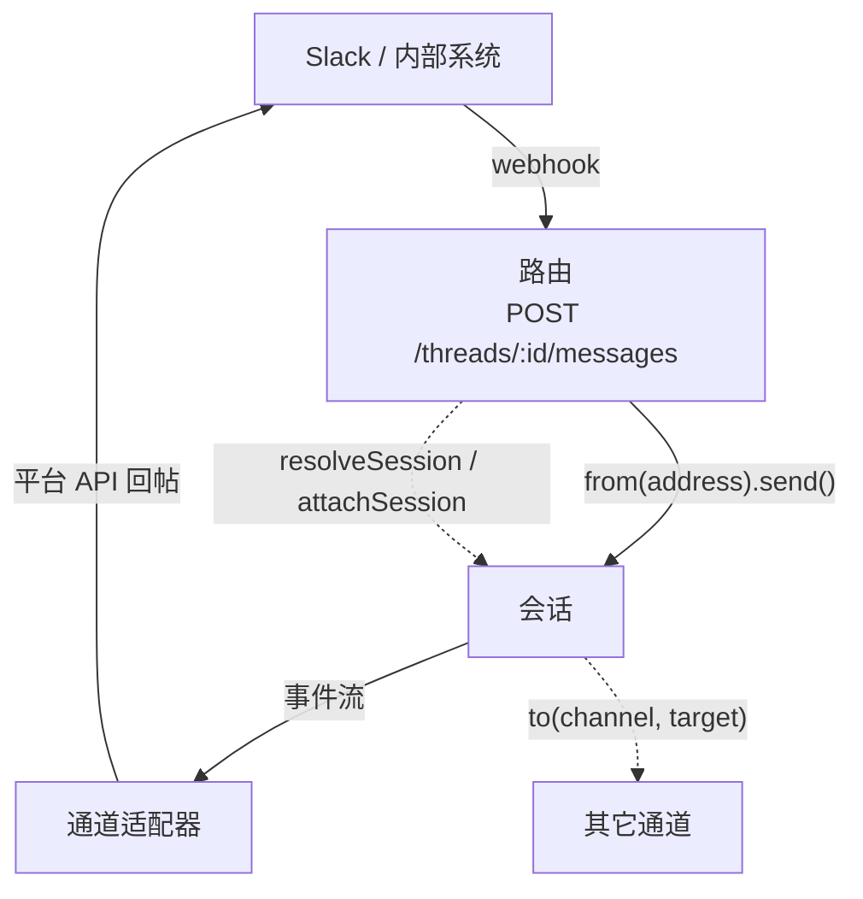

# 第 14 章 通道

> 通道决定 agent 在哪里和用户见面，也决定「谁在说话」。同一份 agent 代码可以同时挂到 HTTP、Slack、Discord、Telegram。这一章讲默认 HTTP 通道的鉴权，以及怎么接 Slack、写自定义通道。

## 14.1 通道解决两件事

1. **投递**：平台消息进来，转成 turn；回复出去，转成平台格式。
2. **身份**：把平台用户映射成 eve 的 principal，让工具能按人/租户隔离。

第二件比第一件重要。没有身份映射，所有「按用户」的逻辑都会退化成一个共享账号，记忆、审批、配额全部串号。

## 14.2 选哪个通道

| 你要的 | 用 |
| --- | --- |
| 网页聊天 | eve 通道 + `useEveAgent`（第 17 章） |
| 本地工具、SDK、`curl` | 默认 eve HTTP 通道 |
| Slack 的 @、DM、按钮 | `channel/slack` |
| Discord 斜杠命令、组件 | `channel/discord` |
| Teams 消息 + Adaptive Cards | `channel/teams` |
| Telegram bot | `channel/telegram` |
| 短信 / 电话转写 | `channel/twilio`、`channel/linq` |
| GitHub issue / PR | `channel/github` |
| Linear issue 委派 | `channel/linear` |
| MCP 客户端把 agent 当工具用 | `channel/mcp` |
| 内部 webhook、WebSocket | 自定义通道 |

## 14.3 默认 HTTP 通道

`agent/channels/eve.ts` 配置 `/eve/v1` 整个表面。不写这个文件，框架用默认源：`[vercelOidc(), localDev(), placeholderAuth()]`。

```ts
// agent/channels/eve.ts
import { eveChannel } from "eve/channels/eve";
import { localDev, vercelOidc } from "eve/channels/auth";

export default eveChannel({
  auth: [vercelOidc(), localDev()],
});
```

`eveChannel` 的字段（只有 `auth` 必填）：

| 字段 | 类型 | 默认 | 说明 |
| --- | --- | --- | --- |
| `auth` | `AuthFn \| AuthFn[]` | 必填 | 路由鉴权链，按顺序尝试 |
| `audience` | `ChannelAudience \| (input) => ChannelAudience` | 按调用者推导 | 追踪内容的可见性分类 |
| `turnPolicy` | `"steer" \| "queue"` | `"steer"` | turn 进行中收到新消息怎么办 |
| `uploadPolicy` | `UploadPolicyInput \| "disabled"` | 25 MB、所有类型 | 入站附件的大小和类型 |
| `fetchFile` | `(url, ctx) => bytes \| { bytes, … } \| null` | 无 | 把 URL 形式的附件取回；返回 `null` 表示「不是我的，你去下载」 |
| `cors` | `boolean \| { origin, methods, … }` | 不处理 | 浏览器 CORS |
| `onMessage` | `(ctx, message) => { auth, context?, title? }` | 用路由鉴权结果 | 派发前改写入站消息 |
| `events` | 事件处理器表 | 无 | 流事件钩子，参数是 `(event, channel, ctx)` |
| `trustedForwarders` | 谓词 | 无 | 允许哪些上游转发用户身份；不配就一律 403 |

### 鉴权链怎么走

`auth` 收一个 `AuthFn` 或数组，按顺序尝试。每个条目三种结果：

| 返回 | 结果 |
| --- | --- |
| 一个 `SessionAuthContext` | 接受，停止遍历 |
| `null` / `undefined` | 跳过，试下一个 |
| **抛异常** | 用特定状态码拒绝（`UnauthenticatedError` → 401，`ForbiddenError` → 403） |

全部跳过 → 401，`WWW-Authenticate` 头会列出配置里声明过的方案（`httpBasic()` 声明 `Basic`，token 类声明 `Bearer`）。

### helper 一览

| Helper | 作用 |
| --- | --- |
| `localDev()` | 只在 `eve dev` / `vercel dev` 进程里放行（看部署环境，不看请求头） |
| `vercelOidc()` | 验证 Vercel OIDC bearer，本地 CLI 和同团队部署互调靠它 |
| `none()` | 显式接受匿名流量，**只放最后一位**，只用于公开演示 |
| `httpBasic({ username, password }, { realm })` | 共享用户名密码，最省事的内部工具方案 |
| `jwtHmac(...)` / `jwtEcdsa(...)` / `oidc(...)` | 自签 JWT / 非对称 JWT / 任意 OIDC issuer |
| `placeholderAuth()` | 生产一律 401，脚手架占位 |
| `verifyHttpBasic(header, { username, password })` | 低层校验，返回 `{ ok, sessionAuth }` |
| `withAuthChallenges(fn, challenges)` | 给自定义 `AuthFn` 声明 401 的方案 |

`localDev()` 和 `vercelOidc()` 都**不**放行生产环境的浏览器用户和外部客户端。面向公众的应用必须接自己的鉴权。

鉴权函数是**运行时**入口：里面读 `process.env` 是安全的，值不会进编译产物，进程启动时从源码重新取。反过来说，别把密码写成模块顶层的常量——那是编译期求值。细节见[附录 C](appendix-c-env-and-secrets.md)。

### 一个可用的单用户方案

```ts
// agent/channels/eve.ts
import { eveChannel } from "eve/channels/eve";
import { httpBasic, localDev, vercelOidc } from "eve/channels/auth";

const username = process.env.OPS_USERNAME;
const password = process.env.OPS_PASSWORD;

export default eveChannel({
  auth: [
    // 配置缺失就不挂这条，让请求落到后面的条目并最终 401
    ...(username && password
      ? [httpBasic({ username, password }, { realm: "opsbot" })]
      : []),
    vercelOidc(),
    localDev(),
  ],
});
```

需要自己控制校验细节（同源检查、注入 `attributes`）时，用低层组合：

```ts
// agent/lib/auth.ts
import { verifyHttpBasic, withAuthChallenges } from "eve/channels/auth";

export const appAuth = withAuthChallenges(
  (request: Request) => {
    const username = process.env.OPS_USERNAME;
    const password = process.env.OPS_PASSWORD;
    if (!username || !password) return null;              // 配置缺失 → 关闭

    // 浏览器发起的跨站请求一律拒绝
    if (request.headers.has("origin") &&
        request.headers.get("sec-fetch-site") !== "same-origin") return null;

    const result = verifyHttpBasic(request.headers.get("authorization"), { username, password });
    if (!result.ok) return null;

    return {
      ...result.sessionAuth,
      attributes: { team: "ops" },
      issuer: "opsbot",
    };
  },
  [{ scheme: "Basic", parameters: { realm: "opsbot", charset: "UTF-8" } }],
);
```

要点：缺环境变量、缺凭据、凭据错误，全部 **fail closed**（返回 `null`，最终 401）。共享密码不提供每人独立身份，多人使用要换真的会话鉴权。

### CORS

默认不管 CORS。浏览器直连时才开：

```ts
export default eveChannel({
  auth: [...],
  cors: {
    origin: "https://app.example.com",
    methods: ["GET", "POST"],
    allowedHeaders: ["authorization", "content-type"],
  },
});
```

### 上传

```ts
export default eveChannel({
  auth: [...],
  uploadPolicy: { maxBytes: 100 * 1024 * 1024 },
  async fetchFile(url) {
    if (!url.startsWith("https://uploads.example.com/")) return null;
    const r = await fetch(url, {
      headers: { authorization: `Bearer ${process.env.UPLOADS_TOKEN}` },
    });
    if (!r.ok) throw new Error(`上传取回失败 ${r.status}`);
    return Buffer.from(await r.arrayBuffer());
  },
});
```

- 默认上限 25 MB、所有类型。超出返回 `413`，类型不允许返回 `415`。
- 内联 base64 还受宿主请求体限制。Vercel Functions 是 4.5 MB，所以 base64 文件大约 3.3 MB 就到顶。
- 大文件先传到自己的存储，把 URL 放进 file part，再用 `fetchFile` 在 workflow step 内取回——字节不经过请求体。
- `uploadPolicy` 覆盖 eve 为这个通道 staged 的**所有**文件，包括它自己下载的 URL。

`uploadPolicy` 只有两个字段（可以只给一个，其余用默认值）：

| 字段 | 类型 | 默认 | 说明 |
| --- | --- | --- | --- |
| `maxBytes` | `number` | 25 MB | 解码后的大小上限。`0` 等于拒绝所有附件 |
| `allowedMediaTypes` | `string[] \| "*"` | `"*"` | 精确值或通配（`image/*`）。不在列表里返回 415 |

整个值也可以直接给 `"disabled"`，拒绝一切附件。

### 请求级上下文

```ts
import { defaultEveAuth, eveChannel } from "eve/channels/eve";

export default eveChannel({
  auth: [...],
  onMessage(ctx, message) {
    return {
      auth: defaultEveAuth(ctx),
      context: [`HTTP 调用者 ${ctx.eve.caller?.principalId ?? "anonymous"} 说：${message}`],
    };
  },
  events: {
    "message.completed"(eventData, _channel, ctx) {
      console.log("回复完成", { sessionId: ctx.session.id });
    },
  },
});
```

- `context` 字符串会变成**持久的用户消息**进历史。
- 只想影响本轮、不写历史，返回 `clientContext`。它替换请求自带的 `clientContext`，进入这个 turn 的每次模型调用，但不进会话历史。
- `ctx.eve.clientContext` 是客户端**原样**发来的那份，没发就是 `undefined`。用它来校验或纠正客户端状态：

```ts
async onMessage(ctx) {
  const auth = defaultEveAuth(ctx);
  const plan = await getVerifiedPlan(auth);           // 以服务端为准
  return { auth, clientContext: [`用户的套餐是 ${plan}。`] };
},
```

`clientContext` 的形状和请求里的一样（`ClientContextValue`：字符串、字符串数组或 JSON 对象）。返回 `[]` 表示丢掉请求带来的上下文，不返回则保留。eve 给客户端提供的内容打 `Client context:` 标签，`onMessage` 返回的不打标签。`onMessage` 只对带消息的请求跑，纯输入应答沿用请求自己的上下文。
- `onMessage` 必须返回 auth 结果。

### audience

通道创建会话时给一个可观测性分类，决定追踪能不能记录内容：

| 会话创建者 | 默认 audience |
| --- | --- |
| 匿名 | `unknown` |
| `user` / `service` / `runtime` principal | `private` |
| 其它 principal 类型 | `unknown` |

`audience` 不影响谁能访问（那是 `auth` 的事），只影响内容捕获。公开演示站可以设 `audience: "public"`。

## 14.4 Slack

```bash
eve add channel/slack
```

推荐走 Vercel Connect，它托管 bot token、请求验签、token 轮换和多工作区安装：

```ts
// agent/channels/slack.ts
import { connectSlackCredentials } from "@vercel/connect/eve";
import { slackChannel } from "eve/channels/slack";

export default slackChannel({
  credentials: connectSlackCredentials("slack/opsbot"),
});
```

不想用 Connect 就自己管凭据：在 Slack app 里加 `app_mentions:read`、`chat:write`（DM 还要 `im:history`，附件要 `files:read`，长回复转摘要要 `files:write`），把 Request URL 指向 `https://<你的域名>/eve/v1/slack`。

Slack 通道自动处理：

- `@mention`、DM、slash command、快捷方式、交互回调
- 在线程里回复、打字指示器
- **把审批和提问渲染成按钮和下拉**
- 任务卡片（子代理/长任务的进度）
- 长回复自动转成 snippet

文本型通道（Twilio、GitHub、Linear、Chat SDK 系）只能一次显示一个请求，答完再显示下一个；Slack 这类有按钮的通道会把所有待答请求都摆出来。

### 排查

| 现象 | 先查什么 |
| --- | --- |
| @ 了没反应 | 事件订阅没开 `app_mention`，或 Request URL 指错，或部署在 Deployment Protection 后面 |
| 审批按钮点不动 | Interactivity 的 Request URL 没配 |
| DM 或线程回复不工作 | 加 `message.im` + `im:history`，重装 app |
| 长回复发不出 | 加 `files:write`，重装 app |
| 预览分支收不到 | 分支域名要能绕过 Deployment Protection，或加 `x-vercel-protection-bypass` |

## 14.5 其它平台

| 通道 | 命令 | 备注 |
| --- | --- | --- |
| Discord | `eve add channel/discord` | 服务器/频道 |
| Telegram | `eve add channel/telegram` | bot |
| Teams | `eve add channel/teams` | Adaptive Cards |
| GitHub | `eve add channel/github` | issue/PR，可 checkout 代码 |
| Linear | `eve add channel/linear` | issue 委派、Agent Sessions |
| Twilio | `eve add channel/twilio` | SMS/语音 |
| MCP | `eve add channel/mcp` | 把 agent 的工具发布成 MCP server |
| Web Chat | `eve add channel/web` | Next.js / TanStack Start 前端 |

配置文件都在 `agent/channels/<name>.ts`，配置项按平台不同。共同点：都会把平台用户映射成 principal。

## 14.6 自定义通道

自定义通道要处理两个方向：平台消息进来（入站）、agent 回复出去（出站）。



入站用**地址句柄**（`from(address)`），因为它要跟随「谁现在拥有这个线程」；出站由事件流驱动，通道把事件翻译成平台格式。`attachSession` 只在你明确要钉住某个会话 ID 时用。

平台不在列表里，或要接内部系统时，写 `defineChannel`。路由是数组，用 `GET` / `POST` / `WS` 构造：

```ts
// agent/channels/internal.ts
import { defineChannel, GET, POST } from "eve/channels";

export default defineChannel({
  routes: [
    POST("/threads/:threadId/messages", async (request, { from, params }) => {
      const body = await request.json();

      if (body.message === "/new") {
        return Response.json(await from(params.threadId).reset({ reason: "用户要求重开" }));
      }

      const session = await from(params.threadId).send(body.message, {
        auth: {
          authenticator: "internal",
          principalId: body.userId,
          principalType: "user",
        },
      });
      return Response.json({ sessionId: session.id });
    }),

    POST("/threads/:threadId/cancel", async (_request, { from, params }) =>
      Response.json(await from(params.threadId).cancel()),
    ),

    GET("/sessions/:sessionId/stream", async (_request, { attachSession, params }) => {
      const stream = await attachSession(params.sessionId).getEventStream();
      return new Response(stream, {
        headers: { "content-type": "application/x-ndjson; charset=utf-8" },
      });
    }),
  ],

  events: {
    "message.completed"(event, _channel, ctx) {
      console.log(ctx.session.id, event.message);
    },
  },
});
```

注意：路由的 `path` 就是应用 URL，**不会**自动加通道名前缀。上面第一条回答的是 `POST /threads/:threadId/messages`，不是 `/internal/threads/...`。也不要占用 `/eve/v1/*`。

`defineChannel` 的字段：

| 字段 | 类型 | 必填 | 说明 |
| --- | --- | --- | --- |
| `routes` | `RouteDefinition[]` | 是 | 用 `GET` / `POST` / `WS` 构造的路由表 |
| `state` | 任意可序列化对象 | 否 | 通道自己的适配器状态，跨请求保留 |
| `metadata` | `(state) => object` | 否 | 把 state 投影成可观测元数据，只返回想暴露的字段 |
| `context` | `(state, session) => ctx` | 否 | 构造传给 `events` / `deliver` 的通道上下文 |
| `events` | 事件处理器表 | 否 | 流事件钩子，参数 `(event, channel, ctx)` |
| `receive` | `(input, ctx) => Session` | 否 | 跨通道投递的接收端实现 |
| `deliver` | `(payload, ctx) => StepInput` | 否 | 自定义投递逻辑（默认走事件流） |
| `turnPolicy` | `"steer" \| "queue"` | 否 | 该通道消息的默认策略 |
| `cors` | `boolean \| options` | 否 | 该通道路由的 CORS |
| `audience` | `(input) => ChannelAudience` | 否 | 会话受众分类 |
| `fetchFile` | 同 `eveChannel` | 否 | 取回 URL 形式的附件 |
| `uploadPolicy` | 同 `eveChannel` | 否 | 附件大小和类型 |

路由处理器的第二个参数：

| 参数 | 类型 | 说明 |
| --- | --- | --- |
| `from` | `(address) => 地址句柄` | 按通道地址寻址，`send()` 才会建会话 |
| `resolveSession` | `(address) => Session \| null` | 查当前持有该地址的会话快照 |
| `attachSession` | `(sessionId) => Session` | 钉死一个会话 ID，不做 IO |
| `to` | `(channel, target) => 句柄` | 往别的通道投递 |
| `params` | `Record<string, string>` | 路径参数（`:threadId` 等） |
| `waitUntil` | `(p: Promise) => void` | 延长请求寿命，做后台工作 |
| `requestIp` | `string \| null` | 宿主机报告的最佳猜测 IP |
| `describe` | `() => Promise<AgentDescription>` | agent 名称、描述、可在会话外跑的工具、技能清单 |
| `listSkillFiles` | `(skill) => Promise<…>` | 列出一个技能的普通文件 |
| `readSkill` | `(skill, path?) => Promise<Uint8Array>` | 读技能文件，默认 `SKILL.md`，单文件上限 512 KiB |
| `invokeTool` | `(name, input, opts) => Promise<…>` | 以指定身份在会话外跑一个工具 |

### 三种句柄，别混

| 句柄 | 寻址方式 | 会建会话吗 |
| --- | --- | --- |
| `from(address)` | 通道自己的地址（线程、频道…） | **只有 `send()` 会** |
| `resolveSession(address)` | 查当前拥有该地址的会话快照 | 不会 |
| `attachSession(sessionId)` | 固定的会话 ID | 不会 |

```ts
const source = from(threadId);
await source.send("Hello", { auth });
await source.respond(inputResponses, { auth });
await source.cancel({ turnId });
await source.compact();
await source.clear();
await source.reset({ reason: "Start over" });

const current = await resolveSession(threadId);   // 当前持有者
const fixed = attachSession(sessionId);           // 钉死一个 ID
```

地址句柄是**动态**的：每次调用都指向当前拥有该地址的会话。`attachSession` 是**固定**的：永远指向那一个 ID，不会跟随、不会重建。

### 地址竞争与 stranded

- 冷启动时两个请求同时发到同一个地址：输的那个把消息**转发**给赢家，然后退出。不会出现两个进程同时服务一个线程。
- 地址上的会话 stranded（被别的 eve 版本构建）时：`send()` 结束它并在同一地址开新会话；`respond()` 抛 `SessionStrandedError`（新会话没有那个请求可答）。

### 元数据

通道可以把适配器状态投影成 metadata，给 instrumentation、动态工具/技能/指令解析器读：

```ts
export default defineChannel({
  state: {
    topic: null as string | null,
    internalCounter: 0,
  },
  metadata(state) {
    return { topic: state.topic };       // 只暴露想暴露的
  },
  routes: [
    POST("/start", async (req, { from }) => {
      const body = await req.json();
      await from(body.token).send(body.message, {
        auth: null,
        state: { topic: body.topic, internalCounter: 0 },
      });
      return new Response("ok");
    }),
  ],
});
```

`state` 里的字段不会自动暴露——`metadata(state)` 返回什么，解析器才能看到什么。

### WebSocket

```ts
import { defineChannel, WS } from "eve/channels";

export default defineChannel({
  routes: [
    WS("/voice/ws", async (_req, { from }) => ({
      async message(_peer, message) {
        await from("voice-demo").send(message.text(), { auth: null });
      },
    })),
  ],
});
```

`WS()` 每个升级请求跑一次，返回生命周期钩子（`upgrade` / `open` / `message` / `close` / `error`）。参数和 HTTP 路由一样（`from`、`to`、`attachSession`、`params`、`waitUntil`、`requestIp`）。

### 跨通道投递

```ts
await to(slack, { channelId: "C0123ABC" }).send("日报已生成", { auth: appAuth });
```

`to(channel, target)` 返回的句柄和路由里的 `from(address)` 契约一致。跨通道投递会**新建会话**（除非目标是已有对话，比如某个 Slack 线程）。

## 14.7 MCP 通道：把 agent 的工具发布出去

反过来，让别的 MCP 客户端把**你的 agent** 当工具用：

```ts
// agent/channels/mcp.ts
import { localDev } from "eve/channels/auth";
import { mcpChannel } from "eve/channels/mcp";

export default mcpChannel({
  auth: localDev(),
  tools: true,
});
```

三个开关：

| 开关 | 默认 | 作用 |
| --- | --- | --- |
| `agent` | 开 | 发布 `agent_start` / `agent_get` / `agent_update` / `agent_cancel` 四个会话工具 |
| `tools` | 关 | 额外发布 agent 能在会话外直接跑的工具 |
| `skills` | 开 | 发布技能 |

`tools: true` 的边界要说清楚：框架工具、workflow / provider 工具、没有 `execute` 的工具、动态解析器和子代理加的工具**都不发布**。三个开关全关会抛错（什么都发布不了）。

每个 `tools/call` 用路由认证的调用者身份执行，**不经过模型**。除非加入 tool session，每次调用是独立会话：

- `defineState` 从初始值开始，改动不保留；
- 调用打开的沙箱在结束时删除；
- 调用可以并行，丢响应后的重试会真的再跑一次。

这意味着**能调这些工具的调用者可以绕过 agent 的指令直接操作**。开 `tools: true` 之前先看一遍会暴露什么。

## 14.8 通道 vs 连接

容易混：

| | 通道 | 连接 |
| --- | --- | --- |
| 方向 | 用户 → agent | agent → 服务 |
| 例子 | Slack、HTTP、Telegram | Linear MCP、CRM OpenAPI |
| 模型感知 | 不感知，通道在模型之外 | 感知，工具出现在目录里 |

一个 agent 可以同时有多个通道和多个连接，互不影响。

## 14.9 常见注意事项

**注意：上线后发现谁都能访问。**
脚手架带 `placeholderAuth()`，它在生产返回 401。但如果你删掉了 `channels/eve.ts` 或改成了 `localDev()`，生产就裸奔了。上线前用无凭据的 `curl` 打一次 `POST /eve/v1/session`，必须 401。

**注意：Slack 里 @ 了但没反应。**
事件订阅没开 `app_mention`，或 Request URL 指错，或部署在 Deployment Protection 后面而 Slack 过不去。

**注意：Slack 里审批按钮点不动。**
Interactivity 的 Request URL 没配。审批按钮走的是交互回调。

**注意：把 bot token 写进代码。**
走环境变量或 Vercel Connect。

**注意：自定义通道里 `from(address)` 用错地址粒度。**
地址粒度决定「什么算同一段对话」。Slack 用线程级，Discord 用频道级，选错会让不同人的对话串在一起。

**注意：用 `attachSession` 处理平台消息。**
它是固定 ID 句柄，不会跟随地址变化。平台消息应该用 `from(address)`。

**注意：以为通道鉴权能保护工具。**
通道鉴权只决定「谁能发消息」。工具级权限要用 `approval` 和工具内的 `ctx.session.auth` 判断。

**注意：`metadata(state)` 返回整个 state。**
内部计数器、临时字段都会泄漏给解析器。只返回需要暴露的字段。

## 14.10 练习

1. 用 HTTP Basic 给 opsbot 加鉴权，用 `curl` 验证无凭据 401、有凭据 200。
2. 接 Slack，在频道里 @ 它，走一遍审批按钮。
3. 写一个自定义通道，暴露 `POST /threads/:id/messages` 和 `GET /sessions/:id/stream`，把 `userId` 映射成 principal。
4. 给自定义通道加 `metadata(state)`，在动态指令里读 `ctx.channel.metadata.topic`。
5. 用 `to(...)` 从定时任务往 Slack 频道发一条消息。

## 延伸阅读

- [Channels overview](https://eve.dev/docs/channels/overview)
- [eve channel](https://eve.dev/docs/channels/eve)
- [Slack](https://eve.dev/docs/channels/slack)
- [Custom channels](https://eve.dev/docs/channels/custom)
- [Auth & route protection](https://eve.dev/docs/guides/auth-and-route-protection)

---

上一章：[13 连接](13-connections.md) · 下一章：[15 定时与钩子](15-schedules-and-hooks.md)
