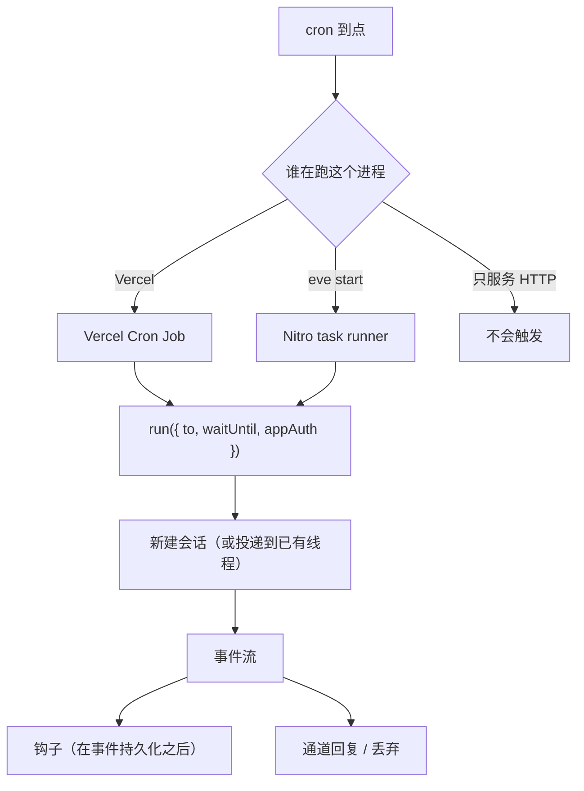

# 第 15 章 定时与钩子

> 定时任务让 agent 自己开工，钩子让你在 agent 干活时旁观并记录。前者是「主动」，后者是「被动」，两者都不经过用户消息。

## 15.1 定时任务和普通会话哪里不同

| | 普通会话 | 定时任务 |
| --- | --- | --- |
| 触发 | 用户消息 | cron |
| 通道 | 有 | **没有**（handler 形式可以自己指定目标） |
| 能否向人提问 | 能 | markdown 形式**不能** |
| 每次触发 | 续接同一会话 | **新会话** |
| 输出 | 回到通道 | markdown 丢弃；handler 发到指定通道 |

最后两条是设计意图：没人看着的任务不该无限期挂着等人回答，也不该复用上一次的对话状态。

## 15.2 两种形式

文件放 `agent/schedules/`，名字从路径推导（`agent/schedules/daily/digest.ts` → `daily/digest`）。

### markdown：发完就不管

```md
<!-- agent/schedules/cleanup.md -->
---
cron: "0 0 * * 0"
---

清理超过 90 天的会话归档，输出清理条数。
```

或 TypeScript：

```ts
// agent/schedules/heartbeat.ts
import { defineSchedule } from "eve/schedules";

export default defineSchedule({
  cron: "*/5 * * * *",
  markdown: "拉取未关闭的 P1 事故，把摘要 POST 到指标端点。",
});
```

特点：

- **没有通道**，不能向人请求输入。
- 调到需要审批的工具时，会话**直接失败**，不会挂起等待。
- 输出被丢弃，但 agent 仍然可以调工具、写库、打日志。
- 每次触发都是**新会话**。

### handler：自己决定发到哪

```ts
// agent/schedules/critical-alerts.ts
import { defineSchedule } from "eve/schedules";
import slack from "../channels/slack";

export default defineSchedule({
  cron: "*/10 * * * *",
  async run({ to, waitUntil, appAuth }) {
    waitUntil(
      to(slack, { channelId: "C0123ABC" }).send(
        "汇总最近 10 分钟新增的 P1 告警，按服务分组。",
        { auth: appAuth },
      ),
    );
  },
});
```

`defineSchedule` 只有三个字段，`cron` 必填，`markdown` 和 `run` **必须且只能给一个**：

| 字段 | 类型 | 说明 |
| --- | --- | --- |
| `cron` | `string` | 标准 5 段表达式，分钟粒度，Vercel 上按 UTC |
| `markdown` | `string` | 发给 agent 的提示词。跑完丢弃输出，没有通道 |
| `run` | `({ to, waitUntil, appAuth }) => void \| Promise<void>` | 完整处理器，自己决定发到哪 |

`run` 拿到三个东西：

| 参数 | 作用 |
| --- | --- |
| `to(channel, target)` | 选一个通道目标，然后 `.send()` |
| `waitUntil(promise)` | 把任务寿命延长到 promise settle，**必须包住 send** |
| `appAuth` | 应用身份 principal：`{ authenticator: "app", principalId: "eve:app", principalType: "runtime" }` |

`to(channel, target).send(message, options)` 的 options：

| 字段 | 类型 | 必填 | 说明 |
| --- | --- | --- | --- |
| `auth` | `SessionAuthContext \| null` | 是 | 这次投递以谁的身份跑。自动化传 `appAuth` |
| `context` | `string[]` | 否 | 作为用户消息持久化到目标会话历史 |
| `initiatorAuth` | `SessionAuthContext \| null` | 否 | 新会话的创建者身份，默认同 `auth` |
| `outputSchema` | JSON Schema | 否 | 要求目标这一轮产出结构化结果 |
| `title` | `string` | 否 | 新建会话的标题 |
| `turnPolicy` | `"steer" \| "queue"` | 否 | 目标会话正忙时的策略 |
| `state` | 通道自己的 state | 通道声明了 `state` 时必填 | 适配器初始状态 |

`auth` 是**必填**的，而且允许显式传 `null`（匿名）。漏掉它不会编译通过，这是有意的：投递必须明确「以谁的身份」。

### 为什么必须 `waitUntil`

cron 任务的执行窗口是有限的。`send()` 只是把消息投递给另一个会话，真正跑起来是在那之后。不包 `waitUntil`，任务可能在 `send` 完成前就结束，停泊的会话和在途的取数都没 settle 完。

```ts
// 对
waitUntil(to(slack, target).send(msg, { auth: appAuth }));

// 错：任务可能提前结束
await to(slack, target).send(msg, { auth: appAuth });
```

### 识别应用身份

```ts
import { isScheduleAuth } from "eve/schedules";

if (isScheduleAuth(ctx.session.auth.current)) {
  // 这是 agent 自己在干活，不是用户在操作
}
```

它判断的是 **principal 身份**，不是「这轮怎么来的」。handler 用用户身份发送时返回 `false`；任何代码把 `appAuth` 传下去，返回 `true`。

用途：让自动化跳过审批，但人来调时仍然要批（第 11 章）。

## 15.3 cron 的细节

标准 5 段：`分 时 日 月 周`，分钟粒度。

**Vercel 按 UTC 计算。** `"0 9 * * 1-5"` 是 UTC 09:00，北京时间 17:00。要北京时间早上 9 点，写 `"0 1 * * 1-5"`。

`eve dev` **不会**按 cron 触发。要手动触发：

```bash
curl -X POST http://localhost:2000/eve/v1/dev/schedules/heartbeat
# {"scheduleId":"heartbeat","sessionIds":["..."]}
```

- 嵌套名字要 URL 编码斜杠（`daily/digest` → `daily%2Fdigest`）。
- 未知 id 返回 404 并列出可用 id。
- 这个路由只在 dev 存在，生产构建不挂载，也不需要鉴权（dev server 只监听本地）。
- 它跑的是和生产 cron 完全相同的派发路径，返回启动的 session id，可以接着订阅每个会话的流。

## 15.4 部署后的定时任务

| 环境 | 行为 |
| --- | --- |
| Vercel | 每个 schedule 变成 Vercel Cron Job，写进 Build Output 配置 |
| `eve build && eve start` | 注册为 Nitro scheduled task，由 Nitro 的 runner 触发 |
| 自定义托管 | **可能不触发**。只服务 HTTP、不启动 Nitro 任务 runner 的平台不会跑 cron |

第三种情况很隐蔽：定义编译成功了，`eve info` 里也有，但就是不执行。要么用 `eve start`，要么用你自己的调度器通过鉴权路由/通道投递触发。



`NO` 这条分支是部署时的常见事故：容器平台把 `.output` 当普通 Node 服务跑，Nitro 的定时任务模块根本没启动。

在 Vercel 上确认：**Settings → Cron Jobs** 看发现，**Observability → Cron Jobs** 看执行历史，**Logs** 看单次运行。

## 15.5 会话连续性

**每次触发都是新会话**，除非 handler 发到一个已有对话（比如某个 Slack 线程）。

需要跨触发保留的数据，存外部存储或 memory 槽，**不要**指望会话状态：

```ts
// 错：上次运行的状态下次读不到
incident.update(...);   // 新会话，全新 state

// 对：写外部存储
await db.set("digest:last-run", new Date().toISOString());
```

### 让用户自己定义定时任务

`agent/schedules/` 里的文件是编译期发现的，用户没法在运行时加一个。要做「每个租户自己配日报时间」，用一个每分钟醒一次的静态任务当派发器：CRUD 工具写你自己的表，handler 原子地领走到期的行，再用 `to(...)` 或 `receive(...)` 起一个普通会话。要点是存储层提供**原子租约**，不是某种固定表结构。完整写法见官方 [Dynamic Scheduling](https://eve.dev/docs/patterns/dynamic-scheduling)。

`eve@0.80` 起，定时任务拉起的会话也能用动态定时工具和 schedule client 管理定时任务（含条件更新、关掉未来几次），集合作用域鉴权和工具审批照常生效。

## 15.6 钩子：订阅事件流

```ts
// agent/hooks/audit.ts
import { defineHook } from "eve/hooks";

export default defineHook({
  events: {
    async "session.started"(_event, ctx) {
      console.info("会话开始", { sessionId: ctx.session.id });
    },
    async "message.completed"(event) {
      console.info("模型说完一段", { length: event.data.message?.length ?? 0 });
    },
  },
});
```

名字来自路径：`agent/hooks/audit.ts` → `audit`，`agent/hooks/auth/load-profile.ts` → `auth/load-profile`。

`defineHook` 只有一个字段：

| 字段 | 类型 | 说明 |
| --- | --- | --- |
| `events` | `Record<事件类型 \| "*", (event, ctx) => void \| Promise<void>>` | 要订阅的事件和处理器 |

`events` 的 key 是事件类型，`"*"` 匹配所有事件。可订阅的类型是框架显式列出的那一组（`action.result`、`turn.*`、`session.*`、`input.*`、`approval.*`、`task.*`、`agent.started` 等），新协议事件不会自动变成钩子事件。

**钩子只能观察，不能往上下文里注入内容。** 要注入内容用 `defineDynamic` + `defineInstructions`（第 6 章）。

### 钩子能拿到什么

```ts
interface HookContext extends SessionContext {
  readonly agent: { readonly name: string; readonly nodeId?: string };
  readonly channel: { readonly kind?: string; readonly continuationToken?: string };
  cancel(): void;
}
```

加上 `SessionContext` 的全部能力：`ctx.session`、`ctx.getSandbox()`、`ctx.getToken()` 等。

所以钩子可以在 turn 结束后释放沙箱算力：

```ts
export default defineHook({
  events: {
    async "turn.completed"(_event, ctx) {
      const sandbox = await ctx.getSandbox();
      await sandbox.stop();      // 停算力，文件还在
    },
  },
});
```

### 三种用途

| 用途 | 典型事件 |
| --- | --- |
| 审计 / 合规 | `action.result`、`turn.completed` |
| 指标 / 告警 | `turn.failed`、`step.failed`、`session.limit` 相关事件 |
| 数据落库 / 分析 | `"*"` 全量 |

## 15.7 把事件落到自己的库

每个事件都有 `meta.id`（ULID，写入时生成一次），是天然主键：

```ts
// agent/hooks/persist.ts
import { defineHook } from "eve/hooks";

export default defineHook({
  events: {
    async "*"(event, ctx) {
      await db.query(
        `insert into agent_events (id, session_id, type, data, emitted_at)
         values ($1, $2, $3, $4, $5)
         on conflict (id) do nothing`,
        [
          event.meta.id,
          ctx.session.id,
          event.type,
          "data" in event ? event.data : null,
          event.meta.at,
        ],
      );
    },
  },
});
```

**`meta.id` 保证什么、不保证什么**，这张表要记住：

| 场景 | 会不会重复 | 靠什么处理 |
| --- | --- | --- |
| 重连、回绕、重放已完成的会话 | 会，但 id 相同 | `on conflict (id) do nothing` |
| step 被打断后重跑 | 会，且 **id 不同** | 只能靠业务幂等键 |

所以：

- 需要「每个 turn/step 只发生一次」的副作用（扣款、发邮件、建工单），用 `event.data` 里的坐标（`turnId`、`stepIndex`、`sequence`）做键。重试会恢复同样的坐标，闸门才有效。
- 需要「存内容」的表，**不要**用这些坐标做键。重试会重新调用模型，同一个坐标可能对应不同的文本，`on conflict` 会留下被放弃的那次、丢掉完成的那次。

一句话：**钩子是 at-least-once，没有任何键能折叠一次重试。**

## 15.8 执行顺序

事件发布时，拥有这个会话的 step 按顺序做四件事：

1. 通道处理器（可能改写适配器状态）
2. 写入持久流（打上 `meta` 信封）
3. 钩子（先具体类型的处理器，再 `"*"`）
4. 模型准备（仅模型生命周期事件；动态解析器在这里更新上下文）

钩子**总在事件持久化之后**跑。所以钩子抛异常不会污染流。

## 15.9 钩子抛异常会怎样

- eve 记录日志（钩子名、订阅、事件类型、事件 ID、会话 ID）
- 继续跑剩下的订阅者
- 当前 turn、子代理通知、会话**继续**
- **不重试**

抛异常不会否决 turn。要中止 turn 必须显式调 `ctx.cancel()`：

```ts
// agent/hooks/require-credentials.ts
import { defineHook } from "eve/hooks";
import { loadWorkspaceCredentials } from "../lib/credentials";

export default defineHook({
  events: {
    async "turn.started"(_event, ctx) {
      try {
        await loadWorkspaceCredentials(ctx.session.auth.current);
      } catch (error) {
        console.warn("取消 turn：凭据不可用", { error, sessionId: ctx.session.id });
        ctx.cancel();
      }
    },
  },
});
```

`ctx.cancel()` 返回 `void`，不要 `await`。调用后 turn 以 `turn.cancelled` → `session.waiting` 结束，**不产生失败事件**。

它在这些事件上无效（会被忽略并记警告）：`turn.completed`、`turn.failed`、`session.completed`、`turn.waiting`、`task.started`、`agent.started` 等。

## 15.10 只对某个通道生效

`agent/hooks/` 下的钩子观察**所有**通道的事件。需要平台特定逻辑时，用通道自己的 `events`：

```ts
// agent/channels/github.ts
export default githubChannel({
  events: {
    async "turn.completed"(event, channel, ctx) {
      console.info("GitHub turn 完成", {
        repository: channel.repository.fullName,
        sessionId: ctx.session.id,
        turnId: event.turnId,
      });
    },
  },
});
```

这样平台相关副作用不依赖「先判断 `channel.kind` 再早退」这种容易写错的守卫。内置通道上，手写的处理器会**替换**该通道对同一事件的默认处理器——覆盖前先看文档，别把回复投递、错误提示这类关键逻辑盖掉。

## 15.11 从事件里取类型化的工具结果

```ts
import { defineHook } from "eve/hooks";
import { toolResultFrom } from "eve/tools";
import readLogs from "../tools/read_logs";
import linear from "../connections/linear";

export default defineHook({
  events: {
    "action.result"(event) {
      const logs = toolResultFrom(event.data.result, readLogs);
      if (logs) console.log(logs.output.lines.length);   // 类型化

      const linearResult = toolResultFrom(event.data.result, linear);
      if (linearResult) console.log(linearResult.connectionToolName);
    },
  },
});
```

结果不匹配或 `isError` 为真时返回 `undefined`。它按**工具定义**匹配，所以挂载的扩展工具（`crm__search`）也能认出来。

## 15.12 子代理的钩子

子代理可以有自己的 `agent/hooks/`：

- 子代理的钩子**只在子代理作用域触发**。
- 父级的钩子**不会**因子代理的 turn 而触发。
- 子代理钩子只看到自己的上下文。

但交互事件（`input.requested`、`authorization.required`）会**代理到父流**上，父级钩子能在父级的 session/agent/channel 上下文里观察它们。事件里保留子代理的 turn 坐标，所以 `event.data.turnId` 可能不等于 `ctx.session.turn.id`。

## 15.13 完整例子：审计 + 日报

```ts
// agent/hooks/audit.ts
import { defineHook } from "eve/hooks";
import { toolResultFrom } from "eve/tools";
import restartService from "../tools/restart_service";

export default defineHook({
  events: {
    async "action.result"(event, ctx) {
      const restart = toolResultFrom(event.data.result, restartService);
      if (!restart) return;

      await db.audit.insert({
        at: event.meta.at,
        sessionId: ctx.session.id,
        turnId: event.data.turnId,
        service: restart.output.service,
        actor: ctx.session.auth.current?.principalId ?? "unknown",
      });
    },
  },
});
```

```ts
// agent/schedules/daily-digest.ts
import { defineSchedule } from "eve/schedules";
import slack from "../channels/slack";

export default defineSchedule({
  cron: "0 1 * * 1-5",        // UTC 01:00 = 北京 09:00
  async run({ to, waitUntil, appAuth }) {
    waitUntil(
      to(slack, { channelId: "C_OPS" }).send(
        [
          "生成昨天的运维日报，包含：",
          "1. 新增和关闭的事故数，按级别分组",
          "2. 重启操作次数和涉及的服务",
          "3. 错误预算消耗最快的三个服务",
          "如果没有异常，调用 no_reply 不要发消息。",
        ].join("\n"),
        { auth: appAuth },
      ),
    );
  },
});
```

配 `no_reply` 工具（`eve add tool/no_reply`）可以让 agent 在「没什么可报」时主动静默，而不是发一条「今天一切正常」。

## 15.14 常见注意事项

**注意：handler 里忘了 `waitUntil`。**
cron 任务可能在 `send` 完成前就结束，停泊的会话和在途的取数都没 settle 完。

**注意：cron 时区搞错。**
Vercel 用 UTC。写完在日历上换算一遍。

**注意：markdown 定时任务调用了要审批的工具。**
直接失败，不挂起。改用 handler 发到有人的通道。

**注意：指望定时任务记住上次的状态。**
每次都是新会话。状态放外部存储。

**注意：钩子里抛异常想阻止 turn。**
不会阻止。用 `ctx.cancel()`。

**注意：用 `meta.id` 做「只发一次邮件」的闸门。**
重试会发新 id。用 `turnId + stepIndex + sequence`。

**注意：自定义托管平台上 cron 不触发。**
平台没启动 Nitro 任务 runner。用 `eve start` 或外部调度器。

**注意：钩子里读会话流，读不到刚发生的事件。**
当前 step 的事件可能还在缓冲。晚点再读。

**注意：在根钩子里按 `channel.kind` 写平台逻辑。**
容易漏判断。平台相关的逻辑放通道的 `events`。

## 15.15 练习

1. 写一个 markdown 定时任务，用 dev 路由手动触发，看它跑起来。
2. 改成 handler 形式发到 Slack，加 `waitUntil`。
3. 写一个 `"*"` 钩子把所有事件落到一张表，按 `meta.id` 去重。
4. 写一个 `turn.started` 钩子，凭据缺失时 `ctx.cancel()`，观察事件流里的 `turn.cancelled`。
5. 写一个子代理自己的钩子，确认父级钩子不会因它触发。

## 延伸阅读

- [Schedules](https://eve.dev/docs/schedules)
- [Hooks](https://eve.dev/docs/guides/hooks)
- [Sessions, Runs & Streaming](https://eve.dev/docs/concepts/sessions-runs-and-streaming)
- [Dynamic Scheduling](https://eve.dev/docs/patterns/dynamic-scheduling)

---

上一章：[14 通道](14-channels.md) · 下一章：[16 评测](16-evals.md)
