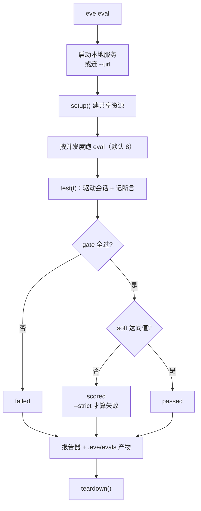

# 第 16 章 评测

> 评测用真实会话跑 agent 并打分。它跑的是用户会打到的同一套 HTTP 接口，所以一个通过的评测意味着「agent 启动了、接受了请求、给出了你断言的结果」。

## 16.1 为什么必须有评测

改一句提示词，可能让某个场景从「正确」变成「看起来正确但漏了关键步骤」。这种退化靠手测发现不了，靠眼睛看也看不出来——因为你只会测你想到的那几个场景。

评测解决三件事：

| 问题 | 评测怎么解 |
| --- | --- |
| 改了提示词，不知道有没有退化 | 固定用例 + 固定断言，跑一遍就知道 |
| 工具重构后行为变了 | 断言工具调用和顺序，而不是只看文字 |
| 多个人改同一个 agent | 提交前跑 `--strict`，退化挡住合入 |

eve 的评测不是单元测试：它启动真实 agent（或指向一个已部署的），用 TypeScript 客户端驱动会话，然后对事件流断言。所以它能抓到「模型根本没调那个工具」这种纯函数测试抓不到的问题。

## 16.2 最小评测

```text
opsbot/
├── agent/
├── evals/
│   ├── evals.config.ts
│   └── smoke.eval.ts
└── package.json
```

```ts
// evals/evals.config.ts
import { defineEvalConfig } from "eve/evals";

export default defineEvalConfig({});
```

```ts
// evals/smoke.eval.ts
import { defineEval } from "eve/evals";
import { includes } from "eve/evals/expect";

export default defineEval({
  description: "基本链路：能回话，能调对工具。",
  async test(t) {
    const turn = await t.send("payment-api 现在正常吗？");
    t.succeeded();
    t.calledTool("get_service_status");
    t.check(turn.message, includes("正常"));
  },
});
```

`defineEval` 的字段：

| 字段 | 类型 | 必填 | 说明 |
| --- | --- | --- | --- |
| `test` | `(t) => void \| Promise<void>` | 是 | 驱动 + 断言的全部脚本 |
| `description` | `string` | 否 | 报告里显示的名字 |
| `tags` | `string[]` | 否 | `--tag` / `--exclude-tag` 过滤用 |
| `timeoutMs` | `number` | 否 | 单个 eval 的超时，覆盖配置默认值 |
| `judge` | `{ model }` | 否 | 这个 eval 的评分模型，覆盖配置 |
| `reporters` | `EvalReporter[]` | 否 | 只给这个 eval 的报告器 |
| `metadata` | `Record<string, unknown>` | 否 | 自定义元数据，报告器可见 |

id 由文件路径推导（`evals/weather.eval.ts` → `weather`），写 `id` 或 `name` 会抛错。

`evals/` 目录**必须**有一个 `evals.config.ts`，空对象也行。

```bash
eve eval               # 跑全部
eve eval smoke         # 跑一个，或某个目录下的全部
eve eval --url https://opsbot.example.com   # 打已部署的
eve eval --list        # 只列出发现的 eval，不跑
eve eval --json        # 机器可读输出
```

退出码：

| 码 | 含义 |
| --- | --- |
| `0` | 所有未跳过的 eval 通过 gate（`--strict` 下还要通过 soft 阈值） |
| `1` | 有 eval 失败：gate 失败、执行错误、或 `--strict` 下的阈值未达 |
| `2` | 配置错误 |

`t.skip(reason)` 的 eval 记为跳过，不计入通过或失败，也不改退出码。

一轮评测的完整路径：



`scored` 是这套设计的关键：soft 断言（judge、score、similarity）默认只记录不拦截，让「质量波动」和「功能坏了」分开。CI 里加 `--strict` 才把质量也变成门槛。

## 16.3 `t` 既是驱动也是断言

`test(t)` 里的 `t` 同时干两件事：驱动 agent、记录断言。没有 `input` / `checks` / `scores` 字段，你写普通控制流。

### 驱动

| API | 作用 |
| --- | --- |
| `t.send(message)` | 建会话并发出第一条消息，等这一轮 settle，返回 turn |
| `t.session(options?)` | 只建会话，不发消息 |
| `turn.session.send(message)` | 在同一会话里追问 |
| `session.respond(responses)` | 回答待处理的人工输入 |
| `session.requireInputRequest(filter?)` | 断言恰好有一个待处理请求，并返回它 |
| `session.sendFile(text, path, mediaType?)` | 带附件 |
| `session.cancel()` | 取消当前 turn |
| `session.compact()` | 压缩 |

turn 上能读：`.message`、`.data`（结构化输出）、`.events`、`.inputRequests`、`.toolCalls`、`.sessionId`、`.status`、`.expectOk()`。

### 断言

三种面，各自对应一种判断：

| 面 | 写法 | 适合 |
| --- | --- | --- |
| 作用域方法 | `t.succeeded()`、`t.calledTool(...)` | 整体行为 |
| 值断言 | `t.check(value, includes("x"))` | 某段文本、解析后的 JSON |
| 打分 | `t.score(0.82).label("faithfulness")` | 自己算的指标 |
| 模型评分 | `t.judge("引用了来源")` | 模糊质量 |

### 常用的作用域方法

| 断言 | 检查什么 |
| --- | --- |
| `t.succeeded()` | 运行没失败，也没停在未答的人工输入上 |
| `t.parked()` | 干净地停在人工输入上 |
| `t.messageIncludes(x)` | 助手文本包含子串或匹配正则 |
| `t.calledTool(name, opts?)` | 某个工具调用完成（可查 `input`、`output`、`status`、`count`） |
| `t.notCalledTool(name)` | 从没请求过某个工具 |
| `t.toolOrder([...])` | 工具请求的顺序 |
| `t.usedNoTools()` | 完全没调工具（技能加载不算） |
| `t.maxToolCalls(n)` | 工具调用次数上限 |
| `t.noFailedActions()` | 没有工具/子代理/技能失败 |
| `t.calledSubagent(name)` | 发生过子代理委派 |
| `t.loadedSkill(name)` | 加载过某个技能 |
| `t.event(type, opts?)` | 出现过某类事件 |
| `t.eventOrder([...])` | 事件组的顺序 |

### 值断言

```ts
import { includes, equals, matches, satisfies, similarity } from "eve/evals/expect";

t.check(turn.message, includes(/正常/));
t.check(parsed, equals({ service: "payment-api", status: "healthy" }));
t.check(parsed, matches(StatusSchema));
t.check(turn.message, similarity("payment-api 正常，p99 82ms"));
t.check(latencyMs, satisfies((v) => v < 1000, "延迟低于 1 秒"));
```

| 构造器 | 判定 | 默认严重度 |
| --- | --- | --- |
| `includes` | 子串 / 正则 | gate |
| `equals` | 深相等 | gate |
| `matches` | Standard Schema（Zod 等） | gate |
| `similarity` | 归一化编辑距离，1 = 相同 | soft |
| `satisfies` | 自定义布尔谓词 | gate |

选最便宜的那个。精确匹配太严、judge 太重时，`similarity` 是中间档。

### 断言推理过程

provider 暴露推理内容时，每个完成的推理块会成为一个 `reasoning.completed` 事件。可以断言文本，也可以拼起来交给 judge：

```ts
turn.event("reasoning.completed", {
  data: { reasoning: /checks? the units/i },
});

const reasoning = turn.events
  .filter((event) => event.type === "reasoning.completed")
  .map((event) => event.data.reasoning)
  .join("\n\n");

t.judge("推理在给结论之前核对了假设。", { on: reasoning }).atLeast(0.8);
```

不暴露推理的 provider 根本不发这个事件：`turn.event` 那道 gate 直接失败，judge 评的是空字符串。provider 藏起来的推理无法评。默认的 judge 输入和 `session.transcript` 都不含推理，所以上面要显式传 `on`。

## 16.4 gate 与 soft

每个断言返回可链式的手柄，严重度挂在断言上：

- **gate（硬）**：失败即 eval 失败，`eve eval` 非零退出。作用域方法、`includes`、`equals`、`matches` 默认是 gate。
- **soft（软）**：只记录数据，进报告。低于阈值时 eval 标记为 `scored`（可见但不致命，除非加 `--strict`）。`similarity`、所有 `t.judge(...)`、所有 `t.score(...)` 默认是 soft。

```ts
t.succeeded();                                  // gate
t.calledTool("get_weather").soft();             // 只记指标
t.judge("引用了来源");                           // soft，无阈值
t.judge("回答与参考一致", { on: {...} }).atLeast(0.7);  // soft，--strict 下按 0.7 卡
t.score(brevity).label("brevity").gate(0.9);    // 硬卡 0.9
```

`await t.require(value, assertion)` 用于「必须过，否则后面的脚本没法继续」的检查。它记 gate 并在失败时停止脚本。

`t.skip(reason)` 放在最前面，表示这个目标不支持该能力，主动跳过。

## 16.5 多轮与人工输入

```ts
export default defineEval({
  async test(t) {
    const first = await t.send("先记一下：payment-api 的负责人是张三。");

    const second = await first.session.send("payment-api 谁负责？");
    await t.require(second.sessionId, equals(first.sessionId));
    second.messageIncludes("张三");
    t.succeeded();
  },
});
```

审批场景：

```ts
export default defineEval({
  async test(t) {
    const turn = await t.send("把 payment-api 重启一下");

    const request = turn.session.requireInputRequest({ toolName: "restart_service" });
    const after = await turn.session.respond([
      { requestId: request.requestId, optionId: "approve" },
    ]);

    after.calledTool("restart_service");
    t.succeeded();
  },
});
```

`requireInputRequest(filter?)` 要求**恰好一个**待处理请求，返回它。filter 可以按工具名、输入、prompt、选项 id 匹配。

`respondAll("approve")` 一次批准所有待处理请求。

## 16.6 工具桩

不想让评测真的调外部服务，用 `stubs`：

```ts
export default defineEval({
  async test(t) {
    const session = await t.session({
      stubs: [
        {
          id: "status",
          tool: "get_service_status",
          outcomes: [
            { response: { service: "payment-api", status: "degraded", instances: 3 } },
            { response: { service: "payment-api", status: "healthy", instances: 3 } },
          ],
        },
        {
          id: "restart",
          tool: "restart_service",
          match: { service: { const: "payment-api" } },
          outcome: { response: { restarted: true } },
        },
      ],
    });

    const first = await session.send("payment-api 现在怎么样？");
    first.expectOk();
    first.calledTool("get_service_status", { count: 1 });
    first.messageIncludes("降级");

    const second = await session.send("重启它，然后再查一次");
    second.toolOrder(["restart_service", "get_service_status"]);
    second.messageIncludes("正常");
  },
});
```

- `outcomes` 是序列，第 N 次调用用第 N 个；单次用 `outcome`。
- `match` 按输入匹配，只有匹配的调用才消费这个桩。
- 未被使用的桩会产生警告，但不失败。
- 同样的 `stubs` 也能传给 `client.sessions.create({ stubs })`。

一个桩的字段：

| 字段 | 类型 | 必填 | 说明 |
| --- | --- | --- | --- |
| `id` | `string` | 是 | 桩的标识，报告里用 |
| `tool` | `string` | 是 | 工具名。子代理的工具写成 `researcher/list_tasks` |
| `match` | `Record<string, JSON Schema \| boolean>` | 否 | 每个具名输入都要存在并满足 schema |
| `outcome` | `{ response } \| { throw: { message, name? } }` | 二选一 | 单次返回或抛错 |
| `outcomes` | 上面形状的数组（至少一个） | 二选一 | 按调用顺序消费 |

工具桩只替换**工具返回值**，不替换模型。所以要测「模型在拿到这个数据后会怎么做」，用它；要测「模型能不能正确生成 SQL」，得用真工具或 mock 模型。

## 16.7 确定性模型

不想让评测依赖真实模型（慢、贵、不稳定）时，把 agent 的模型换成 `mockModel`：

```ts
// agent/agent.ts（专用 fixture agent）
import { defineAgent } from "eve";
import { mockModel } from "eve/evals";

export default defineAgent({
  model: mockModel("固定回复"),
});
```

按对话内容回复：

```ts
model: mockModel(({ lastUserMessage, userMessageCount }) =>
  `第 ${userMessageCount} 轮：${lastUserMessage}`
),
```

构造确定的工具循环：

```ts
model: mockModel({
  modelId: "ops-script",
  provider: "fixtures",
  respond: ({ toolResults }) =>
    toolResults.length === 0
      ? { toolCalls: [{ name: "get_service_status", input: { service: "payment-api" } }] }
      : `状态：${JSON.stringify(toolResults[0]?.output)}`,
}),
```

`mockModel` 编译时按 100 万 token 上下文窗口处理，所以压缩不会干扰。要在小窗口下测压缩，显式设 `modelContextWindowTokens`。

它是 agent 定义的一部分，所以只适合专用 fixture agent，别把生产 agent 的模型改成 mock。

## 16.8 数据集扇出

一个文件跑多组输入：默认导出数组。

```ts
// evals/triage/dataset.eval.ts
import { defineEval } from "eve/evals";
import { includes } from "eve/evals/expect";
import cases from "./cases.json";

export default cases.map((c) =>
  defineEval({
    description: `分诊：${c.name}`,
    async test(t) {
      const turn = await t.send(c.input);
      t.succeeded();
      t.check(turn.message, includes(c.expect));
    },
  })
);
```

固定数据放 `evals/data/`，共享辅助函数放同级的非 `.eval.ts` 文件（任何不以 `.eval.ts` 结尾的文件都不会被当成评测）。

## 16.9 judge 的细节

```ts
t.judge("回答引用了日志证据，而不是猜测");
```

默认评分的是**最近一次 settle 的 turn** 的助手消息，输入是 `{ input, output }`（提示 + 回复）。

三种评分器：

| 问法 | 分数 |
| --- | --- |
| 字符串 / `boolean` | 模型给出的「为真概率」，0–1 |
| `score`（rubric） | 返回的档位 / 最高档位 |
| `choice` | 选中项等于 `expected` 得 1，否则 0 |

```ts
t.judge({
  type: "score",
  instructions: "评估回复的清晰度。",
  criteria: ["不清楚", "基本清楚", "清晰简洁"],
})
  .label("clarity")
  .atLeast(0.75);
```

要评整段多轮对话：

```ts
t.judge("助手记住了用户偏好的词", { on: first.session.transcript }).atLeast(0.8);
```

judge 用配置里的评分模型，**不是**被测 agent 的模型：

```ts
// evals/evals.config.ts
export default defineEvalConfig({
  judge: { model: "typesafe-ai/jev" },
});
```

judge 默认是 soft（可以用 `.gate()` 提升为硬性 gate）。常见做法是 `.atLeast(0.7)` 加 CI 里的 `--strict`。

## 16.10 运行、产物与 CI

```bash
eve eval                       # 本地起服务跑全部
eve eval --strict              # soft 低于阈值也算失败
eve eval --url https://...     # 打已部署环境
eve eval --tag fast            # 只跑带某个 tag 的
eve eval --exclude-tag slow    # 跳过带某个 tag 的
eve eval --max-concurrency 4   # 并发（默认 8）
eve eval --junit .eve/junit.xml
eve eval weather               # 只跑某个目录
```

每次运行会在 `.eve/evals/<timestamp>/` 下留产物：`summary.json`、`results.jsonl`，以及每个 eval 的断言结果、事件流和 `t.log` 输出。控制台输出是精简的，失败时去看产物。

CI 里的最小配置：

```yaml
- run: npm ci
- run: npx eve eval --strict --junit .eve/junit.xml
  env:
    OPENAI_API_KEY: ${{ secrets.OPENAI_API_KEY }}
```

建议的基线：

- 每个关键工具至少一个「调对了」的用例
- 每个关键拒绝场景一个「没调」的用例（比如问候不该查数据库）
- 每个审批场景一个「停下来等」的用例
- 一个多轮记忆用例
- 数据集扇出覆盖分类/分诊类逻辑

不要一上来写五十个。**先有三个能跑的 smoke，比有五十个写不完的强。**

## 16.11 配置与报告器

```ts
// evals/evals.config.ts
export default defineEvalConfig({
  judge: { model: "typesafe-ai/jev" },
  maxConcurrency: 4,
  timeoutMs: 120_000,
  async setup() {
    const db = await startTestDatabase();
    return { db };
  },
  async teardown(ctx) {
    await ctx?.db.close();
  },
});
```

`defineEvalConfig` 的字段：

| 字段 | 类型 | 默认 | 说明 |
| --- | --- | --- | --- |
| `judge` | `{ model }` | `typesafe-ai/jev` | `t.judge` 的默认评分模型 |
| `reporters` | `EvalReporter[]` | 控制台 | 整轮运行的报告器 |
| `maxConcurrency` | `number` | `8` | 并发执行的 eval 数 |
| `timeoutMs` | `number` | 单 eval 默认 | 单个 eval 的超时 |
| `setup` | `() => context \| Promise<context>` | 无 | 服务启动前跑一次，返回值进 `t.context` |
| `teardown` | `(context) => void \| Promise<void>` | 无 | 服务关闭后跑，失败也会跑 |

`setup` 在本地服务启动**之前**跑一次，`teardown` 在服务关闭后跑（包括失败情况）。并发评测共享这些资源，改数据的用例要自己隔离。

要在 eval 文件里用 `t.context` 的类型：

```ts
import type config from "./evals.config.js";

export default defineEval<typeof config>({
  async test(t) {
    await t.context.db.query("SELECT 1");
  },
});
```

报告器：

```ts
import { defineEvalConfig } from "eve/evals";
import { Braintrust } from "eve/evals/reporters";

export default defineEvalConfig({
  reporters: [Braintrust({ projectName: "opsbot" })],
});
```

配置里的报告器观察整轮运行，所以一个 `Braintrust()` 放在这里就够了，不用每个 eval 加一遍。

## 16.12 常见注意事项

**注意：`evals/` 下没有 `evals.config.ts`。**
评测跑不起来。空对象也要有。

**注意：断言 `eve__tool` 或 `eve__skill`。**
通过目录工具发的调用，报告的是**被调用条目**的名字（`linear__list_issues`）或技能加载。断言要写条目名。

**注意：`t.calledTool` 和 `t.usedNoTools` 同时用。**
互斥。选一个。

**注意：`t.succeeded()` 就以为覆盖了质量。**
它只检查「没失败、没卡住」。内容正确性要另外断言。

**注意：judge 没有阈值，以为它会让评测失败。**
judge 默认 soft 且无阈值，记录但不判定。要卡就 `.atLeast()` 并跑 `--strict`。

**注意：mock 模型用在生产 agent 上。**
`mockModel` 是 fixture 专用。生产 agent 的模型改成 mock 就永远返回固定文本。

**注意：工具桩匹配写得太宽。**
`match` 不写会按顺序消费所有调用，容易在第二次调用时拿到意外结果。按输入收窄。

**注意：改了提示词只跑本地 smoke。**
CI 里要跑 `--strict`，否则 soft 退化永远不拦。

## 16.13 练习

1. 写三个 smoke：正常回答、调对工具、问候时不调工具。
2. 加一个审批用例，用 `requireInputRequest` + `respond` 走完流程。
3. 用 `stubs` 让一个用例完全不依赖外部服务，验证工具顺序。
4. 配一个 judge 断言 + `--strict`，故意让它失败，确认 CI 会红。
5. 用数据集扇出把五个分诊用例跑成一个文件。

## 延伸阅读

- [Evals overview](https://eve.dev/docs/evals/overview)
- [Cases](https://eve.dev/docs/evals/cases)
- [Assertions](https://eve.dev/docs/evals/assertions)
- [Tool Stubs](https://eve.dev/docs/evals/tool-stubs)
- [Judge](https://eve.dev/docs/evals/judge)

---

上一章：[15 定时与钩子](15-schedules-and-hooks.md) · 下一章：[17 前端与部署](17-frontend-and-deploy.md)
