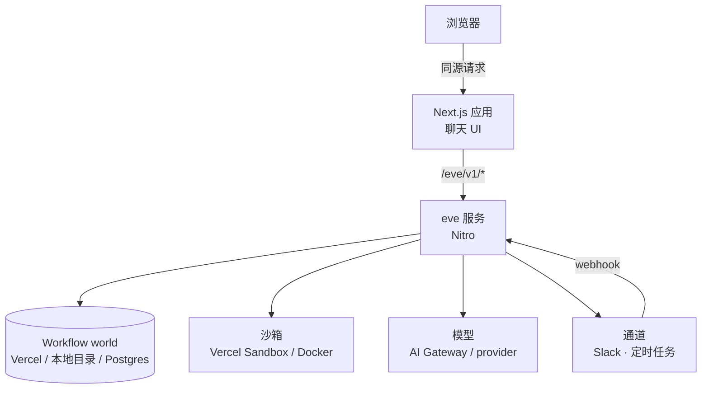

# 第 17 章 前端与部署

> 前端只需要一个 hook；部署只需要两条命令——但鉴权和模型凭据必须自己配，因为默认策略在生产环境一律拒绝。

## 17.1 三种交付形态

| 形态 | 谁托管谁 | 适合 |
| --- | --- | --- |
| 框架集成（Next.js / Nuxt / SvelteKit / TanStack） | 前端应用托管 agent，同源路由 | 已有 Web 应用，要一个聊天面板 |
| 平级服务 | 前端和 agent 各自独立部署，反向代理或平台路由 | 多前端、多 agent、独立伸缩 |
| 无前端 | 只有 HTTP / Slack / 定时 | 内部工具、后台任务 |

框架集成的好处是**同源**：没有 CORS，不用配 URL 环境变量，浏览器 cookie 直接带上。

部署后的组件关系（以框架集成为例）：



四个依赖各自独立：world 存执行状态，沙箱跑命令，模型是外部 API，通道是入站口。**自托管要自己负责 world 和沙箱这两块**，Vercel 上它们由平台提供。

## 17.2 用脚手架生成

```bash
eve add channel/web
```

选 Next.js 或 TanStack Start，它会生成：

```text
next.config.ts
app/page.tsx
app/_components/agent-chat.tsx
app/_components/agent-message.tsx
```

```ts
// next.config.ts
import type { NextConfig } from "next";
import { withEve } from "eve/next";

const nextConfig: NextConfig = {};

export default withEve(nextConfig);
```

`withEve` 在开发时启动 agent 进程并代理请求，部署时把 agent 作为独立服务贡献出去。

### `withEve` 的几个选项

| 选项 | 默认 | 用途 |
| --- | --- | --- |
| `eveRoot` | Next.js 应用根 | eve 项目根（可含一个 `agent/` 或一个 `agents/` workspace） |
| `agents` | workspace 自动推断 | 挂到 `/eve/<name>/v1/*` 的具名 agent |
| `eveBuildCommand` | 自动生成 | 生成服务的构建命令 |
| `servicePrefix` | `/_eve_internal/eve` | 内部路由命名空间 |
| `devServerTimeoutMs` | `180000` | 等 dev server 就绪的上限，冷启动慢时调大 |

前后端平级时：

```ts
// apps/web/next.config.ts
export default withEve(nextConfig, { eveRoot: "../.." });
```

**保留生成的聊天组件。** 它渲染了工具结果、错误、授权链接、审批按钮、问题表单。自己写一个只渲染文本的组件，第 11 章的审批就没法在 UI 上完成——turn 会一直挂着。

## 17.3 自己写 UI

```tsx
"use client";

import { useEveAgent } from "eve/react";

export function Chat() {
  const agent = useEveAgent();
  const busy = agent.status === "submitted" || agent.status === "streaming";

  return (
    <form
      onSubmit={(e) => {
        e.preventDefault();
        const form = new FormData(e.currentTarget);
        const text = String(form.get("message") ?? "").trim();
        if (text) void agent.send(text, busy ? { turnPolicy: "steer" } : undefined);
      }}
    >
      {agent.data.messages.map((m) => (
        <article key={m.id}>
          <header>{m.role}</header>
          {m.parts.map((p, i) =>
            p.type === "text" ? <p key={p.id ?? i}>{p.text}</p> : null
          )}
        </article>
      ))}
      <input name="message" disabled={agent.status === "resuming"} />
      <button type="submit" disabled={agent.status === "resuming"}>发送</button>
    </form>
  );
}
```

`useEveAgent()` 的选项：

| 选项 | 类型 | 默认 | 说明 |
| --- | --- | --- | --- |
| `agent` | `string` | 无 | 具名 agent，路由到 `/eve/<name>/v1/*`；不能和 `host` 同时用 |
| `host` | `string` | `""`（同源） | 基址或同源代理前缀 |
| `auth` | 同 `Client` 的 `auth` | 无 | 浏览器端的凭据解析（`bearer` / `basic` / `vercelOidc`） |
| `headers` | `Record<string, string> \| 回调` | 无 | 每个请求都带的头 |
| `session` | `ClientSession` | 无 | 用已有会话句柄 |
| `initialSession` | `{ sessionId, streamIndex }` | 无 | 用保存的游标恢复 |
| `initialEvents` | `MessageStreamEvent[]` | 无 | 先渲染历史，必须是同一会话流的有序前缀 |
| `resume` | `boolean` | `false` | 挂载后重放并跟随进行中的 turn，需要 `session` 或 `initialSession` |
| `prewarm` | `boolean` | `false` | 只建会话不发起 turn |
| `reducer` | `EveAgentReducer<TData>` | 默认 reducer | 自定义投影 |
| `optimistic` | `boolean` | `true` | 提交时先本地显示用户消息 |
| `followIdle` | `boolean` | `true` | 会话空闲时是否继续挂着流；`false` 在空闲时关流，下次 `send` / `respond` / `resume` 从游标重开 |
| `followSubagents` | `boolean` | `false` | 跟随每个子代理的会话到 `conversation.agents` |
| `onError` / `onEvent` / `onFinish` / `onSessionChange` / `prepareSend` | 回调 | 无 | 生命周期钩子 |

`useEveAgent()` 返回的东西：

| 字段 | 用途 |
| --- | --- |
| `data` | 选定的投影，默认是 `ConversationState`（含 `messages`、`inputs`） |
| `conversation` | 规范会话状态，含子代理状态 |
| `status` | `ready` / `resuming` / `submitted` / `streaming` / `error` |
| `error` | 最近一次失败 |
| `events` | 原始事件流，要自己投影时用 |
| `session` | 可序列化游标（`sessionId`、`streamIndex`） |
| `prewarm` | 只建会话不发起 turn |
| `send` | 发消息，可带每轮选项 |
| `respond` | 回答待处理的人工输入 |
| `resume` | 接回已有会话并跟随进行中的 turn |
| `cancel` | 取消当前 turn |
| `reset` | 清本地状态，开新会话 |

### 刷新后接回

把 `{ sessionId, streamIndex }` 存进 URL 或 localStorage，刷新后用 `resume` 接回去，进行中的 turn 也能继续跟：

```tsx
const agent = useEveAgent({
  session: savedSession,        // 从存储里读
  initialEvents: savedEvents,   // 可选：先渲染历史
});
```

多个聊天线程时，每个线程存一份 `session` + 事件日志；切换线程要重挂组件（`key={chat.id}`），因为 `session`、`auth`、`reducer`、`followIdle` 这些只在 store 创建时读一次。

**长期挂载的面板要关掉空闲跟随。** 只要组件还挂着，流就一直重连，哪怕什么都没发生。像常驻侧边栏这种只在用户主动问话后才需要回复的界面，传 `followIdle: false`：会话进入空闲（没有 turn 在跑或停泊、没有任务在跑、没有待登录）时关流，下一次 `send` / `respond` / `resume` 从会话游标重开，中间到达的事件那时补上。prewarm 的会话在第一条消息之前不开流。反过来，如果定时任务、通道或另一个标签页可能在你空闲时给同一会话开新 turn，就别关。

### 流式

`useEveAgent` 默认已经把 `message.appended` 累加进 `data.messages`。要自己处理原始流，用 `events`：

```tsx
useEffect(() => {
  for (const event of agent.events) {
    if (event.type === "action.result") console.log(event.data.result.toolName);
  }
}, [agent.events]);
```

## 17.4 在 UI 里处理审批

默认 reducer 把待处理请求记在 `data.inputs` 里，每条带 `requestId`、`kind`、`prompt`、`options`。**不要自己过滤状态**，用 `eve/react` 导出的 `openConversationInputs()`——它知道哪些请求已经 settle、哪些属于子代理：

```tsx
import { openConversationInputs } from "eve/react";

const pending = openConversationInputs(agent.data).map((input) => input.request);

return pending.map((request) => (
  <fieldset key={request.requestId} disabled={agent.status === "resuming"}>
    <legend>
      {request.kind === "tool-approval"
        ? "需要审批"
        : request.kind === "question"
          ? "需要回答"
          : "额度提示"}
    </legend>
    <p>{request.prompt}</p>
    {request.options?.map((option) => (
      <button
        key={option.id}
        type="button"
        onClick={() => void agent.respond([{ requestId: request.requestId, optionId: option.id }])}
      >
        {option.label}
      </button>
    ))}
  </fieldset>
));
```

要点：

- 提交不等于完成。`respond()` 先把请求标成 `responded`，等 `approval.settled` 或 `input.resolved` 到达才算解决。
- 一个 turn 可能有多个待答请求。全渲染出来，别只显示第一个。
- `allowFreeform` 为真的问题要渲染文本输入，发 `{ requestId, text }`。
- 被拒绝的审批会重新打开。

## 17.5 鉴权

默认通道在生产环境返回 401。三种做法：

**做法一：应用会话（推荐给已有 Web 应用）**

```ts
// agent/channels/eve.ts
import { eveChannel } from "eve/channels/eve";
import { localDev, vercelOidc } from "eve/channels/auth";
import { verifyAppSession } from "../lib/auth";

export default eveChannel({
  auth: [verifyAppSession, vercelOidc(), localDev()],
});
```

`verifyAppSession` 从 cookie 或 bearer 里验证你的应用会话，返回 `principalType: "user"` 的 principal。同源集成会自动带 cookie。

`eveChannel` 除 `auth` 外还有 `audience`、`uploadPolicy`、`fetchFile`、`cors`、`turnPolicy`、`onMessage`、`events`、`trustedForwarders`，字段表在第 14 章。

**做法二：HTTP Basic（单用户内部工具）**

见第 14 章。注意要配 `proxy.ts` 让浏览器弹原生登录框，并且必须走 HTTPS。

```ts
// proxy.ts
import { routeAuth } from "eve/channels/auth";
import { NextResponse } from "next/server";
import { appAuth } from "./agent/lib/auth";

export async function proxy(request: Request) {
  if (process.env.NODE_ENV === "development") return NextResponse.next();
  const result = await routeAuth(request, appAuth);
  return result instanceof Response ? result : NextResponse.next();
}

export const config = { matcher: ["/", "/s/:path*"] };
```

**做法三：匿名（只用于公开演示）**

```ts
import { none } from "eve/channels/auth";

export default eveChannel({ auth: [none()] });
```

`none()` 是显式放行所有请求。**处理私有或生产数据的 agent 绝不能用。**

## 17.6 部署到 Vercel

```bash
npx vercel@latest link
npx vercel@latest env add ANTHROPIC_API_KEY preview
npx vercel@latest env add OPS_USERNAME preview
npx vercel@latest env add OPS_PASSWORD preview
npx vercel@latest deploy
```

或者用 eve 自己的命令：

```bash
eve link
eve deploy
```

要点：

- **本地 `.env` 不会随部署上传。** 每个环境（Preview / Production）都要单独配。
- 如果你本地用的是 ChatGPT 订阅登录，部署要换成 AI Gateway 模型 + `AI_GATEWAY_API_KEY`。订阅凭据只在你笔记本上有效。
- 部署在 Vercel 上时，沙箱自动用 Vercel Sandbox，workflow 自动用 Vercel Workflow，cron 自动变成 Vercel Cron Job。
- 生产要发 `--prod`。

部署后必须验证：

```bash
# 无凭据必须 401
curl -i -X POST https://your-app.vercel.app/eve/v1/session

# 健康检查（公开）
curl https://your-app.vercel.app/eve/v1/health

# 带凭据应该 202
curl -i -X POST https://your-app.vercel.app/eve/v1/session \
  -u "$USER:$PASS" -H 'content-type: application/json' \
  -d '{"message":"hi"}'
```

第一条如果返回 202，你的 agent 是公开的，任何人都在花你的钱。

## 17.7 自托管

目标：Node 服务 + 你自己的持久化 + 你自己的沙箱。

### 1. 构建与启动

```bash
eve build
PORT=3000 eve start --host 0.0.0.0
```

构建产物在 `.output/`（Nitro server）。`eve start` 服务这份产物，接受 `PORT` 或 `--port`。TLS、伸缩、重启、日志收集交给你的进程管理器或容器平台。

### 2. 模型与鉴权

- 非 Vercel 主机用 Gateway 字符串模型：设 `AI_GATEWAY_API_KEY`。
- 直连 provider：装对应 AI SDK provider 包，在 `agent.ts` 里传模型对象，设它自己的 API key。
- **别把 `vercelOidc()` 当成唯一的生产鉴权**——它只在 Vercel 环境有意义。用 Basic / JWT / OIDC / 自定义 verifier。

### 3. 持久化 workflow 状态

默认的本地 world 把 run 状态写在 `.eve/.workflow-data`。两种做法：

**把目录挂到持久卷**（最简单）：

```text
/app/.eve/.workflow-data  →  持久卷
```

**换一个 world 包**：

```ts
// agent/agent.ts
export default defineAgent({
  model: "anthropic/claude-sonnet-5",
  experimental: {
    workflow: { world: "@workflow/world-postgres" },
  },
});
```

换 world 的完整步骤（建表、环境变量、自定义包）在 10.14。有一个部署时必须处理的点：Postgres world 自带的 worker 会把编排投递到 `POST /.well-known/workflow/v1/flow`，这个路由**没有鉴权**，要在网关层挡住。

- 版本钉在 eve 自带的那一代 `@workflow/*` 上。`eve@0.81.1` 依赖 `@workflow/world@5.0.3`、`world-local@5.1.0`、`world-vercel@5.2.0`，`world-postgres` 当前最新 `5.0.5`。装 `latest` 可能拿到协议不兼容的版本，初始化时会被拒。官方文档里还写着 `5.0.0-beta.x`，那行已经过时，以包里的依赖为准。
- 连接串等配置放**环境变量**，由 world 包自己读，不要写进 `agent.ts`。
- 要在构建产物里保持 external，加到 `build.externalDependencies`。

### 4. 沙箱

```ts
// agent/sandbox/sandbox.ts
import { defineSandbox } from "eve/sandbox";
import { DockerSandbox } from "eve/sandbox/docker";

export const environment = DockerSandbox.environment();

export default defineSandbox(() => environment.open({ networkPolicy: "deny-all" }));
```

构建机要能构建镜像，运行时要能启动容器（挂 docker socket 或用远程 Docker）。

### 5. 反向代理

- 请求体上限放开（附件内联 base64）。
- **关闭响应缓冲**（NDJSON 要逐行下发）。
- 超时给够（长 turn 可能跑几分钟）。

### 6. 定时任务

`eve start` 会启动 Nitro 的 scheduled task runner。如果你用自己的进程管理器只服务 HTTP、不启动 runner，cron 定义还在但不会触发。要么用 `eve start`，要么用外部调度器通过鉴权路由触发。

### 7. 版本钉死

非 Vercel Workflow 的世界，**一个 eve 版本同时只能服务一个 world**。升级后老会话全部 stranded（第 10 章）。所以：

```json
{ "dependencies": { "eve": "0.81.1" } }
```

不要用 `^`。升级是需要计划的操作。

## 17.8 环境变量清单

先记住三条，细节见[附录 C](appendix-c-env-and-secrets.md)：`.env.local` 不会随部署上传；`eve build` 不读 `.env*`，编译期求值的定义要用构建机的环境；沙箱里没有 `process.env`。

| 变量 | 用途 | 必填 |
| --- | --- | --- |
| `AI_GATEWAY_API_KEY` | 走 AI Gateway 的模型 | 用 Gateway 时 |
| `ANTHROPIC_API_KEY` / `OPENAI_API_KEY` | 直连 provider | 直连时 |
| `DEEPSEEK_API_KEY` / `DASHSCOPE_API_KEY` / `ZHIPU_API_KEY` 等 | 直连国产 provider（第 2 章） | 用哪个填哪个 |
| 业务工具自己的密钥 | 日志 API、OPS API 等 | 按需 |
| 通道鉴权凭据 | Basic 用户名密码、应用会话密钥 | 生产必填 |
| `WORKFLOW_POSTGRES_URL`（没有则退回 `DATABASE_URL`） | Postgres world 的连接串 | 自托管时 |

一个原则：**所有密钥只在应用运行时**。不要放进沙箱、不要放进技能正文、不要放进给模型的工具输出。

## 17.9 常见坑

**坑：部署后 401，以为部署坏了。**
默认鉴权策略就是拒绝生产流量。配 `agent/channels/eve.ts`。

**坑：部署后能用，但任何人扫到 URL 都能用。**
同上，反过来说：没有鉴权就是公开的。用无凭据 curl 验证。

**坑：本地能跑，线上模型报错。**
本地 `.env` 没上传，或用了订阅登录。换成 Gateway/API key 并配到对应环境。

**坑：自己写聊天 UI，审批按钮没有。**
turn 会一直挂着。保留生成的组件，或自己实现 `respond`。

**坑：自托管 cron 不触发。**
托管方式没启动 Nitro 任务 runner。用 `eve start`。

**坑：自托管升级后所有会话 409。**
stranded session。钉版本，升级前接受中断。

**坑：反向代理缓冲了流式响应。**
前端看起来「一次性吐出全部」。关掉代理缓冲。

**坑：`withEve` 的 `eveRoot` 写错。**
前后端平级时忘了 `eveRoot: "../.."`，dev 起来找不到 agent。

## 17.10 练习

1. `eve add channel/web` 生成 Next.js 前端，跑通一轮对话和一个审批。
2. 把 `{ sessionId, streamIndex }` 存进 URL，刷新后 `resume` 接回。
3. 用 HTTP Basic 保护部署，验证无凭据 401、有凭据 202。
4. 本地 `eve build && eve start`，用 `curl` 验证 `/eve/v1/health` 和一次完整对话。
5. 用 Docker 做沙箱 + Postgres 做 world，跑一次自托管。

## 延伸阅读

- [Frontend overview](https://eve.dev/docs/guides/frontend/overview)
- [Next.js](https://eve.dev/docs/guides/frontend/nextjs)
- [Auth & route protection](https://eve.dev/docs/guides/auth-and-route-protection)
- [Deployment overview](https://eve.dev/docs/guides/deployment/overview)
- [Self-hosting](https://eve.dev/docs/guides/deployment/self-hosting)

---

上一章：[16 评测](16-evals.md) · 下一章：[18 进阶与上线检查](18-advanced-and-production.md)
