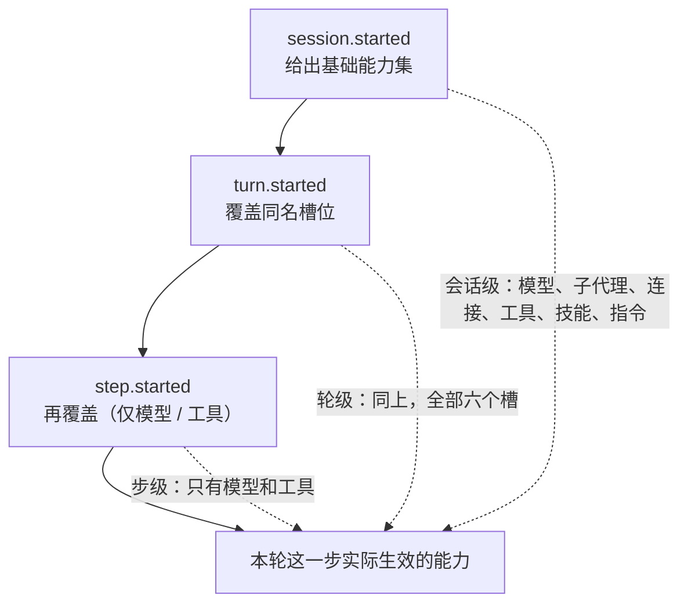

# 第 18 章 进阶与上线检查

> 这一章把散落在前面的进阶能力收在一起，然后给一份能逐条打勾的上线清单。清单比概念重要。

## 18.1 动态能力：一个机制，六个槽位

`defineDynamic` 用同一个解析器接口，按会话事件决定模型、子代理、连接、工具、技能、指令。

```ts
import { defineDynamic } from "eve";

export default defineDynamic({
  events: {
    "session.started": (_event, ctx) => { /* 返回能力或 null */ },
    "turn.started": (_event, ctx) => { /* … */ },
    "step.started": (_event, ctx) => { /* 仅模型和工具支持 */ },
  },
});
```

| 槽位 | 支持的事件 | 必须返回什么 | 名字从哪来 | 返回 `null` |
| --- | --- | --- | --- | --- |
| 模型 | session / turn / step | 模型 ID 字符串；`{ model, reasoning?, modelContextWindowTokens?, modelOptions? }`；`LanguageModel` 对象（仅 step） | 不适用 | **不允许**，turn 直接失败 |
| 子代理 | session / turn | `defineAgent({ description, model, … })` | 所在目录名 | 不暴露给父模型 |
| 连接 | session / turn | `defineMcpClientConnection(…)` 或 `defineOpenAPIConnection(…)`，或它们的 map | 单个用文件名；map 用 key | 不暴露 |
| 工具 | session / turn / step | `defineTool({ … })`，或它的 map | 单个用文件名；map 用 key | 不暴露 |
| 技能 | session / turn | `defineSkill({ … })`，或它的 map | 单个用文件名；map 用 key | 不暴露 |
| 指令 | session / turn | `defineInstructions({ content, role? })` | 不适用 | 不贡献内容 |

这张表里最容易忽略的是「必须返回什么」：**每个条目都要用对应的 `define*` 包一层**，直接返回一个裸对象不会被接受。

模型那一行还有一条序列化规则：**`session.started` 和 `turn.started` 只能返回字符串**（或 `model` 为字符串的选择对象）。`LanguageModel` 对象（比如直连 DeepSeek 的 `deepseek("deepseek-v4-pro")`）不可序列化，只能从 `step.started` 返回。所以「按租户切到国产模型」要么用 Gateway 字符串，要么把切换放进 step。

`defineDynamic` 的字段：

| 字段 | 类型 | 必填 | 说明 |
| --- | --- | --- | --- |
| `events` | `{ "session.started"?, "turn.started"?, "step.started"? }` | 是 | 每个 key 是一个解析器，签名 `(event, ctx) => 能力 \| null` |
| `build` | `{ externalDependencies?: string[] }` | 否 | 只在外层 `defineDynamic` 上有效，要在解析器运行前生效 |

### 返回值的三种形状

**形状一：单个定义。** 子代理、指令只能这样返回：

```ts
// agent/subagents/finance/agent.ts
import { defineAgent, defineDynamic } from "eve";

export default defineDynamic({
  events: {
    "session.started": (_event, ctx) =>
      ctx.session.auth.current?.attributes.plan === "enterprise"
        ? defineAgent({
            description: "分析财务和会计数据。",
            model: "anthropic/claude-sonnet-5",
          })
        : null,
  },
});
```

**形状二：map。** 工具、连接、技能可以一次返回一组，key 就是名字：

```ts
// agent/tools/query.ts
import { defineDynamic, defineTool } from "eve/tools";
import { z } from "zod";
import { listTables, runReadOnly } from "../lib/warehouse";

export default defineDynamic({
  events: {
    "session.started": async () =>
      Object.fromEntries(
        (await listTables()).map((t) => [
          t.name,                                  // 模型看到 `orders`、`users`……
          defineTool({
            description: `查询 ${t.name}。列：${t.columns.join(", ")}`,
            inputSchema: z.object({ sql: z.string() }),
            execute: ({ sql }) => runReadOnly(t.name, sql),
          }),
        ]),
      ),
  },
});
```

工具和技能的 map key 有硬约束：**只用 ASCII 字母、数字、下划线、连字符，首字符必须是字母，长度不超过 64**。违反时 eve 记日志并跳过这个结果——不会报错，只是「东西不见了」，所以这类问题很难查。

连接的 map key 直接成为连接名，同时占住 `<name>__` 这个工具前缀。所以 key 不能和已有的工具、子代理、别的连接撞名。

**形状三：模型选择对象。** 模型可以是字符串，也可以带覆盖项：

```ts
model: defineDynamic({
  events: {
    "step.started": (_event, ctx) =>
      hasImageInput(ctx)
        ? { model: "google/gemini-3.5-flash", reasoning: "low" }
        : { model: "zai/glm-5.2" },
  },
}),
```

带对象的写法在换模型的同时可以改 `reasoning`、`modelContextWindowTokens`、`modelOptions`。只换模型 ID 时用字符串更省事，上下文窗口由 eve 从 Gateway 目录查。`hasImageInput` 在这里只是示意，完整的图片检测逻辑见本节末尾的「按消息内容切模型」。

### 三条执行规则

1. **优先级 step > turn > session。** 最近触发的那个拥有该文件的槽位集合。
2. **解析器在编译期跑一次做分类校验，运行时再跑一次。** 所以顶层代码在两个阶段都会执行，会话相关的逻辑必须放进 handler。
3. **失败即失败。** 模型解析器抛错或不返回具体模型，turn 在调用 provider 之前就失败。其它槽位的失败会记录并跳过该结果。

模型解析器优先用 `session.started`：prompt 缓存按模型分，中途换模型等于按未缓存价格重读整段对话。

三个事件的作用范围是逐层覆盖的：



越靠后的事件优先级越高，但**能力越窄**：`step.started` 只能改模型和工具，改不了连接和指令。所以「按租户换连接」要放在 `session.started`，「这一轮改用便宜模型」可以放在 `turn.started`。

### 冲突规则

| 情况 | 结果 |
| --- | --- |
| 动态条目和**手写**条目同名 | 动态**覆盖**手写的 |
| 动态条目撞上 workflow 工具或子代理 | **报错**，跳过该解析器的结果 |
| 两个动态解析器产出同名 | **报错**（真歧义），需要自己加命名空间 |

### 一个实用模式：按消息内容切模型

```ts
model: defineDynamic({
  events: {
    "step.started": (_event, ctx) => {
      const hasImage = ctx.messages.some(
        (m) => m.role === "user" && Array.isArray(m.content) &&
          m.content.some((p) => p.type === "image" ||
            (p.type === "file" && String(p.mediaType).startsWith("image/"))),
      );
      return hasImage ? "google/gemini-3.5-flash" : "zai/glm-5.2";
    },
  },
}),
```

图片在 `step.started` 之前已经被 staged 到 `/workspace/.eve/attachments`，但 `ctx.messages` 里保留了 media type，所以能判断。

## 18.2 扩展包

需要跨 agent 复用能力时，打成扩展。

### 能贡献什么

```text
@acme/crm/
├── package.json
└── extension/
    ├── extension.ts
    ├── tools/search.ts
    ├── channels/webhook.ts
    ├── connections/api.ts
    ├── skills/triage/SKILL.md
    ├── schedules/sync.ts
    ├── subagents/reviewer/agent.ts
    ├── instructions.md
    ├── hooks/audit.ts
    └── lib/http.ts
```

**不能**贡献：agent 配置、instrumentation、memory 槽、沙箱、嵌套扩展。这些是消费方 agent 的事。

### 创建与挂载

```bash
npx eve@latest extension init my-crm
```

```ts
// agent/extensions/crm.ts
import crm from "@acme/crm";

export default crm({ apiKey: process.env.CRM_API_KEY! });
```

挂载名成为命名空间：`crm__search`、`crm__webhook`、`crm__sync`、`crm__api`、`crm__reviewer`。通道保留自己的路由路径，定时任务保留自己的 cron 表达式。

三条约束：

- 挂载名不能和连接同名（连接占住 `<name>__` 整个前缀）。
- 不能叫 `eve`（框架保留）。
- 每个挂载绑定自己的配置；移动或重命名挂载等于换一个实例，它的 state 键也会变。

### 配置 schema

```ts
// extension/extension.ts
import { defineExtension } from "eve/extension";
import { z } from "zod";

export default defineExtension({
  config: z.object({
    apiKey: z.string(),
    baseUrl: z.string().url().default("https://api.acme.example"),
  }),
});
```

消费方传的配置会先校验，默认值已经填好。扩展里的贡献直接读这个句柄：

```ts
// extension/tools/search.ts
import { defineTool } from "eve/tools";
import { z } from "zod";
import extension from "../extension";

export default defineTool({
  description: "搜索 CRM。",
  inputSchema: z.object({ query: z.string() }),
  async execute({ query }) {
    const { apiKey, baseUrl } = extension.config;   // 已校验，已填默认值
    return { query, baseUrl, authenticated: apiKey.length > 0 };
  },
});
```

配置 schema 必须同步校验（不能返回 Promise）。不需要配置时，`defineExtension()` 空调用即可。

`defineExtension` 只有一个字段：

| 字段 | 类型 | 必填 | 说明 |
| --- | --- | --- | --- |
| `config` | 任意 Standard Schema（Zod、Valibot…） | 否 | 消费方在挂载时传的设置；校验后的值通过 `extension.config` 读取 |

### 内置扩展里的两个 GitHub 钩子

eve 自带的 `eve/extensions/git` 把 GitHub 访问代理成 `git__gh` 工具。它有两个可选回调，位置在 `git({ github: { … } })` 里：

| 选项 | 签名 | 作用 |
| --- | --- | --- |
| `github.authorize` | `({ auth, repository, token }) => boolean \| Promise<boolean>` | 每次 `gh` 调用前跑，返回 `false` 就不执行 |
| `github.attribution` | `(ctx) => { name, email } \| null` | 给提交和 PR 加 `Co-authored-by` |

`authorize` 的执行顺序是：校验命令和仓库 → 铸造只作用于该仓库的 app token → `await authorize(...)` → 装凭据租约 → 跑命令。返回 `false` 时租约还没装、命令也没跑。`auth` 是调用那一刻的会话调用者，可能是 `null`。**判断只对这一次调用生效**，不缓存，也不对每个 GitHub API 请求重复。注意放行的命令用的是 app token 的权限，不是调用者本人的 GitHub 权限。

```ts
// agent/extensions/git.ts
import git from "eve/extensions/git";
import { brokerGitHubLease } from "../lib/github";

export default git({
  github: {
    connector: "github/my-agent",
    org: "acme",
    broker: brokerGitHubLease,
    // GitHub 通道的会话把评论者 login 放在 auth.subject 上
    async authorize({ auth, repository, token }) {
      if (auth?.authenticator !== "github-webhook" || !auth.subject) return false;
      const res = await fetch(
        `https://api.github.com/repos/${repository}/collaborators/${auth.subject}`,
        { headers: { authorization: `Bearer ${token}` } },
      );
      return res.status === 204;
    },
  },
});
```

`gh` 工具提交的作者是 GitHub App 本身。要把功劳记到具体的人身上，用 `attribution` 返回他：

```ts
git({
  github: {
    connector: "github",
    org: "acme",
    broker,
    attribution: (ctx) => coAuthorFor(ctx.session.auth.current),
  },
});
```

它会在每条 `gh-signed-commit` 消息末尾、以及带 `--body` / `--body-file` 的 `gh pr create` 正文末尾加 `Co-authored-by: <name> <email>`。返回 `null` 就不加。agent 自己写的 `Co-authored-by` 行会保留，并且和这条排在同一块里，仍然算数。用 `--fill` / `--template` 建的 PR，以及 `gh api` 这类路径，不加署名。

## 18.3 远程 agent

专家在另一个部署里：

```ts
// agent/subagents/weather.ts
import { defineRemoteAgent } from "eve";
import { vercelOidc } from "eve/agents/auth";

export default defineRemoteAgent({
  url: "https://weather-agent.example.com",
  description: "回答天气、温度、预报、风、雨、雪的问题。",
  auth: vercelOidc(),
});
```

| 参数 | 说明 |
| --- | --- |
| `url` | 基址，可以是函数（运行时解析） |
| `description` | 必填，模型可见 |
| `auth` | 出站鉴权 |
| `forwardPrincipal` | 转发调用者身份，**只在对方信任你时开** |
| `headers` | 静态或惰性解析的请求头 |
| `path` | 默认 `/eve/v1/session` |
| `tool` | `false` 时只允许 `ctx.agent()` 调用 |

**`forwardPrincipal: true` 是一个信任声明。** 打开它意味着对方会把你的用户身份当作已认证的。对方的 `trustedForwarders` 必须明确接受你，否则不该开。

跨部署升级：两边一起升。旧版本可能不认新版本的续接和重置协议。

## 18.4 运行时生成的 workflow 程序

让模型自己写一段 JS 来编排子代理：

```ts
// agent/tools/workflow.ts
import { workflow } from "eve/tools/workflow";

export default workflow({ maxSubagents: 20 });
```

`workflow()` 的选项：

| 选项 | 类型 | 默认 | 说明 |
| --- | --- | --- | --- |
| `maxSubagents` | `number` | `100` | 一段程序里最多调几次子代理，范围 1–128 |

工具对模型的输入只有一个字段：

| 字段 | 类型 | 说明 |
| --- | --- | --- |
| `js` | `string` | 一段 async 函数体，返回值必须 JSON 可序列化 |

- 模型通过 `js` 提供函数体。
- 唯一宿主能力是 `ctx.agent(name, { message, outputSchema? })`，直接 resolve 成结果。
- 程序**不能**访问 workflow 上下文、会话状态、凭据、import、普通工具。
- 每次调用都开新的子会话，不能续接上一次的。

适合「按情况临时决定怎么拆分任务」；代价是模型写的编排不可预测，必须有超时和预算上限。

## 18.5 可观测性

三层，从近到远：

### 1. 本地

```bash
eve logs list
eve logs show <id>
eve traces list
eve traces show <id>
```

trace 默认写到 `.eve/traces/`，按时间、大小和保留条数设上限。

### 2. 事件落库

`agent/hooks/` 订阅 `"*"`，按 `meta.id` 入库（第 15 章）。这是最可靠的自建审计，不依赖外部服务。

### 3. OpenTelemetry

`agent/instrumentation/` 下每个文件一个 provider：

```ts
// agent/instrumentation/otel.ts
import { registerOTel } from "@vercel/otel";

registerOTel({ serviceName: "opsbot" });
```

eve 的 span 覆盖：模型调用、工具执行（`execute_tool`）、审批、子代理委派、durable turn。导出到 Datadog / Honeycomb / Sentry / Jaeger 都是同一个口子。

**内容捕获受 audience 和追踪策略控制。** 私有会话默认不记录内容。这是合规友好的默认值，别随手改成 `public`。

### 4. 线上核对

`GET /eve/v1/info` 返回编译后的完整快照：工具、技能、连接、通道、沙箱、诊断。适合回答「线上到底加载了什么」。

## 18.6 安全模型

| 边界 | 规则 |
| --- | --- |
| 应用运行时 vs 沙箱 | 密钥只在应用侧，沙箱没有 `process.env` |
| 模型 vs 凭据 | 连接凭据由 eve 注入，模型看不到 URL 和 token |
| 通道 vs 工具 | 通道鉴权决定谁能发消息，工具权限另算 |
| 用户输入 vs 身份 | 身份只从 `auth.current` 取，绝不从消息取 |
| 记忆 vs 指令 | 召回内容是不可信数据，要在指令里写明 |

失败模式一律 fail closed：缺配置、缺凭据、验证失败都拒绝，不回退到宽松策略。

**凭据代理**：沙箱里的进程需要访问鉴权服务时，由应用侧换 token 再转发，token 不进入沙箱。

密钥怎么进来、在哪一层读、什么时候会被烘进编译产物，见[附录 C](appendix-c-env-and-secrets.md)。

## 18.7 成本控制

| 旋钮 | 作用 | 代价 |
| --- | --- | --- |
| 系统提示长度 | 每轮都付 | 太短行为不稳 |
| 技能 `deferred` | 减少常驻描述 | 多一次搜索调用 |
| 工具 `deferred` / 连接白名单 | 减少 schema token | 模型可能找不到工具 |
| 压缩阈值调低 | 更早摘要 | 丢细节 |
| `limits` 上限 | 硬止损 | 长任务被中断 |

真正的省钱不在这些旋钮，而在**减少无效循环**：工具返回可操作的错误信息、给模型明确的停止条件、不要让它在同一个失败上重试五次。

## 18.8 上线检查清单

### 鉴权与访问

- [ ] `agent/channels/eve.ts` 配了真实鉴权，不是 `placeholderAuth()` 或 `localDev()`
- [ ] 无凭据 `POST /eve/v1/session` 返回 401（实测过）
- [ ] 生产环境没有用 `none()`
- [ ] 浏览器方案走了 HTTPS（Basic 尤其必须）
- [ ] 多用户场景没有共用密码

### 工具与副作用

- [ ] 每个有副作用的工具都有幂等键或唯一性记录
- [ ] 危险工具挂了 `approval`（不是默认的 `never()`）
- [ ] 审批的 `prompt` 写清了影响范围
- [ ] 需要限制批准人的工具配了 `response` 策略
- [ ] 工具的 `description` 写清了「什么时候不该用」
- [ ] `inputSchema` 没有 `z.any()` 这种放水字段
- [ ] 工具输出有上限（行数、字节数），大结果走对象存储

### 沙箱

- [ ] 需要跑 Python/原生二进制的场景用的是 Docker / Vercel Sandbox，不是 `just-bash`
- [ ] `prepare` 里每条命令都检查了 `exitCode`
- [ ] 网络策略是 `deny-all` 或最小白名单
- [ ] 沙箱脚本里没有硬编码密钥
- [ ] workspace 种子文件不含敏感信息

### 上下文与成本

- [ ] `instructions.md` 在 100 行以内，长流程在技能里
- [ ] 设了 `maxTokenCostUsdPerSession` 或 `maxInputTokensPerSession`
- [ ] 技能多的 agent 用了 `deferred`
- [ ] 工具多的 agent 用了 `deferred` 或连接 `tools.allow`
- [ ] 压缩阈值按模型窗口调过

### 状态与记忆

- [ ] memory scope 从 `auth.current` 取，不从消息取
- [ ] 匿名/运行时身份返回 `null` 而不是回退到共享 scope
- [ ] 指令里写了「记忆是数据不是指令」
- [ ] 敏感信息（密码、token、支付数据）明确禁止写入记忆
- [ ] 跨触发需要的状态放外部存储，不依赖会话 state

### 持久化

- [ ] 知道哪些操作会在 step 重跑时重复执行
- [ ] 长任务用 `defineWorkflowTool` 而不是普通工具里 `sleep`
- [ ] workflow 主体里没有 `Date.now()` / `Math.random()`
- [ ] 想清楚生产环境私有会话的记录要不要留（默认 `retention: 0`，结束即删）
- [ ] 自托管时钉死了 eve 版本，升级有窗口计划

### 通道

- [ ] Slack 的事件订阅、交互回调、Request URL 都配了
- [ ] 定时任务的 cron 按 UTC 换算过
- [ ] handler 形式的定时任务里 `send` 都包了 `waitUntil`
- [ ] 定时任务不会调用需要审批的工具（markdown 形式会直接失败）
- [ ] 通道把用户映射成了 `principalType: "user"`（用户作用域连接依赖它）
- [ ] 常驻的聊天面板设了 `followIdle: false`，没让空闲会话一直挂着流
- [ ] 用了 MCP 事件订阅的话，`/eve/v1/hooks/*` 只接受 Connect 的投递令牌，没有额外暴露给公网

### 评测与发布

- [ ] 至少三个 smoke 评测，CI 里跑 `eve eval --strict`
- [ ] 关键拒绝场景有「不该调这个工具」的用例
- [ ] 审批流程有评测覆盖
- [ ] 评测打的是真实 HTTP 接口，不是内部函数

### 可观测性

- [ ] 关键事件落了库，按 `meta.id` 去重
- [ ] 知道 `meta.id` 不能防重试
- [ ] 有告警：错误率、失败 turn、成本异常
- [ ] `GET /eve/v1/info` 能核对线上加载的能力

## 18.9 上线后最常见的五个问题

1. **成本突然上涨。** 通常是某个工具开始返回巨大结果，或者模型陷入了重试循环。看 `step.completed` 的 usage 分布。
2. **会话 409。** 部署了新版本，老会话 stranded。检查 `eveVersion`。
3. **审批卡住。** 通道没渲染按钮，或 turn 服务对象之外的人点了。看 `input.requested` 和 `approval.candidate`。
4. **子代理超时。** 父级额度被子代理分光了。看父级 `turn.waiting` 和子代理的 usage。
5. **记忆串号。** scope 解析器读了模型输入，或匿名回退到了共享值。审 scope 函数。

## 18.10 练习

1. 对照 18.8 的清单，给你的项目逐条打勾，把没过的写成 issue。
2. 用 `defineDynamic` 按租户切换模型，验证 `eve info` 里显示的是解析器而不是具体模型。
3. 把一个通用能力打成扩展包，在两个 agent 里挂载，确认命名空间前缀生效。
4. 配一个 OTel 出口（本地 Jaeger 就行），看一次完整 turn 的 span 树。
5. 故意把一个会话的 scope 写成固定字符串，用两个用户验证记忆串号，然后修掉。

## 延伸阅读

- [Dynamic Capabilities](https://eve.dev/docs/guides/dynamic-capabilities)
- [Extensions](https://eve.dev/docs/extensions)
- [Remote Agents](https://eve.dev/docs/guides/remote-agents)
- [Security Model](https://eve.dev/docs/concepts/security-model)
- [Observability](https://eve.dev/docs/observability/otel)

---

上一章：[17 前端与部署](17-frontend-and-deploy.md) · 附录：[A 术语与速查](appendix-a-glossary.md)
